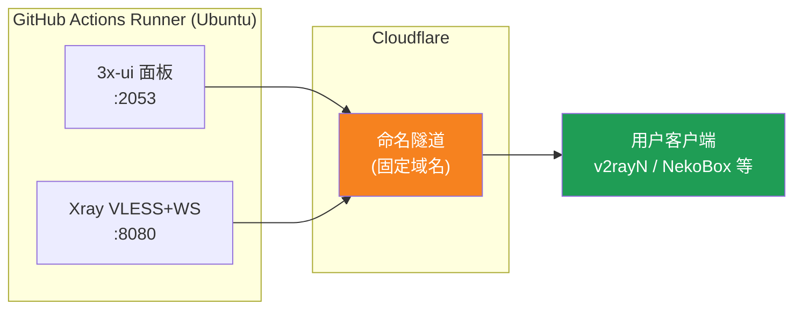
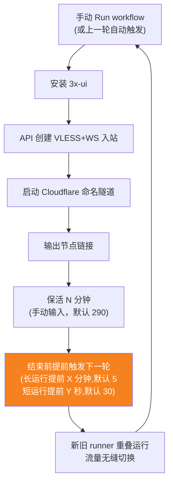
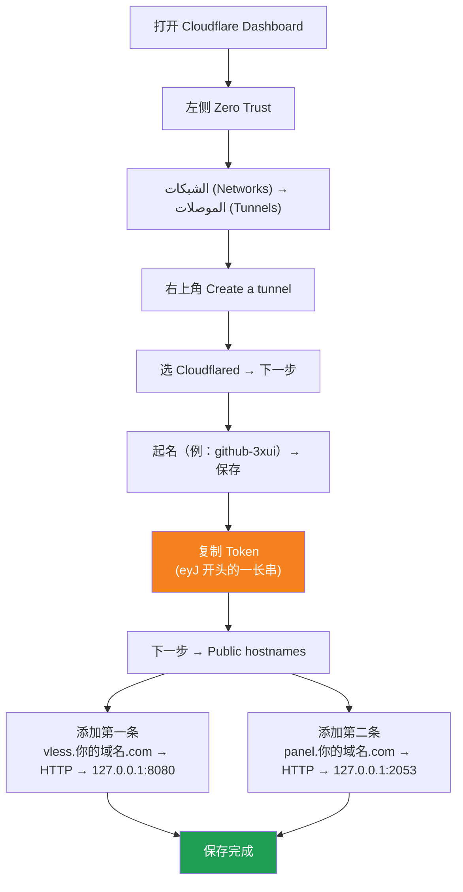

[简体中文](README.md) | [English](README.en.md) | [Русский](README.ru.md) | [日本語](README.ja.md) | [한국어](README.ko.md) | [Español](README.es.md) | [العربية](README.ar.md) | [Čeština](README.cs.md) | [Dansk](README.da.md) | [Deutsch](README.de.md) | [Esperanto](README.eo.md) | [فارسی](README.fa.md) | [Suomi](README.fi.md) | [Français](README.fr.md) | [Ελληνικά](README.gr.md) | [Magyar](README.hu.md) | [Bahasa Indonesia](README.id.md) | [Italiano](README.it.md) | [മലയാളം](README.ml.md) | [Nederlands](README.nl.md) | [Norsk](README.no.md) | [Polski](README.pl.md) | [Português](README.ptbr.md) | [Română](README.ro.md) | [Türkçe](README.tr.md) | [Українська](README.ua.md) | [Tiếng Việt](README.vn.md)

# ☁️ cloud-3xui — عقدة VLESS مجانية على GitHub

أنشئ تلقائيًا لوحة 3x-ui وعقدة VLESS على الخوادم المجانية لـ GitHub Actions، مع اسم نطاق ثابت وتجديد تلقائي عند انقطاع الاتصال.

## مخطط المعمارية



## عملية التجديد التلقائي



## التجديد التلقائي

- **مدة الإبقاء تحددها أنت**: عند النقر على Run workflow املأ `run_minutes` يدويًا، ويُشغَّل بقدر ما تدخل من دقائق؛ وإذا تركته فارغًا تُستخدم القيمة الافتراضية 290
- **توريث المعلمات تلقائيًا**: كل جولة تُمرّر `run_minutes` / `countdown_interval` / `countdown_unit` / `overlap_threshold` / `overlap_long` / `overlap_short` إلى الجولة التالية عبر API، فتستمر السلسلة كاملة بالقيم التي أدخلتها أول مرة
- للاختبار السريع املأ `5`، وللاستخدام اليومي اتركه فارغًا ليُستخدم الافتراضي 290
- **بدء متداخل (تبديل سلس)**: تُشغَّل الجولة التالية مسبقًا قبل نهاية الجولة الحالية؛ يعمل المشغّل القديم والجديد في الوقت نفسه، وتدعم أنفاق Cloudflare اتصالات متعددة، فيتم توجيه حركة المرور تلقائيًا إلى الاتصالات المتاحة، فلا يكاد المستخدمون يلاحظون انتهاء الجولة القديمة. توقيت البدء قابل للضبط: مدة keep-alive الأطول من `overlap_threshold` (الافتراضي 5 دقائق) تُعد جولة طويلة وتبدأ قبل `overlap_long` (الافتراضي 5 دقائق)؛ والأقصر تُعد جولات قصيرة وتبدأ قبل `overlap_short` (الافتراضي 30 ثانية)
- النطاق وUUID ثابتان، فإعداد العميل مرة واحدة يبقى صالحًا دائمًا
- للإيقاف انتقل إلى Actions وانقر Cancel، ولن يُعاد التشغيل تلقائيًا بعد الإلغاء

## عناوين ثابتة

| الاستخدام | العنوان |
|------|------|
| العقدة | `vless.mallow.ccwu.cc:443` (VLESS + WebSocket + TLS) |
| اللوحة | `https://panel.mallow.ccwu.cc/panel` (اسم المستخدم `admin`) |

> ⚠️ النطاقات أعلاه مجرد أمثلة. لتغييرها، عدّل المتغيرين `VLESS_HOST` / `PANEL_HOST` في Settings → Secrets and variables → Actions → Variables، دون تعديل ملف سير العمل.

## إعداد النطاق

يوجد نطاقا العقدة واللوحة في متغيرات GitHub، ولا حاجة لتعديل ملف سير العمل:

| المتغير | قيمة مثال | الوصف |
|------|-----------|--------|
| `VLESS_HOST` | `vless.mallow.ccwu.cc` | عنوان العقدة (اسم مضيف كامل) |
| `PANEL_HOST` | `panel.mallow.ccwu.cc` | عنوان اللوحة (اسم مضيف كامل) |

**كيفية التغيير**: انتقل إلى **Settings** → **Secrets and variables** → **Actions** → علامة التبويب **Variables** → **New repository variable**، ثم أدخل الاسم والقيمة. يسري التغيير في تشغيل سير العمل التالي.

**ثلاث ملاحظات**:
- يحتوي كل متغير على **اسم المضيف الكامل** (بما فيه بادئة النطاق الفرعي)، لذلك يمكن أن يشير العقدة واللوحة إلى نطاقين مختلفين، ولا يشترط أن يتشاركا النطاق الأب نفسه
- يجب أن تطابق القيم أسماء المضيف العامة (Public Hostnames) التي أنشأتها في نفق Cloudflare في الخطوة 1 (`vless` → 127.0.0.1:8080، `panel` → 127.0.0.1:2053)، وإلا فلن يعمل الرابط
- إذا لم يُضبط متغير ما، يعرض الشريط (banner) عنصرًا نائبًا لذلك الإدخال (`vless.YOUR_DOMAIN` / `panel.YOUR_DOMAIN`)

## خطوات التكوين التفصيلية

### نطاق مجاني (لا تملك نطاقًا؟ ابدأ من هنا)

لا تملك نطاقًا خاصًا؟ احصل على نطاق مجاني من https://my.dnshe.com/ (مثل `.ccwu.cc`، صالح لمدة 10 سنوات)، ثم حوّل خوادم الأسماء (NS) الخاصة بالنطاق إلى Cloudflare.

### الخطوة 1: إنشاء نفق مسمّى في Cloudflare


الموقع الرسمي لـ Cloudflare: https://www.cloudflare-cn.com (الصين) / https://www.cloudflare.com (دولي)
لوحة التحكم: https://dash.cloudflare.com



1. افتح [Cloudflare Dashboard](https://dash.cloudflare.com)، ومن القائمة اليسرى انتقل إلى **Zero Trust**
2. من اليسار **الشبكات (Networks)** → **الموصلات (Tunnels)**، ثم انقر **Create a tunnel** أعلى اليمين
3. اختر النوع **Cloudflared**، ثم انقر التالي
4. أعطِ النفق اسمًا (مثل `github-3xui`)، ثم احفظ
5. ستعرض الصفحة أمر تثبيت على الشكل التالي:
   ```
   cloudflared.exe service install eyJhIjoiYzEyNGI2...
   ```
   انسخ السلسلة الطويلة التي تبدأ بـ `eyJ`، وهي **Tunnel Token**، واحتفظ بها جيدًا
6. انقر التالي للانتقال إلى **Public hostnames** (مسارات التطبيقات المنشورة)، وانقر **Add a public hostname** لإضافة مسارين:

   **الأول (العقدة):**
   - Subdomain (النطاق الفرعي): `vless`
   - Domain (النطاق): اختر نطاقك
   - Service Type (نوع الخدمة): `HTTP`
   - URL: `127.0.0.1:8080`

   **الثاني (اللوحة):**
   - Subdomain (النطاق الفرعي): `panel`
   - Domain (النطاق): اختر نطاقك
   - Service Type (نوع الخدمة): `HTTP`
   - URL: `127.0.0.1:2053`

7. احفظ. سينشئ Cloudflare سجلات DNS تلقائيًا دون الحاجة إلى إضافة يدوية.

### الخطوة 2: توليد UUID

1. افتح https://1024tools.com/uuid/
2. انسخ الـ UUID المولّد (على الشكل `cbfc229f-9d34-4fef-9990-8baa82a7327b`)
3. **احفظ هذا الـ UUID جيدًا**، فلن يظهر بشكل صريح في سجلات سير العمل، وستحتاجه في كل مرة لتركيب رابط العقدة

### الخطوة 3: إضافة Secrets وVariables إلى GitHub

1. ادخل إلى هذا المستودع، وانقر على تبويب **Settings**
2. من اليسار **Secrets and variables** → **Actions**
3. انقر **New repository secret** أعلى اليمين، وأضف الثلاثة التالية بالترتيب:

   | Name | Secret (القيمة) | الوصف |
   |------|-------------|------|
   | `CF_TUNNEL_TOKEN` | الـ Tunnel Token المنسوخ من الخطوة 1 | بيانات اعتماد نفق Cloudflare |
   | `PANEL_PASSWORD` | كلمة المرور التي حددتها للوحة | كلمة مرور تسجيل الدخول إلى لوحة 3x-ui |
   | `VLESS_UUID` | الـ UUID المولّد في الخطوة 2 | UUID العقدة، ثابت لا يتغير |

4. انتقل إلى علامة التبويب **Variables**، وانقر على **New repository variable**، وأضف متغيرين (انظر قسم إعداد النطاق أعلاه):

   | Name | القيمة | الوصف |
   |------|--------|--------|
   | `VLESS_HOST` | `vless.mallow.ccwu.cc` | عنوان العقدة |
   | `PANEL_HOST` | `panel.mallow.ccwu.cc` | عنوان اللوحة |

### الخطوة 4: تشغيل سير العمل

1. انقر على تبويب **Actions** أعلى المستودع
2. من اليسار اختر **3x-ui VLESS Node**
3. انقر زر **Run workflow** على اليمين
4. في النموذج المنبثق:
   - **Panel password**: اتركه فارغًا (سيستخدم `PANEL_PASSWORD` secret تلقائيًا)
     كلمة مرور اللوحة (اتركها فارغة لاستخدام PANEL_PASSWORD secret)
   - **Run duration**: الافتراضي `290` (دقيقة)، وللاختبار الأول يمكن كتابة `5` للتحقق السريع؛ وللاستخدام اليومي اتركه فارغًا
   - **Countdown output interval**: الفاصل الزمني لإخراج العد التنازلي، الافتراضي `1`، أدخل `0` للتعطيل
   - **Countdown interval unit**: وحدة الفاصل الزمني للعد التنازلي، حدد `minutes` أو `seconds` من القائمة المنسدلة
   - **Overlap threshold**: عتبة التداخل (بالدقائق، الافتراضي `5`) — مدة keep-alive الأطول من ذلك تُعد جولة طويلة
   - **Overlap long**: عدد الدقائق المسبقة لبدء الجولة التالية في الجولات الطويلة (الافتراضي `5`)
   - **Overlap short**: عدد الثواني المسبقة لبدء الجولة التالية في الجولات القصيرة (الافتراضي `30`)
     مدة التشغيل (بالدقائق، الافتراضي 290، بحد أقصى 340)
5. انقر الزر الأخضر **Run workflow** لبدء التشغيل

### الخطوة 5: الحصول على رابط العقدة

1. انتظر حوالي 2-3 دقائق، وانقر على المهمة الجارية للانتقال إلى صفحة التفاصيل
2. وسّع خطوة **Start named Cloudflare tunnel**، واطلع على مخرجات السجل:
   ```
   ==================================================
     面板 Panel: https://panel.mallow.ccwu.cc/panel  (admin / 你的面板密码)

     VLESS 节点 node:
     vless://YOUR_UUID@vless.mallow.ccwu.cc:443?encryption=none&security=tls&sni=vless.mallow.ccwu.cc&type=ws&path=%2Fws#GitHub-3xui

     把 YOUR_UUID 换成你在 VLESS_UUID secret 里填的 UUID
     Replace YOUR_UUID with the UUID from your VLESS_UUID secret
     域名：去 Settings → Secrets and variables → Actions → Variables 改 VLESS_HOST / PANEL_HOST 变量
     Domain: set the VLESS_HOST / PANEL_HOST variables in Settings → Secrets and variables → Actions → Variables
   ==================================================
   ```
3. انسخ رابط `vless://`، واستبدل `YOUR_UUID` بـ UUID الخاص بك (النطاق هو بالفعل النطاق الحقيقي من متغيراتك، ولا حاجة لاستبداله.)
4. الصقه في عميل v2rayN / v2rayNG / Streisand / NekoBox وغيرها لبدء الاستخدام

### الخطوة 6: التحقق من التجديد التلقائي (اختياري)

1. في التشغيل الأول، اضبط المدة على `5` دقائق
2. بعد 5 دقائق، اطلع على سجل الخطوة الأخيرة **Trigger next run**، ويجب أن يظهر:
   ```
   HTTP 204
   已触发下一次运行 Next run triggered
   ```
3. ارجع إلى قائمة Actions، ويجب أن يظهر تشغيل جديد مُفعَّل تلقائيًا
4. بعد التأكد، أعد التشغيل وأعد المدة إلى `290` للاستخدام العادي

## شرح خطوات سير العمل

| الخطوة | العربي | English | الوصف |
|------|------|---------|------|
| Install 3x-ui | تثبيت 3x-ui | Install 3x-ui | تثبيت اللوحة بشكل غير تفاعلي بالسكربت الرسمي |
| Create VLESS+WS inbound via API | إنشاء مدخل VLESS+WS عبر API | Create VLESS+WS inbound via API | تسجيل الدخول برمز API وإنشاء المدخل تلقائيًا |
| Start named Cloudflare tunnel | تشغيل نفق Cloudflare المسمّى | Start named Cloudflare tunnel | الاتصال بالنفق ذي النطاق الثابت باستخدام الرمز |
| Keep alive | الحفاظ على التشغيل | Keep alive | السكون لعدد الدقائق المحدد مع مراقبة حالة الخدمات وطباعة العد التنازلي بالفاصل الزمني المحدد |
| Trigger next run | تشغيل الدورة التالية | Trigger next run | استدعاء API لبدء الدورة التالية تلقائيًا |

## الأسئلة الشائعة

**Q: الـ UUID في رابط العقدة يظهر كـ `***` في السجلات؟**
A: هذه آلية حماية الـ secrets في GitHub. استبدل `YOUR_UUID` بالـ UUID الذي أدخلته في `VLESS_UUID` secret.

**Q: يظهر النطاق في السجلات كـ `YOUR_DOMAIN`؟**
A: انتقل إلى Settings → Secrets and variables → Actions → Variables وأنشئ المتغيرين `VLESS_HOST` / `PANEL_HOST` باسمَي مضيف كاملين؛ وتأكد من مطابقتهما لأسماء المضيف العامة في نفق Cloudflare.

**Q: اختبار العميل يفشل (-1)؟**
A: تحقق من ثلاثة أمور: ① هل تم استبدال الـ UUID بشكل صحيح؛ ② هل إصدار العميل حديث (v2rayN 7.x+)؛ ③ هل نفق Cloudflare متصل بشكل طبيعي (اطلع على السجلات).

**Q: لم يتم تشغيل إعادة التشغيل التلقائية؟**
A: اطلع على سجل خطوة **Trigger next run**. إذا ظهر رمز HTTP غير 204، تحقق من إعدادات صلاحيات Actions في المستودع.

**س: هل سينقطع الاتصال أثناء التدوير؟**
ج: يُستخدم البدء المتداخل — تُشغَّل الجولة التالية مسبقًا قبل نهاية الجولة الحالية، ويعمل المشغِّل القديم والجديد في الوقت نفسه، فلا يُفترض أن يكون هناك انقطاع ملحوظ. في الحالات القصوى مثل ازدحام GitHub قد تحدث تقلبات قصيرة، وسيعيد العميل الاتصال تلقائيًا.

**Q: أريد إيقاف التجديد التلقائي؟**
A: اذهب إلى صفحة Actions وألغِ (Cancel) التشغيل الحالي، ولن يتم التشغيل تلقائيًا بعد ذلك.

## ملاحظات

- **السرعة**: تمر الحركة عبر Cloudflare → خوادم GitHub (أمريكا/أوروبا)، وهي مناسبة للاستخدام المؤقت/الخفيف فقط
- **تبديل سلس**: يُستخدم البدء المتداخل — تُشغَّل الجولة التالية قبل 5 دقائق من نهاية كل جولة، ويكون المشغّل القديم والجديد متصلين معًا، فلا يشعر المستخدم نظريًا بأي شيء؛ وفي الحالات القصوى (مثل ازدحام GitHub) قد تحدث تذبذبات قصيرة
- **الامتثال**: تشغيل وكيل على GitHub Actions قد ينتهك شروط الاستخدام ويؤدي إلى إغلاق الحساب، قيّم ذلك بنفسك
- **الأمان**: لا تنشر `CF_TUNNEL_TOKEN` / `PANEL_PASSWORD` / `VLESS_UUID` في أماكن عامة
