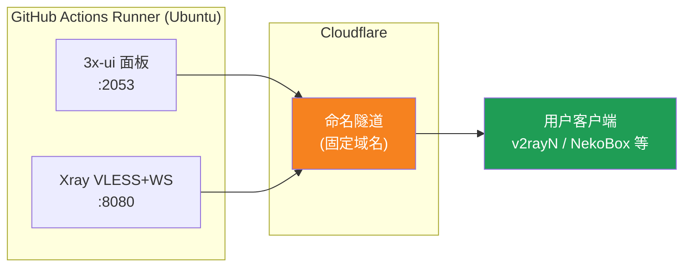
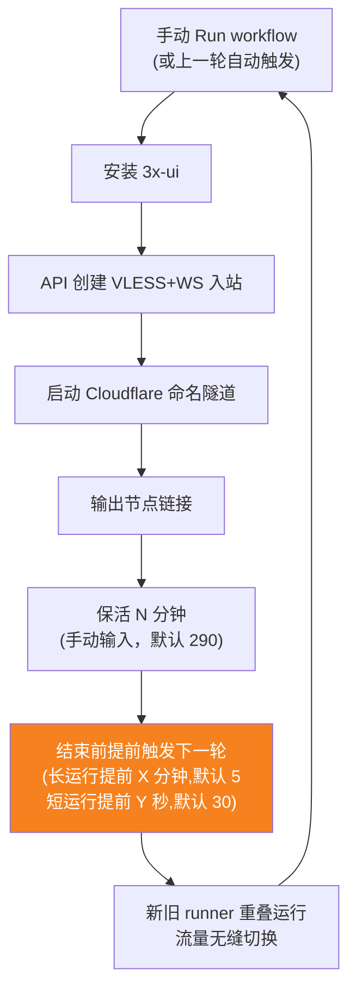
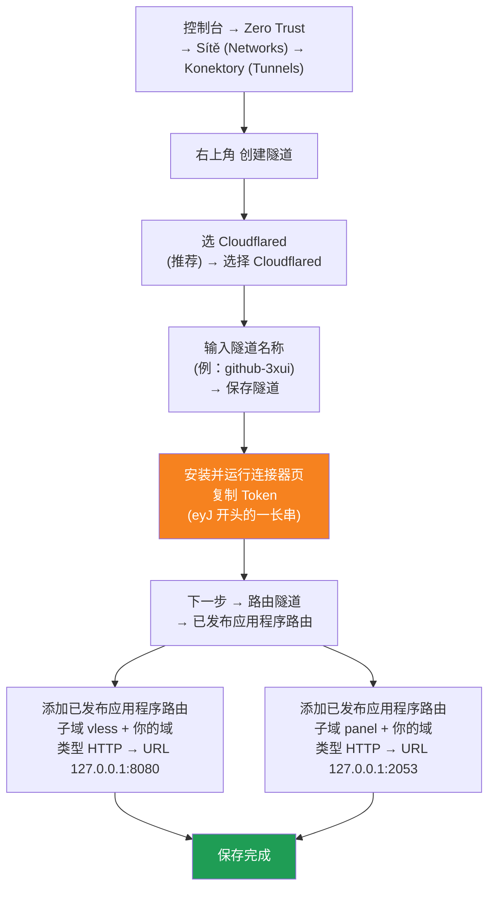

[简体中文](README.md) | [English](README.en.md) | [Русский](README.ru.md) | [日本語](README.ja.md) | [한국어](README.ko.md) | [Español](README.es.md) | [العربية](README.ar.md) | [Čeština](README.cs.md) | [Dansk](README.da.md) | [Deutsch](README.de.md) | [Esperanto](README.eo.md) | [فارسی](README.fa.md) | [Suomi](README.fi.md) | [Français](README.fr.md) | [Ελληνικά](README.gr.md) | [Magyar](README.hu.md) | [Bahasa Indonesia](README.id.md) | [Italiano](README.it.md) | [മലയാളം](README.ml.md) | [Nederlands](README.nl.md) | [Norsk](README.no.md) | [Polski](README.pl.md) | [Português](README.ptbr.md) | [Română](README.ro.md) | [Türkçe](README.tr.md) | [Українська](README.ua.md) | [Tiếng Việt](README.vn.md)

# ☁️ cloud-3xui — Bezplatný VLESS uzel na GitHubu

Automaticky nasadí panel 3x-ui + VLESS uzel na bezplatných serverech GitHub Actions s pevnou doménou a automatickým obnovením při výpadku.

## Diagram architektury



## Proces automatického prodloužení



## Automatické prodloužení

- **Délku udržení určujete vy**: při kliknutí na Run workflow ručně vyplňte `run_minutes`, poběží tolik minut, kolik zadáte; pokud pole necháte prázdné, použije se výchozí hodnota 290
- **Parametry se dědí automaticky**: každé kolo předá `run_minutes` / `countdown_interval` / `countdown_unit` / `overlap_threshold` / `overlap_long` / `overlap_short` dalšímu kolu přes API, takže celý řetězec používá hodnoty, které jste zadali na začátku
- Pro rychlý test vyplňte `5`, pro běžné použití nechte prázdné a použije se výchozí 290
- **Překrývající se start (plynulé přepnutí)**: další kolo se spustí předem ještě před koncem aktuálního kola; starý i nový runner běží současně, tunely Cloudflare podporují více připojení, provoz je automaticky směrován na dostupná připojení, takže uživatelé konec starého kola téměř nezaznamenají. Načasování spuštění je nastavitelné: keep-alive delší než `overlap_threshold` (výchozí 5 minut) se považuje za dlouhé kolo a spustí se `overlap_long` (výchozí 5 minut) předem; kratší se považují za krátká kola a spouštějí se `overlap_short` (výchozí 30 sekund) předem
- Doména i UUID jsou pevné, konfigurace klienta stačí nastavit jednou a platí trvale
- Pro zastavení přejděte do Actions a klikněte na Cancel, po zrušení se automaticky nerestartuje

## Pevné adresy

| Účel | Adresa |
|------|------|
| Uzel | `vless.mallow.ccwu.cc:443` (VLESS + WebSocket + TLS) |
| Panel | `https://panel.mallow.ccwu.cc/panel` (uživatelské jméno `admin`) |

> ⚠️ Výše uvedené domény jsou jen příklady. Chcete-li je změnit, upravte proměnné `VLESS_HOST` / `PANEL_HOST` v Settings → Secrets and variables → Actions → Variables, soubor workflow upravovat nemusíte.

## Nastavení domény

Domény uzlu a panelu jsou uloženy v proměnných GitHubu, soubor workflow není třeba upravovat:

| Proměnná | Příklad hodnoty | Popis |
|----------|-----------------|-------|
| `VLESS_HOST` | `vless.mallow.ccwu.cc` | Adresa uzlu (úplný název hostitele) |
| `PANEL_HOST` | `panel.mallow.ccwu.cc` | Adresa panelu (úplný název hostitele) |

**Jak změnit**: Přejděte do **Settings** → **Secrets and variables** → **Actions** → na kartu **Variables** → **New repository variable** a vyplňte název a hodnotu. Změna se projeví při příštím spuštění workflow.

**Tři poznámky**:
- Každá proměnná obsahuje **úplný název hostitele** (včetně předpony subdomény), takže uzel a panel mohou odkazovat na různé domény, nemusí sdílet stejnou nadřazenou doménu
- Hodnoty se musí shodovat s veřejnými názvy hostitelů (Public Hostnames), které jste vytvořili v tunelu Cloudflare v kroku 1 (`vless` → 127.0.0.1:8080, `panel` → 127.0.0.1:2053), jinak odkaz nebude fungovat
- Pokud proměnná není nastavena, banner zobrazí u dané položky zástupný text (`vless.YOUR_DOMAIN` / `panel.YOUR_DOMAIN`)

## Podrobný návod k nastavení

### Doména zdarma (nemáte doménu? začněte zde)

Nemáte vlastní doménu? Získejte ji zdarma na https://my.dnshe.com/ (např. `.ccwu.cc`, platnost 10 let) a poté delegujte NS záznamy domény do Cloudflare.

### Krok 1: Vytvoření pojmenovaného tunelu v Cloudflare


Oficiální web Cloudflare: https://www.cloudflare-cn.com (Čína) / https://www.cloudflare.com (mezinárodní)
Řídicí panel: https://dash.cloudflare.com



Podrobné kroky:

1. Otevřete [řídicí panel Cloudflare](https://dash.cloudflare.com) a v levém menu přejděte na **Zero Trust** → **Sítě (Networks)** → **Konektory (Tunnels)**
2. Klikněte vpravo nahoře na **Create a tunnel**
3. **Vyberte typ tunelu**: zvolte **Cloudflared** (doporučeno) a klikněte na **Select Cloudflared**
4. **Pojmenujte tunel**: zadejte název (např. `github-3xui`) a klikněte na **Save tunnel**
5. **Nainstalujte a spusťte konektor**: stránka zobrazí instalační příkaz — zkopírujte dlouhý **token** začínající `eyJ` a uložte si ho (později ho použijete jako GitHub Secret). Nic **není** třeba instalovat lokálně, pokračujte dál
6. **Směrujte tunel**: přejděte na kartu **Public hostnames**, klikněte na **Add a public hostname** a přidejte dva záznamy:

   **První (uzel):**
   - Subdoména: `vless`
   - Doména: vyberte svou doménu
   - Typ: `HTTP`
   - URL: `127.0.0.1:8080`

   **Druhý (panel):**
   - Subdoména: `panel`
   - Doména: vyberte svou doménu
   - Typ: `HTTP`
   - URL: `127.0.0.1:2053`
7. Uložte. Cloudflare vytvoří DNS záznamy automaticky. Stav **Healthy** v seznamu konektorů (Tunnels) znamená úspěšné nastavení.


### Krok 2: Vygenerování UUID

1. Otevřete https://1024tools.com/uuid/
2. Zkopírujte vygenerované UUID (ve tvaru `cbfc229f-9d34-4fef-9990-8baa82a7327b`)
3. **Toto UUID si dobře poznamenejte**, v logu workflow se nezobrazí v otevřené podobě a budete ho potřebovat při každém skládání odkazu na uzel

### Krok 3: Přidání Secrets a Variables na GitHubu

1. Otevřete tento repozitář a klikněte na záložku **Settings**
2. Vlevo **Secrets and variables** → **Actions**
3. Vpravo nahoře klikněte na **New repository secret** a postupně přidejte tři:

   | Name | Secret (hodnota) | Popis |
   |------|-------------|------|
   | `CF_TUNNEL_TOKEN` | Tunnel Token zkopírovaný v kroku 1 | Přihlašovací údaje tunelu Cloudflare |
   | `PANEL_PASSWORD` | Vámi nastavené heslo panelu | Přihlašovací heslo panelu 3x-ui |
   | `VLESS_UUID` | UUID vygenerované v kroku 2 | UUID uzlu, nemění se |

4. Přejděte na kartu **Variables**, klikněte na **New repository variable** a přidejte dvě proměnné (viz část Nastavení domény výše):

   | Name | Hodnota | Popis |
   |------|---------|-------|
   | `VLESS_HOST` | `vless.mallow.ccwu.cc` | Adresa uzlu |
   | `PANEL_HOST` | `panel.mallow.ccwu.cc` | Adresa panelu |

### Krok 4: Spuštění workflow

1. Klikněte na záložku **Actions** v horní části repozitáře
2. Vlevo vyberte **3x-ui VLESS Node**
3. Vpravo klikněte na tlačítko **Run workflow**
4. Ve vyskakovacím formuláři:
   - **Panel password**: nechte prázdné (automaticky se použije `PANEL_PASSWORD` secret)
     Heslo panelu (prázdné = použije se PANEL_PASSWORD secret)
   - **Run duration**: výchozí `290` (minut), při prvním testu můžete zadat `5` pro rychlé ověření; pro běžné použití nechte prázdné
   - **Countdown output interval**: Interval výpisu odpočtu, výchozí `1`, zadáním `0` se vypne
   - **Countdown interval unit**: Jednotka intervalu výpisu odpočtu, z rozevíracího seznamu vyberte `minutes` nebo `seconds`
   - **Overlap threshold**: Práh překrytí (minuty, výchozí `5`) — keep-alive delší než tato hodnota se považuje za dlouhé kolo
   - **Overlap long**: O kolik minut dříve spustit další kolo u dlouhých kol (výchozí `5`)
   - **Overlap short**: O kolik sekund dříve spustit další kolo u krátkých kol (výchozí `30`)
     Doba běhu (v minutách, výchozí 290, max. 340)
5. Kliknutím na zelené **Run workflow** spustíte běh

### Krok 5: Získání odkazu na uzel

1. Počkejte asi 2–3 minuty, klikněte na běžící úlohu a otevřete detail
2. Rozbalte krok **Start named Cloudflare tunnel** a podívejte se na výstup logu:
   ```
   ==================================================
     面板 Panel: https://panel.mallow.ccwu.cc/panel  (admin / 你的面板密码)

     VLESS 节点 node:
     vless://YOUR_UUID@vless.mallow.ccwu.cc:443?encryption=none&security=tls&sni=vless.mallow.ccwu.cc&type=ws&path=%2Fws#GitHub-3xui

     把 YOUR_UUID 换成你在 VLESS_UUID secret 里填的 UUID
     Replace YOUR_UUID with the UUID from your VLESS_UUID secret
     域名：去 Settings → Secrets and variables → Actions → Variables 改 VLESS_HOST / PANEL_HOST 变量
     Domain: set the VLESS_HOST / PANEL_HOST variables in Settings → Secrets and variables → Actions → Variables
   ==================================================
   ```
3. Zkopírujte odkaz `vless://` a nahraďte `YOUR_UUID` svým UUID (Doména už je ta skutečná z vašich proměnných, není třeba ji nahrazovat.)
4. Vložte ho do klientů v2rayN / v2rayNG / Streisand / NekoBox apod. a můžete používat

### Krok 6: Ověření automatického prodloužení (volitelné)

1. Při prvním běhu nastavte dobu na `5` minut
2. Po 5 minutách zkontrolujte log posledního kroku **Trigger next run**, měl by se objevit:
   ```
   HTTP 204
   已触发下一次运行 Next run triggered
   ```
3. Vraťte se na seznam Actions, měl by se objevit nový automaticky spuštěný běh
4. Po ověření spusťte znovu a vraťte dobu na `290` pro běžné používání

## Popis kroků workflow

| Krok | Česky | English | Popis |
|------|------|---------|------|
| Install 3x-ui | Instalace 3x-ui | Install 3x-ui | Nainstaluje panel oficiálním skriptem bez interakce |
| Create VLESS+WS inbound via API | Vytvoření příchozího VLESS+WS přes API | Create VLESS+WS inbound via API | Přihlásí se přes API Token a automaticky vytvoří příchozí |
| Start named Cloudflare tunnel | Spuštění pojmenovaného tunelu Cloudflare | Start named Cloudflare tunnel | Připojí tunel s pevnou doménou pomocí Tokenu |
| Keep alive | Udržení běhu | Keep alive | Uspí se na zadaný počet minut, sleduje stav služeb a vypisuje odpočet v nastaveném intervalu |
| Trigger next run | Spuštění dalšího běhu | Trigger next run | Zavolá API a automaticky nastartuje další kolo |

## Časté dotazy

**Q: V logu se UUID v odkazu na uzel zobrazuje jako `***`?**
A: To je ochranný mechanismus secretů GitHubu. Nahraďte `YOUR_UUID` UUID, které jste zadali do `VLESS_UUID` secret.

**Q: V logu se doména zobrazuje jako `YOUR_DOMAIN`?**
A: V Settings → Secrets and variables → Actions → Variables vytvořte proměnné `VLESS_HOST` / `PANEL_HOST` s úplnými názvy hostitelů a zkontrolujte, že odpovídají veřejným názvům hostitelů v tunelu Cloudflare.

**Q: Test klienta selže (-1)?**
A: Zkontrolujte tři věci: ① zda je UUID nahrazeno správně; ② zda je verze klienta dostatečně nová (v2rayN 7.x+); ③ zda je tunel Cloudflare správně připojen (podívejte se do logu).

**Q: Automatický restart se nespustil?**
A: Podívejte se na log kroku **Trigger next run**. Pokud se zobrazí jiný HTTP stavový kód než 204, zkontrolujte nastavení oprávnění Actions v repozitáři.

**Q: Dojde při rotaci k výpadku?**
A: Používá se překrývající se start — další kolo se spustí ještě před koncem aktuálního, starý i nový runner běží současně, takže teoreticky nedojde k žádnému výpadku. V extrémních případech, např. při frontě GitHubu, může dojít ke krátkému kolísání; klient se automaticky znovu připojí.

**Q: Chci zastavit automatické prodloužení?**
A: Na stránce Actions zrušte (Cancel) aktuální běh a automaticky se už nic nespustí.

## Poznámky

- **Rychlost**: provoz jde přes Cloudflare → datacentra GitHubu (USA/Evropa), vhodné pouze pro dočasné/lehké použití
- **Plynulé přepnutí**: používá se překrývající se start — další kolo se spouští 5 minut před koncem každého kola, starý i nový runner jsou současně online, takže uživatelé teoreticky nic nepostřehnou; v extrémních případech (např. fronta GitHub) může dojít ke krátkodobému kolísání
- **Podmínky**: běh proxy na GitHub Actions může porušovat ToS a vést k zablokování účtu, zvažte sami
- **Bezpečnost**: nezveřejňujte `CF_TUNNEL_TOKEN` / `PANEL_PASSWORD` / `VLESS_UUID`
