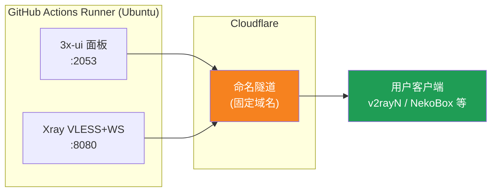
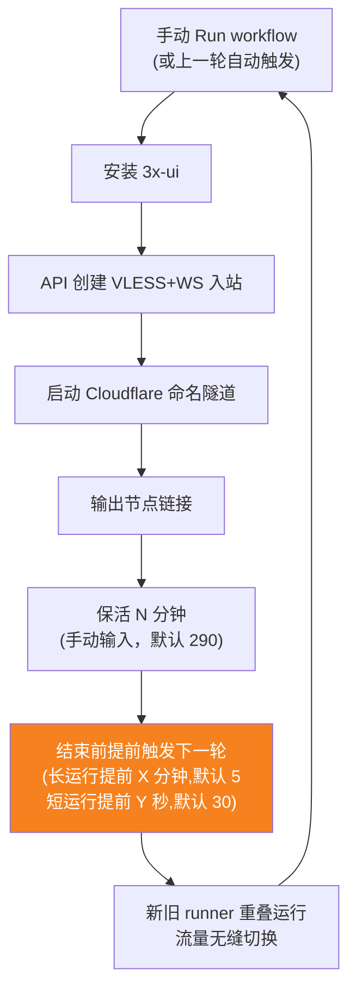
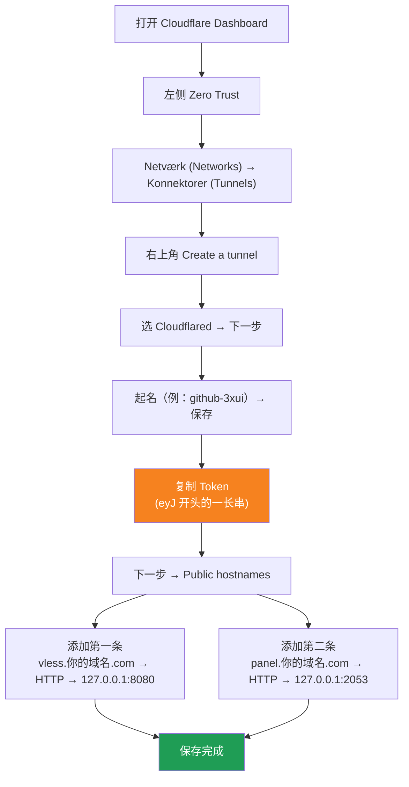

[简体中文](README.md) | [English](README.en.md) | [Русский](README.ru.md) | [日本語](README.ja.md) | [한국어](README.ko.md) | [Español](README.es.md) | [العربية](README.ar.md) | [Čeština](README.cs.md) | [Dansk](README.da.md) | [Deutsch](README.de.md) | [Esperanto](README.eo.md) | [فارسی](README.fa.md) | [Suomi](README.fi.md) | [Français](README.fr.md) | [Ελληνικά](README.gr.md) | [Magyar](README.hu.md) | [Bahasa Indonesia](README.id.md) | [Italiano](README.it.md) | [മലയാളം](README.ml.md) | [Nederlands](README.nl.md) | [Norsk](README.no.md) | [Polski](README.pl.md) | [Português](README.ptbr.md) | [Română](README.ro.md) | [Türkçe](README.tr.md) | [Українська](README.ua.md) | [Tiếng Việt](README.vn.md)

# ☁️ cloud-3xui — Gratis VLESS-node på GitHub

Opsætter automatisk et 3x-ui-panel + VLESS-node på GitHub Actions' gratis servere med fast domæne og automatisk fornyelse ved afbrydelse.

## Arkitekturdiagram



## Automatisk fornyelsesproces



## Automatisk fornyelse

- **Varigheden bestemmer du**: når du klikker på Run workflow, udfyld manuelt `run_minutes` – det kører det antal minutter, du indtaster; lader du det stå tomt, bruges standardværdien 290
- **Parametre nedarves automatisk**: hver kørsel sender `run_minutes` / `countdown_interval` / `countdown_unit` / `overlap_threshold` / `overlap_long` / `overlap_short` videre til næste kørsel via API’en, så hele kæden bruger de værdier, du indtastede først
- Til en hurtig test skriv `5`; til daglig brug lad det stå tomt og brug standard 290
- **Overlappende opstart (sømløst skift)**: den næste kørsel startes på forhånd inden den aktuelle kørsel slutter; gamle og nye runners kører samtidigt, Cloudflare-tunneler understøtter flere forbindelser, trafik dirigeres automatisk til tilgængelige forbindelser, så brugerne næsten ikke bemærker afslutningen af den gamle kørsel. Starttidspunktet kan indstilles: keep-alive længere end `overlap_threshold` (standard 5 minutter) regnes som en lang kørsel og starter `overlap_long` (standard 5 minutter) før; kortere regnes som korte kørsler og starter `overlap_short` (standard 30 sekunder) før
- Domænet og UUID er faste, så klientkonfigurationen gælder permanent efter én opsætning
- Vil du stoppe, så gå til Actions og klik på Cancel – efter annullering genstartes det ikke automatisk

## Faste adresser

| Formål | Adresse |
|------|------|
| Node | `vless.mallow.ccwu.cc:443` (VLESS + WebSocket + TLS) |
| Panel | `https://panel.mallow.ccwu.cc/panel` (brugernavn `admin`) |

> ⚠️ Domænerne ovenfor er eksempler – udskift dem med dit eget domæne.

## Detaljerede konfigurationstrin

### Gratis domæne (intet domæne? start her)

Har du ikke dit eget domæne? Få et gratis på https://my.dnshe.com/ (f.eks. `.ccwu.cc`, gyldigt i 10 år), og peg derefter domænets NS-poster til Cloudflare.

### Trin 1: Opret navngivet tunnel i Cloudflare


Cloudflares officielle websted: https://www.cloudflare-cn.com (Kina) / https://www.cloudflare.com (international)
Kontrolpanel: https://dash.cloudflare.com



1. Åbn [Cloudflare Dashboard](https://dash.cloudflare.com), gå til **Zero Trust** i menuen til venstre
2. Vælg **Netværk (Networks)** → **Konnektorer (Tunnels)** til venstre, klik på **Create a tunnel** øverst til højre
3. Vælg typen **Cloudflared**, og klik videre
4. Giv tunnelen et navn (f.eks. `github-3xui`), og gem
5. Siden viser en installationskommando i formen:
   ```
   cloudflared.exe service install eyJhIjoiYzEyNGI2...
   ```
   Kopiér den lange streng, der starter med `eyJ` – det er din **Tunnel Token**, gem den godt
6. Klik videre til **Public hostnames** (offentliggjorte applikationsruter), klik på **Add a public hostname**, og tilføj to:

   **Den første (node):**
   - Subdomain (underdomæne): `vless`
   - Domain (domæne): vælg dit domæne
   - Service Type (tjenestetype): `HTTP`
   - URL: `127.0.0.1:8080`

   **Den anden (panel):**
   - Subdomain (underdomæne): `panel`
   - Domain (domæne): vælg dit domæne
   - Service Type (tjenestetype): `HTTP`
   - URL: `127.0.0.1:2053`

7. Gem. Cloudflare opretter DNS-poster automatisk – ingen manuel tilføjelse nødvendig.

### Trin 2: Generér UUID

1. Åbn https://1024tools.com/uuid/
2. Kopiér det genererede UUID (i formen `cbfc229f-9d34-4fef-9990-8baa82a7327b`)
3. **Sørg for at gemme dette UUID**, det vises ikke i klartekst i workflow-loggen, og du skal bruge det hver gang du samler node-linket

### Trin 3: Tilføj Secrets på GitHub

1. Gå til dette repository, og klik på fanen **Settings**
2. Til venstre: **Secrets and variables** → **Actions**
3. Klik på **New repository secret** øverst til højre, og tilføj de tre i rækkefølge:

   | Name | Secret (værdi) | Beskrivelse |
   |------|-------------|------|
   | `CF_TUNNEL_TOKEN` | Tunnel Token kopieret i trin 1 | Cloudflare-tunnelens legitimationsoplysninger |
   | `PANEL_PASSWORD` | Den panel-adgangskode du har valgt | Login-adgangskode til 3x-ui-panelet |
   | `VLESS_UUID` | UUID'et genereret i trin 2 | Nodens UUID, ændres ikke |

### Trin 4: Kør workflowet

1. Klik på fanen **Actions** øverst i repositoryet
2. Vælg **3x-ui VLESS Node** til venstre
3. Klik på knappen **Run workflow** til højre
4. I den pop op-form:
   - **Panel password**: lad stå tomt (bruger automatisk `PANEL_PASSWORD`-secretet)
     Panel-adgangskode (tom = bruger PANEL_PASSWORD-secret)
   - **Run duration**: standard `290` (minutter), ved første test kan du skrive `5` for hurtig verifikation; lad det stå tomt til daglig brug
   - **Countdown output interval**: Interval for nedtællingsoutput, standard `1`, skriv `0` for at deaktivere det
   - **Countdown interval unit**: Enhed for nedtællingsintervallet, vælg `minutes` eller `seconds` i rullemenuen
   - **Overlap threshold**: Tærskel for overlapning (minutter, standard `5`) — keep-alive længere end dette regnes som en lang kørsel
   - **Overlap long**: Minutter før afslutning næste kørsel startes ved lange kørsler (standard `5`)
   - **Overlap short**: Sekunder før afslutning næste kørsel startes ved korte kørsler (standard `30`)
     Kørselsvarighed (minutter, standard 290, maks. 340)
5. Klik på den grønne **Run workflow** for at starte

### Trin 5: Få node-linket

1. Vent ca. 2-3 minutter, klik på den kørende opgave for at åbne detaljesiden
2. Udfold trinnet **Start named Cloudflare tunnel**, og se log-outputtet:
   ```
   ==================================================
     面板 Panel: https://panel.mallow.ccwu.cc/panel  (admin / 你的面板密码)

     VLESS 节点 node:
     vless://YOUR_UUID@vless.mallow.ccwu.cc:443?encryption=none&security=tls&sni=vless.mallow.ccwu.cc&type=ws&path=%2Fws#GitHub-3xui

     把 YOUR_UUID 换成你在 VLESS_UUID secret 里填的 UUID
     Replace YOUR_UUID with the UUID from your VLESS_UUID secret
     域名：去 Settings → Secrets and variables → Actions → Variables 改 VLESS_HOST / PANEL_HOST 变量
     Domain: set the VLESS_HOST / PANEL_HOST variables in Settings → Secrets and variables → Actions → Variables
   ==================================================
   ```
3. Kopiér `vless://`-linket, og erstat `YOUR_UUID` med dit UUID
4. Indsæt det i v2rayN / v2rayNG / Streisand / NekoBox m.fl. for at bruge det

### Trin 6: Verificér automatisk fornyelse (valgfrit)

1. Ved første kørsel sættes varigheden til `5` minutter
2. Efter 5 minutter ses loggen for det sidste trin **Trigger next run**, som bør vise:
   ```
   HTTP 204
   已触发下一次运行 Next run triggered
   ```
3. Gå tilbage til Actions-listen – der bør nu være en ny automatisk udløst kørsel
4. Når det er bekræftet, kør igen og sæt varigheden tilbage til `290` til normal brug

## Forklaring af workflow-trin

| Trin | Dansk | English | Forklaring |
|------|------|---------|------|
| Install 3x-ui | Installér 3x-ui | Install 3x-ui | Installerer panelet med det officielle script uden interaktion |
| Create VLESS+WS inbound via API | Opret VLESS+WS inbound via API | Create VLESS+WS inbound via API | Logger ind med API-token og opretter inbound automatisk |
| Start named Cloudflare tunnel | Start navngivet Cloudflare-tunnel | Start named Cloudflare tunnel | Forbinder tunnelen med fast domæne via token |
| Keep alive | Hold i live | Keep alive | Sover i det angivne antal minutter, overvåger tjenesternes status og udskriver nedtællingen med det indstillede interval |
| Trigger next run | Udløs næste kørsel | Trigger next run | Kalder API'et og starter automatisk næste runde |

## Ofte stillede spørgsmål

**Q: UUID'et i node-linket vises som `***` i loggen?**
A: Det er GitHubs secret-beskyttelsesmekanisme. Erstat `YOUR_UUID` med det UUID, du indtastede i `VLESS_UUID`-secretet.

**Q: Klienttesten fejler (-1)?**
A: Tjek tre ting: ① om UUID'et er erstattet korrekt; ② om klientversionen er ny nok (v2rayN 7.x+); ③ om Cloudflare-tunnelen er forbundet korrekt (se loggen).

**Q: Den automatiske genstart blev ikke udløst?**
A: Se loggen for trinnet **Trigger next run**. Hvis der vises en anden HTTP-statuskode end 204, tjek Actions-rettighedsindstillingerne i repositoryet.

**Q: Bliver forbindelsen afbrudt under rotation?**
A: Der bruges overlappende opstart — næste kørsel startes før den aktuelle slutter, gamle og nye runners er online samtidigt, så i teorien er der ingen afbrydelse. I ekstreme tilfælde som GitHub-kø kan der forekomme korte udsving; klienten genopretter automatisk forbindelsen.

**Q: Vil du stoppe den automatiske fornyelse?**
A: Gå til Actions-siden og annuller (Cancel) den aktuelle kørsel – så udløses der ikke flere automatisk.

## Bemærkninger

- **Hastighed**: trafikken går via Cloudflare → GitHubs datacentre (USA/Europa), kun egnet til midlertidig/let brug
- **Sømløst skift**: overlappende opstart anvendes — næste kørsel startes 5 minutter før hver kørsel slutter, gamle og nye runners er online samtidigt, så brugerne bemærker i teorien intet; i ekstreme tilfælde (f.eks. GitHub-kø) kan der stadig forekomme korte udsving
- **Overholdelse**: at køre proxy på GitHub Actions kan overtræde ToS og føre til kontosuspension – vurder selv
- **Sikkerhed**: offentliggør ikke `CF_TUNNEL_TOKEN` / `PANEL_PASSWORD` / `VLESS_UUID`
