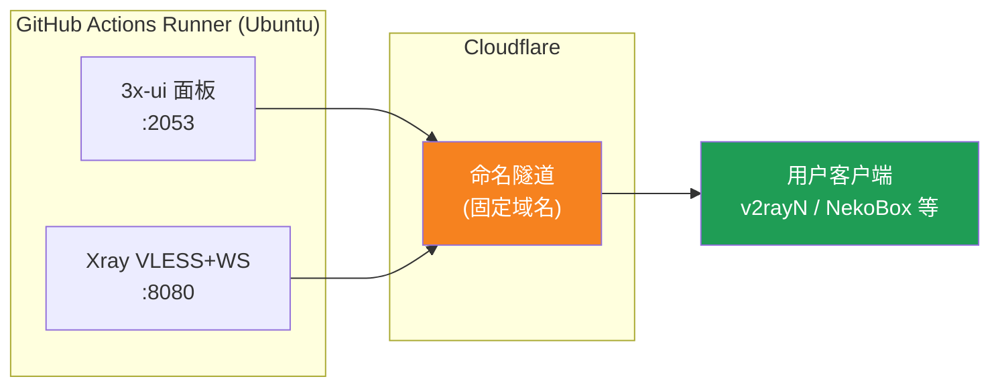
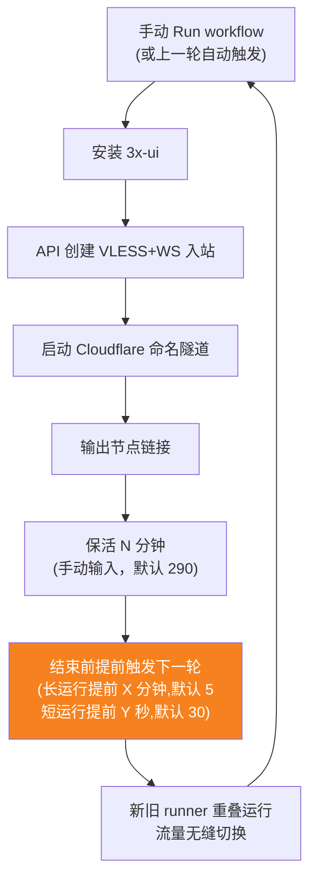
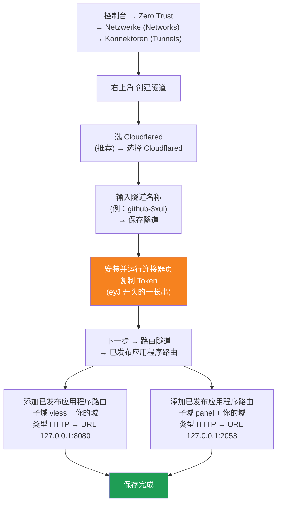

[简体中文](README.md) | [English](README.en.md) | [Русский](README.ru.md) | [日本語](README.ja.md) | [한국어](README.ko.md) | [Español](README.es.md) | [العربية](README.ar.md) | [Čeština](README.cs.md) | [Dansk](README.da.md) | [Deutsch](README.de.md) | [Esperanto](README.eo.md) | [فارسی](README.fa.md) | [Suomi](README.fi.md) | [Français](README.fr.md) | [Ελληνικά](README.gr.md) | [Magyar](README.hu.md) | [Bahasa Indonesia](README.id.md) | [Italiano](README.it.md) | [മലയാളം](README.ml.md) | [Nederlands](README.nl.md) | [Norsk](README.no.md) | [Polski](README.pl.md) | [Português](README.ptbr.md) | [Română](README.ro.md) | [Türkçe](README.tr.md) | [Українська](README.ua.md) | [Tiếng Việt](README.vn.md)

# ☁️ cloud-3xui — Kostenloser VLESS-Knoten auf GitHub

Richtet automatisch ein 3x-ui-Panel + VLESS-Knoten auf den kostenlosen Servern von GitHub Actions ein, mit fester Domain und automatischer Verlängerung bei Verbindungsabbruch.

## Architekturdiagramm



## Ablauf der automatischen Verlängerung



## Automatische Verlängerung

- **Die Dauer bestimmst du**: beim Klick auf Run workflow fülle manuell `run_minutes` aus – es läuft so viele Minuten, wie du eingibst; lässt du es leer, wird der Standardwert 290 verwendet
- **Automatische Parametervererbung**: jede Runde übergibt `run_minutes` / `countdown_interval` / `countdown_unit` / `overlap_threshold` / `overlap_long` / `overlap_short` per API an die nächste Runde, sodass die gesamte Kette die ursprünglich eingegebenen Werte behält
- Zum schnellen Testen trage `5` ein; für den Alltag lass es leer und nutze den Standard 290
- **Überlappender Start (nahtloser Wechsel)**: die nächste Runde wird vorab noch vor Ende der aktuellen Runde gestartet; alte und neue Runner laufen gleichzeitig, Cloudflare-Tunnel unterstützen mehrere Verbindungen, der Datenverkehr wird automatisch an verfügbare Verbindungen geleitet, sodass Benutzer das Ende der alten Runde kaum bemerken. Der Startzeitpunkt ist konfigurierbar: keep-alive länger als `overlap_threshold` (Standard 5 Minuten) gilt als lange Runde und startet `overlap_long` (Standard 5 Minuten) vorher; kürzere gelten als kurze Runden und starten `overlap_short` (Standard 30 Sekunden) vorher
- Domain und UUID sind fest, die Client-Konfiguration ist einmal eingerichtet dauerhaft gültig
- Zum Stoppen gehe zu Actions und klicke auf Cancel – nach dem Abbrechen wird es nicht automatisch neu gestartet

## Feste Adressen

| Zweck | Adresse |
|------|------|
| Knoten | `vless.mallow.ccwu.cc:443` (VLESS + WebSocket + TLS) |
| Panel | `https://panel.mallow.ccwu.cc/panel` (Benutzername `admin`) |

> ⚠️ Die obigen Domains sind Beispiele – ersetze sie durch deine eigene Domain.

## Ausführliche Konfigurationsschritte

### Kostenlose Domain (keine Domain? hier starten)

Keine eigene Domain? Beantragen Sie kostenlos eine auf https://my.dnshe.com/ (z. B. `.ccwu.cc`, 10 Jahre gültig) und delegieren Sie anschließend die NS-Einträge der Domain an Cloudflare.

### Schritt 1: Benannten Tunnel in Cloudflare erstellen


Offizielle Cloudflare-Website: https://www.cloudflare-cn.com (China) / https://www.cloudflare.com (international)
Dashboard: https://dash.cloudflare.com



Detaillierte Schritte:

1. Öffne das [Cloudflare Dashboard](https://dash.cloudflare.com) und gehe im linken Menü zu **Zero Trust** → **Netzwerke (Networks)** → **Konnektoren (Tunnels)**
2. Klicke oben rechts auf **Create a tunnel**
3. **Tunneltyp wählen**: Wähle **Cloudflared** (empfohlen) und klicke auf **Select Cloudflared**
4. **Tunnel benennen**: Gib einen Namen ein (z. B. `github-3xui`) und klicke auf **Save tunnel**
5. **Connector installieren und ausführen**: Die Seite zeigt einen Installationsbefehl — kopiere das lange **Token**, das mit `eyJ` beginnt, und speichere es (du brauchst es später als GitHub Secret). Eine lokale Installation ist **nicht** nötig; fahre einfach fort
6. **Tunnel routen**: Wechsle zum Tab **Public hostnames**, klicke auf **Add a public hostname** und füge zwei Einträge hinzu:

   **Erster (Node):**
   - Subdomain: `vless`
   - Domain: wähle deine Domain
   - Typ: `HTTP`
   - URL: `127.0.0.1:8080`

   **Zweiter (Panel):**
   - Subdomain: `panel`
   - Domain: wähle deine Domain
   - Typ: `HTTP`
   - URL: `127.0.0.1:2053`
7. Speichern. Cloudflare erstellt die DNS-Einträge automatisch. Der Status **Healthy** in der Konnektoren (Tunnels)-Liste bedeutet erfolgreiche Konfiguration.


### Schritt 2: UUID generieren

1. Öffne https://1024tools.com/uuid/
2. Kopiere die generierte UUID (in der Form `cbfc229f-9d34-4fef-9990-8baa82a7327b`)
3. **Notiere dir diese UUID unbedingt**, sie wird im Workflow-Log nicht im Klartext angezeigt und du brauchst sie jedes Mal, wenn du den Knoten-Link zusammensetzt

### Schritt 3: Secrets auf GitHub hinzufügen

1. Öffne dieses Repository und klicke auf den Reiter **Settings**
2. Links **Secrets and variables** → **Actions**
3. Klicke oben rechts auf **New repository secret** und füge nacheinander die drei hinzu:

   | Name | Secret (Wert) | Beschreibung |
   |------|-------------|------|
   | `CF_TUNNEL_TOKEN` | Der in Schritt 1 kopierte Tunnel Token | Anmeldedaten für den Cloudflare-Tunnel |
   | `PANEL_PASSWORD` | Dein festgelegtes Panel-Passwort | Login-Passwort für das 3x-ui-Panel |
   | `VLESS_UUID` | Die in Schritt 2 generierte UUID | UUID des Knotens, bleibt unverändert |

### Schritt 4: Workflow ausführen

1. Klicke oben im Repository auf den Reiter **Actions**
2. Wähle links **3x-ui VLESS Node**
3. Klicke rechts auf die Schaltfläche **Run workflow**
4. Im eingeblendeten Formular:
   - **Panel password**: leer lassen (verwendet automatisch das `PANEL_PASSWORD`-Secret)
     Panel-Passwort (leer lassen = verwendet das PANEL_PASSWORD-Secret)
   - **Run duration**: Standard `290` (Minuten), beim ersten Test kannst du `5` für eine schnelle Prüfung eintragen; für den Alltag leer lassen
   - **Countdown output interval**: Countdown-Ausgabeintervall, Standard `1`, zum Deaktivieren `0` eingeben
   - **Countdown interval unit**: Einheit des Countdown-Ausgabeintervalls, wählen Sie `minutes` oder `seconds` aus dem Dropdown-Menü
   - **Overlap threshold**: Überlappungsschwelle (Minuten, Standard `5`) — keep-alive darüber gilt als lange Runde
   - **Overlap long**: Minuten vor Ende zum vorzeitigen Starten bei langen Runden (Standard `5`)
   - **Overlap short**: Sekunden vor Ende zum vorzeitigen Starten bei kurzen Runden (Standard `30`)
     Laufzeit (Minuten, Standard 290, max. 340)
5. Klicke auf das grüne **Run workflow**, um zu starten

### Schritt 5: Knoten-Link abrufen

1. Warte etwa 2–3 Minuten, klicke auf die laufende Aufgabe, um die Detailseite zu öffnen
2. Klappe den Schritt **Start named Cloudflare tunnel** auf und sieh dir die Log-Ausgabe an:
   ```
   ==================================================
     面板 Panel: https://panel.mallow.ccwu.cc/panel  (admin / 你的面板密码)

     VLESS 节点 node:
     vless://YOUR_UUID@vless.mallow.ccwu.cc:443?encryption=none&security=tls&sni=vless.mallow.ccwu.cc&type=ws&path=%2Fws#GitHub-3xui

     把 YOUR_UUID 换成你在 VLESS_UUID secret 里填的 UUID
     Replace YOUR_UUID with the UUID from your VLESS_UUID secret
     域名：去 Settings → Secrets and variables → Actions → Variables 改 VLESS_HOST / PANEL_HOST 变量
     Domain: set the VLESS_HOST / PANEL_HOST variables in Settings → Secrets and variables → Actions → Variables
   ==================================================
   ```
3. Kopiere den `vless://`-Link und ersetze `YOUR_UUID` durch deine UUID
4. Füge ihn in v2rayN / v2rayNG / Streisand / NekoBox usw. ein und nutze ihn

### Schritt 6: Automatische Verlängerung prüfen (optional)

1. Stelle beim ersten Lauf die Dauer auf `5` Minuten
2. Sieh dir nach 5 Minuten das Log des letzten Schritts **Trigger next run** an, es sollte zeigen:
   ```
   HTTP 204
   已触发下一次运行 Next run triggered
   ```
3. Kehre zur Actions-Liste zurück – dort sollte ein neuer automatisch ausgelöster Lauf erscheinen
4. Nach der Bestätigung erneut ausführen und die Dauer für den normalen Betrieb auf `290` zurücksetzen

## Erläuterung der Workflow-Schritte

| Schritt | Deutsch | English | Erläuterung |
|------|------|---------|------|
| Install 3x-ui | 3x-ui installieren | Install 3x-ui | Installiert das Panel nicht-interaktiv mit dem offiziellen Skript |
| Create VLESS+WS inbound via API | VLESS+WS-Inbound per API erstellen | Create VLESS+WS inbound via API | Meldet sich per API-Token an und erstellt automatisch das Inbound |
| Start named Cloudflare tunnel | Benannten Cloudflare-Tunnel starten | Start named Cloudflare tunnel | Verbindet den Tunnel mit fester Domain per Token |
| Keep alive | Am Leben halten | Keep alive | Schläft die angegebene Minutenzahl, überwacht den Dienststatus und gibt den Countdown im eingestellten Intervall aus |
| Trigger next run | Nächsten Lauf auslösen | Trigger next run | Ruft die API auf und startet automatisch die nächste Runde |

## Häufige Fragen

**Q: Die UUID im Knoten-Link wird im Log als `***` angezeigt?**
A: Das ist der Secret-Schutzmechanismus von GitHub. Ersetze `YOUR_UUID` durch die UUID, die du in das `VLESS_UUID`-Secret eingetragen hast.

**Q: Der Client-Test schlägt fehl (-1)?**
A: Prüfe drei Dinge: ① ob die UUID korrekt ersetzt wurde; ② ob die Client-Version aktuell genug ist (v2rayN 7.x+); ③ ob der Cloudflare-Tunnel korrekt verbunden ist (siehe Log).

**Q: Der automatische Neustart wurde nicht ausgelöst?**
A: Sieh dir das Log des Schritts **Trigger next run** an. Wenn ein anderer HTTP-Statuscode als 204 angezeigt wird, prüfe die Actions-Berechtigungseinstellungen des Repositorys.

**F: Bricht die Verbindung bei der Rotation ab?**
A: Es wird ein überlappender Start verwendet — die nächste Runde wird gestartet, bevor die aktuelle endet; alte und neue Runner sind gleichzeitig online, sodass theoretisch keine Unterbrechung auftritt. In Extremfällen, z. B. bei GitHub-Warteschlangen, kann es zu kurzen Schwankungen kommen; der Client verbindet sich automatisch neu.

**Q: Die automatische Verlängerung stoppen?**
A: Gehe auf die Actions-Seite und brich (Cancel) den aktuellen Lauf ab – danach wird nichts mehr automatisch ausgelöst.

## Hinweise

- **Geschwindigkeit**: Der Traffic läuft über Cloudflare → GitHub-Rechenzentren (USA/Europa), nur für temporäre/leichte Nutzung geeignet
- **Nahtloser Wechsel**: Es wird ein überlappender Start verwendet — die nächste Runde wird 5 Minuten vor Ende jeder Runde gestartet, alte und neue Runner sind gleichzeitig online, sodass Nutzer theoretisch nichts bemerken; in Extremfällen (z. B. GitHub-Warteschlange) kann es dennoch zu kurzen Schwankungen kommen
- **Compliance**: Ein Proxy auf GitHub Actions kann gegen die ToS verstoßen und zur Kontosperrung führen – selbst bewerten
- **Sicherheit**: Veröffentliche `CF_TUNNEL_TOKEN` / `PANEL_PASSWORD` / `VLESS_UUID` nicht öffentlich
