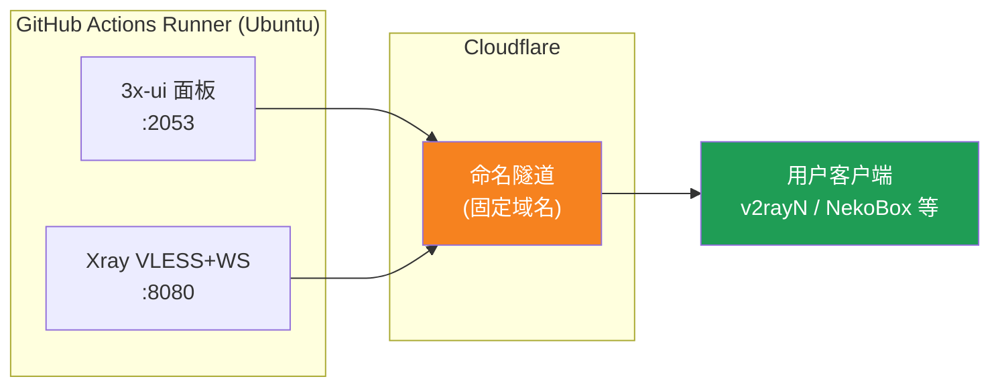
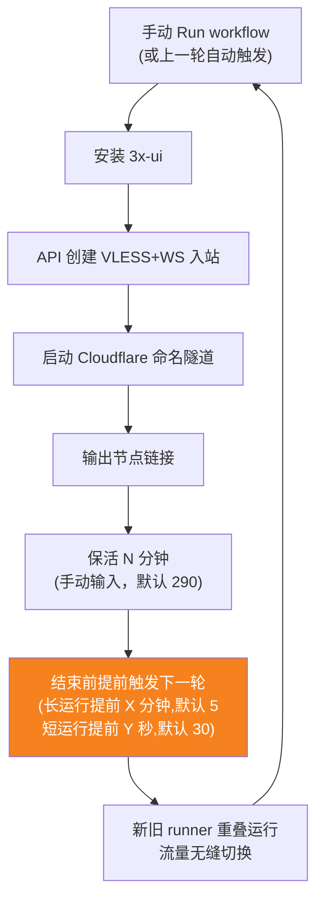
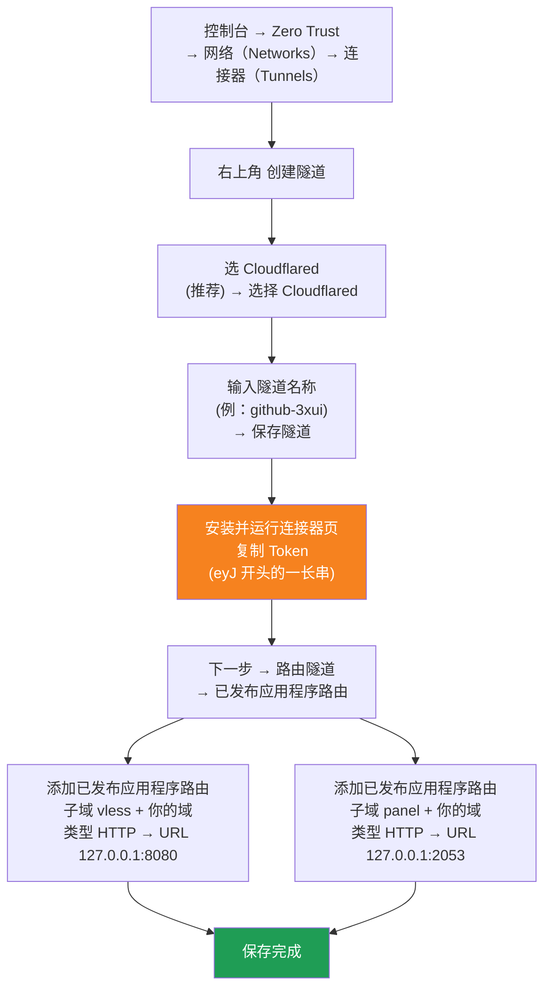

[简体中文](README.md) | [English](README.en.md) | [Русский](README.ru.md) | [日本語](README.ja.md) | [한국어](README.ko.md) | [Español](README.es.md) | [العربية](README.ar.md) | [Čeština](README.cs.md) | [Dansk](README.da.md) | [Deutsch](README.de.md) | [Esperanto](README.eo.md) | [فارسی](README.fa.md) | [Suomi](README.fi.md) | [Français](README.fr.md) | [Ελληνικά](README.gr.md) | [Magyar](README.hu.md) | [Bahasa Indonesia](README.id.md) | [Italiano](README.it.md) | [മലയാളം](README.ml.md) | [Nederlands](README.nl.md) | [Norsk](README.no.md) | [Polski](README.pl.md) | [Português](README.ptbr.md) | [Română](README.ro.md) | [Türkçe](README.tr.md) | [Українська](README.ua.md) | [Tiếng Việt](README.vn.md)

# ☁️ cloud-3xui — Free VLESS Node on GitHub

Automatically build a 3x-ui panel + VLESS node on free GitHub Actions servers, with a fixed domain and automatic keep-alive on disconnect.

## Architecture



## Auto keep-alive flow



## Auto keep-alive

- **You set the keep-alive duration**: when clicking Run workflow, fill in `run_minutes` manually — it will run for as many minutes as you enter; leave it empty to use the default 290
- **Parameters auto-inherit**: each round passes `run_minutes` / `countdown_interval` / `countdown_unit` / `overlap_threshold` / `overlap_long` / `overlap_short` to the next round via the API, so the whole chain keeps the values you first entered
- For a quick test, just enter `5`; for daily use, leave it empty to use the default 290
- **Overlapping startup (seamless switch)**: the next round is triggered in advance before the end of the current round; old and new runners run simultaneously, Cloudflare tunnels support multiple connections, traffic is automatically routed to available connections, so users barely notice when the old round exits. Trigger timing is configurable: keep-alive longer than `overlap_threshold` (default 5 minutes) counts as a long run and triggers `overlap_long` (default 5 minutes) in advance; shorter ones count as short runs and trigger `overlap_short` (default 30 seconds) in advance
- The domain and UUID are fixed — configure the client once and it stays valid forever
- To stop it, go to Actions and click Cancel; once cancelled, it will not restart automatically


## Fixed addresses

| Purpose | Address |
|---------|---------|
| Node | `vless.mallow.ccwu.cc:443` (VLESS + WebSocket + TLS) |
| Panel | `https://panel.mallow.ccwu.cc/panel` (username `admin`) |

> ⚠️ The domains above are examples. To change them, edit the `VLESS_HOST` / `PANEL_HOST` variables in Settings → Secrets and variables → Actions → Variables — no need to edit the workflow file.

## Domain setup

The node and panel domains live in GitHub variables — no need to edit the workflow file:

| Variable | Example value | Description |
|----------|---------------|-------------|
| `VLESS_HOST` | `vless.mallow.ccwu.cc` | Node address (full hostname) |
| `PANEL_HOST` | `panel.mallow.ccwu.cc` | Panel address (full hostname) |

**How to change**: go to **Settings** → **Secrets and variables** → **Actions** → the **Variables** tab → **New repository variable**, then fill in the name and value. It takes effect on the next workflow run.

**Three things to note**:
- Each variable holds the **full hostname** (including the subdomain prefix), so the node and the panel can point at different domains — they don't have to share a parent domain
- The values must match the Public Hostnames you created in the Cloudflare tunnel in step 1 (`vless` → 127.0.0.1:8080, `panel` → 127.0.0.1:2053) — if they don't match, the link won't work
- If a variable is not set, the banner shows a placeholder for that entry (`vless.YOUR_DOMAIN` / `panel.YOUR_DOMAIN`)

## Detailed setup steps

### Free domain (no domain? start here)

Don't have your own domain? Apply for one for free at https://my.dnshe.com/ (e.g. `.ccwu.cc`, valid for 10 years), then point the domain's NS records to Cloudflare.

### Step 1: Create a named tunnel in Cloudflare


Cloudflare official site: https://www.cloudflare-cn.com (China) / https://www.cloudflare.com (International)
Dashboard: https://dash.cloudflare.com



Detailed steps:

1. Open [Cloudflare Dashboard](https://dash.cloudflare.com), then go to **Zero Trust** → **Networks** → **Tunnels** in the left menu
2. Click **Create a tunnel** in the top-right corner
3. **Select tunnel type**: choose **Cloudflared** (recommended), then click **Select Cloudflared**
4. **Name the tunnel**: enter a name (e.g. `github-3xui`), then click **Save tunnel**
5. **Install and run the connector**: the page shows an install command — copy the long **Token** starting with `eyJ` and save it (you will store it as a GitHub Secret later). You do **not** need to install anything locally; just click Next to continue
6. **Route the tunnel**: go to the **Public hostnames** tab and click **Add a public hostname**, then add two entries:

   **First entry (node):**
   - Subdomain: `vless`
   - Domain: select your domain
   - Type: `HTTP`
   - URL: `127.0.0.1:8080`

   **Second entry (panel):**
   - Subdomain: `panel`
   - Domain: select your domain
   - Type: `HTTP`
   - URL: `127.0.0.1:2053`
7. Save. Cloudflare creates the DNS records automatically — no manual DNS setup needed. Back in the Tunnels list, a **Healthy** status means the configuration succeeded.


### Step 2: Generate a UUID

1. Open https://1024tools.com/uuid/
2. Copy the generated UUID (it looks like `cbfc229f-9d34-4fef-9990-8baa82a7327b`)
3. **Be sure to remember this UUID** — it will not appear in plaintext in the workflow logs, and you will need it every time you assemble the node link.

### Step 3: Add Secrets and Variables to GitHub

1. Open this repository and click the **Settings** tab.
2. On the left, go to **Secrets and variables** → **Actions**.
3. Click **New repository secret** in the top-right corner and add these three:

   | Name | Secret (value) | Description |
   |------|----------------|-------------|
   | `CF_TUNNEL_TOKEN` | The Tunnel Token copied in step 1 | Cloudflare tunnel credential |
   | `PANEL_PASSWORD` | The panel password you set | 3x-ui panel login password |
   | `VLESS_UUID` | The UUID generated in step 2 | Node UUID, never changes |

4. Switch to the **Variables** tab, click **New repository variable**, and add two variables (see [Domain setup](#domain-setup) for details):

   | Name | Value | Description |
   |------|-------|-------------|
   | `VLESS_HOST` | `vless.mallow.ccwu.cc` | Node address |
   | `PANEL_HOST` | `panel.mallow.ccwu.cc` | Panel address |

### Step 4: Run the workflow

1. Click the **Actions** tab at the top of the repository.
2. On the left, select **3x-ui VLESS Node**.
3. Click the **Run workflow** button on the right.
4. In the popup form:
   - **Panel password**: leave empty (automatically uses the `PANEL_PASSWORD` secret)
   - **Run duration**: default `290` (minutes); for a first test you can enter `5` for a quick check; for daily use, just leave it empty
   - **Countdown output interval**: Countdown output interval, default `1`, enter `0` to disable
   - **Countdown interval unit**: Countdown output interval unit, select `minutes` or `seconds` from the dropdown
   - **Overlap threshold**: Overlap threshold (minutes, default `5`) — keep-alive longer than this counts as a long run
   - **Overlap long**: Minutes to trigger early for long runs (default `5`)
   - **Overlap short**: Seconds to trigger early for short runs (default `30`)
5. Click the green **Run workflow** button to start.

### Step 5: Get the node link

1. Wait about 2–3 minutes, then click the running job to open its details page.
2. Expand the **Start named Cloudflare tunnel** step and check the log output:
   ```
   ==================================================
     面板 Panel: https://panel.mallow.ccwu.cc/panel  (admin / 你的面板密码)

     VLESS 节点 node:
     vless://YOUR_UUID@vless.mallow.ccwu.cc:443?encryption=none&security=tls&sni=vless.mallow.ccwu.cc&type=ws&path=%2Fws#GitHub-3xui

     把 YOUR_UUID 换成你在 VLESS_UUID secret 里填的 UUID
     Replace YOUR_UUID with the UUID from your VLESS_UUID secret
     域名：去 Settings → Secrets and variables → Actions → Variables 改 VLESS_HOST / PANEL_HOST 变量
     Domain: set the VLESS_HOST / PANEL_HOST variables in Settings → Secrets and variables → Actions → Variables
   ==================================================
   ```
3. Copy the `vless://` link and replace `YOUR_UUID` with your UUID. (The domain is already the real one from your variables — no need to replace it.)
4. Paste it into v2rayN / v2rayNG / Streisand / NekoBox or other clients and you're good to go.

### Step 6: Verify the auto keep-alive (optional)

1. For the first run, set the duration to `5` minutes.
2. After 5 minutes, check the log of the final **Trigger next run** step — it should show:
   ```
   HTTP 204
   已触发下一次运行 Next run triggered
   ```
3. Go back to the Actions list — a new automatically triggered run should appear.
4. Once confirmed, run it again with the duration set back to `290` for normal use.

## Workflow step reference

| Step | 中文 | English | Description |
|------|------|---------|-------------|
| Install 3x-ui | 安装 3x-ui | Install 3x-ui | Install the panel non-interactively with the official script |
| Create VLESS+WS inbound via API | 通过 API 创建 VLESS+WS 入站 | Create VLESS+WS inbound via API | Log in with the API Token and create the inbound automatically |
| Start named Cloudflare tunnel | 启动 Cloudflare 命名隧道 | Start named Cloudflare tunnel | Connect to the fixed-domain tunnel using the Token |
| Keep alive | 保活 | Keep alive | Sleep for the specified minutes while monitoring service status, and print the countdown at the configured interval |
| Trigger next run | 触发下一次运行 | Trigger next run | Call the API to automatically start the next round |

## FAQ

**Q: The UUID in the node link shows as `***` in the logs?**
A: That's GitHub's secret protection mechanism. Just replace `YOUR_UUID` with the UUID you filled in your `VLESS_UUID` secret.

**Q: The domain in the logs shows as `YOUR_DOMAIN`?**
A: Go to Settings → Secrets and variables → Actions → Variables and create the `VLESS_HOST` / `PANEL_HOST` variables with the full hostnames; make sure they match the Public Hostnames in your Cloudflare tunnel.

**Q: The client test fails (-1)?**
A: Check three things: ① whether the UUID was replaced correctly; ② whether the client version is recent enough (v2rayN 7.x+); ③ whether the Cloudflare tunnel is connected properly (check the logs).

**Q: The automatic restart didn't trigger?**
A: Check the log of the **Trigger next run** step. If it shows an HTTP status code other than 204, check the repository's Actions permission settings.

**Q: Will the connection drop during rotation?**
A: Overlapping startup is used — the next round is launched before the current one ends, with old and new runners online simultaneously, so in theory it is seamless. In extreme cases such as GitHub queueing there may be brief fluctuations; the client will reconnect automatically.

**Q: Want to stop the automatic keep-alive?**
A: Just go to the Actions page and Cancel the current run — it won't trigger again automatically.

## Notes

- **Speed**: traffic goes through Cloudflare → GitHub data centers (US/EU), so it's only suitable for temporary/light use
- **Seamless switching**: overlapping startup is used — the next round is launched 5 minutes before each round ends, old and new runners are online simultaneously, so in theory users notice nothing; in extreme cases (e.g. GitHub queueing) there may still be brief fluctuations
- **Compliance**: running a proxy on GitHub Actions risks violating the ToS and getting your account banned — evaluate for yourself
- **Security**: don't post `CF_TUNNEL_TOKEN` / `PANEL_PASSWORD` / `VLESS_UUID` anywhere public
