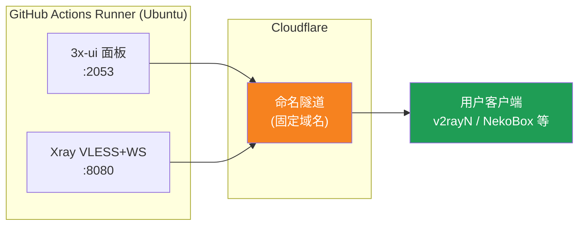
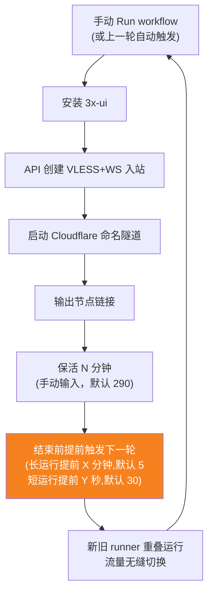
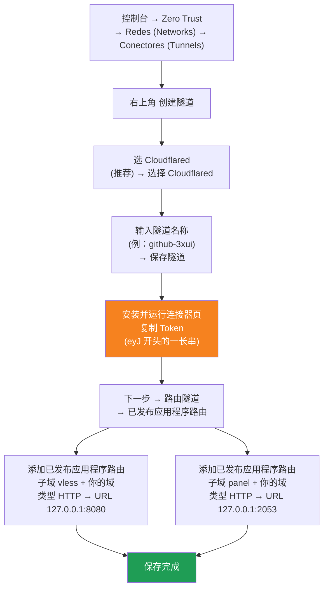

[简体中文](README.md) | [English](README.en.md) | [Русский](README.ru.md) | [日本語](README.ja.md) | [한국어](README.ko.md) | [Español](README.es.md) | [العربية](README.ar.md) | [Čeština](README.cs.md) | [Dansk](README.da.md) | [Deutsch](README.de.md) | [Esperanto](README.eo.md) | [فارسی](README.fa.md) | [Suomi](README.fi.md) | [Français](README.fr.md) | [Ελληνικά](README.gr.md) | [Magyar](README.hu.md) | [Bahasa Indonesia](README.id.md) | [Italiano](README.it.md) | [മലയാളം](README.ml.md) | [Nederlands](README.nl.md) | [Norsk](README.no.md) | [Polski](README.pl.md) | [Português](README.ptbr.md) | [Română](README.ro.md) | [Türkçe](README.tr.md) | [Українська](README.ua.md) | [Tiếng Việt](README.vn.md)

# ☁️ cloud-3xui — Nodo VLESS gratuito en GitHub

Construye automáticamente un panel 3x-ui + nodo VLESS en los servidores gratuitos de GitHub Actions, con dominio fijo y reconexión automática.

## Arquitectura



## Flujo de reconexión automática



## Reconexión automática

- **Usted fija la duración**: al hacer clic en Run workflow, escriba `run_minutes` manualmente; se ejecutará tantos minutos como indique; si lo deja vacío, se usará el valor predeterminado 290
- **Herencia automática de parámetros**: cada ronda pasa `run_minutes` / `countdown_interval` / `countdown_unit` / `overlap_threshold` / `overlap_long` / `overlap_short` a la siguiente a través de la API, por lo que toda la cadena mantiene los valores que ingresaste al principio
- Para una prueba rápida escriba `5`; para el uso diario, déjelo vacío y se usará el valor predeterminado 290
- **Arranque superpuesto (cambio sin interrupciones)**: la siguiente ronda se inicia anticipadamente antes del final de la ronda actual; los runners antiguo y nuevo funcionan simultáneamente, los túneles de Cloudflare admiten múltiples conexiones, el tráfico se dirige automáticamente a las conexiones disponibles, por lo que los usuarios apenas notan la salida de la ronda anterior. El momento de inicio es configurable: un keep-alive superior a `overlap_threshold` (predeterminado 5 minutos) se considera ronda larga e inicia `overlap_long` (predeterminado 5 minutos) antes; las más cortas se consideran rondas cortas e inician `overlap_short` (predeterminado 30 segundos) antes
- El dominio y el UUID son fijos: configure el cliente una vez y valdrá para siempre
- Para detenerlo, vaya a Actions y pulse Cancel; una vez cancelado, no se reiniciará automáticamente


## Direcciones fijas

| Uso | Dirección |
|-----|-----------|
| Nodo | `vless.mallow.ccwu.cc:443` (VLESS + WebSocket + TLS) |
| Panel | `https://panel.mallow.ccwu.cc/panel` (usuario `admin`) |

> ⚠️ Los dominios anteriores son ejemplos. Para cambiarlos, edita las variables `VLESS_HOST` / `PANEL_HOST` en Settings → Secrets and variables → Actions → Variables, no hace falta editar el archivo del workflow.

## Configuración del dominio

Los dominios del nodo y del panel están en variables de GitHub, no hace falta editar el archivo del workflow:

| Variable | Valor de ejemplo | Descripción |
|----------|------------------|-------------|
| `VLESS_HOST` | `vless.mallow.ccwu.cc` | Dirección del nodo (nombre de host completo) |
| `PANEL_HOST` | `panel.mallow.ccwu.cc` | Dirección del panel (nombre de host completo) |

**Cómo cambiarlo**: ve a **Settings** → **Secrets and variables** → **Actions** → la pestaña **Variables** → **New repository variable**, y completa el nombre y el valor. Tendrá efecto en la próxima ejecución del workflow.

**Tres cosas a tener en cuenta**:
- Cada variable contiene el **nombre de host completo** (incluido el prefijo del subdominio), así que el nodo y el panel pueden apuntar a dominios distintos, no tienen que compartir el mismo dominio padre
- Los valores deben coincidir con los nombres de host públicos (Public Hostnames) que creaste en el túnel de Cloudflare en el paso 1 (`vless` → 127.0.0.1:8080, `panel` → 127.0.0.1:2053); si no coinciden, el enlace no funcionará
- Si una variable no está configurada, el banner muestra un marcador de posición para ese elemento (`vless.YOUR_DOMAIN` / `panel.YOUR_DOMAIN`)

## Pasos detallados de configuración

### Dominio gratuito (¿sin dominio? empiece aquí)

¿No tiene dominio propio? Solicite uno gratis en https://my.dnshe.com/ (por ejemplo, `.ccwu.cc`, válido por 10 años) y luego delegue los registros NS del dominio a Cloudflare.

### Paso 1: Crear un túnel con nombre en Cloudflare


Sitio oficial de Cloudflare: https://www.cloudflare-cn.com (China) / https://www.cloudflare.com (internacional)
Panel de control: https://dash.cloudflare.com



Pasos detallados:

1. Abre el [panel de Cloudflare](https://dash.cloudflare.com) y ve a **Zero Trust** → **Redes (Networks)** → **Conectores (Tunnels)** en el menú izquierdo
2. Haz clic en **Create a tunnel** en la esquina superior derecha
3. **Selecciona el tipo de túnel**: elige **Cloudflared** (recomendado) y haz clic en **Select Cloudflared**
4. **Nombra el túnel**: escribe un nombre (p. ej. `github-3xui`) y haz clic en **Save tunnel**
5. **Instala y ejecuta el conector**: la página muestra un comando de instalación; copia el **Token** largo que empieza por `eyJ` y guárdalo (lo usarás como GitHub Secret). **No** necesitas instalar nada en local; continúa al siguiente paso
6. **Enruta el túnel**: ve a la pestaña **Public hostnames**, haz clic en **Add a public hostname** y añade dos entradas:

   **Primera (nodo):**
   - Subdominio: `vless`
   - Dominio: elige tu dominio
   - Tipo: `HTTP`
   - URL: `127.0.0.1:8080`

   **Segunda (panel):**
   - Subdominio: `panel`
   - Dominio: elige tu dominio
   - Tipo: `HTTP`
   - URL: `127.0.0.1:2053`
7. Guarda. Cloudflare crea los registros DNS automáticamente. Si en la lista de conectores (Tunnels) el estado es **Healthy**, la configuración es correcta.


### Paso 2: Generar un UUID

1. Abra https://1024tools.com/uuid/
2. Copie el UUID generado (se ve así: `cbfc229f-9d34-4fef-9990-8baa82a7327b`)
3. **Asegúrese de guardar este UUID**: no aparecerá en texto plano en los registros del workflow y lo necesitará cada vez que construya el enlace del nodo.

### Paso 3: Añadir Secrets y Variables en GitHub

1. Abra este repositorio y haga clic en la pestaña **Settings**.
2. A la izquierda, vaya a **Secrets and variables** → **Actions**.
3. Haga clic en **New repository secret** en la esquina superior derecha y añada estos tres:

   | Name | Secret (valor) | Descripción |
   |------|----------------|-------------|
   | `CF_TUNNEL_TOKEN` | El Tunnel Token copiado en el paso 1 | Credencial del túnel de Cloudflare |
   | `PANEL_PASSWORD` | La contraseña del panel que usted defina | Contraseña de acceso al panel 3x-ui |
   | `VLESS_UUID` | El UUID generado en el paso 2 | UUID del nodo, no cambia |

4. Cambia a la pestaña **Variables**, haz clic en **New repository variable** y añade dos variables (ver la sección Configuración del dominio más arriba):

   | Name | Valor | Descripción |
   |------|-------|-------------|
   | `VLESS_HOST` | `vless.mallow.ccwu.cc` | Dirección del nodo |
   | `PANEL_HOST` | `panel.mallow.ccwu.cc` | Dirección del panel |

### Paso 4: Ejecutar el workflow

1. Haga clic en la pestaña **Actions** en la parte superior del repositorio.
2. A la izquierda, seleccione **3x-ui VLESS Node**.
3. Haga clic en el botón **Run workflow** a la derecha.
4. En el formulario emergente:
   - **Panel password**: déjelo vacío (usa automáticamente el secret `PANEL_PASSWORD`)
     Contraseña del panel (si se deja vacío, usa el secret PANEL_PASSWORD)
   - **Run duration**: valor predeterminado `290` (minutos); para una primera prueba puede escribir `5` para una verificación rápida; para el uso diario, simplemente déjelo vacío
   - **Countdown output interval**: Intervalo de salida de la cuenta atrás, predeterminado `1`, escriba `0` para desactivarlo
   - **Countdown interval unit**: Unidad del intervalo de la cuenta atrás, seleccione `minutes` o `seconds` en el menú desplegable
   - **Overlap threshold**: Umbral de superposición (minutos, predeterminado `5`): un keep-alive más largo se considera una ronda larga
   - **Overlap long**: Minutos de antelación para iniciar la siguiente ronda en rondas largas (predeterminado `5`)
   - **Overlap short**: Segundos de antelación para iniciar la siguiente ronda en rondas cortas (predeterminado `30`)
     Duración de ejecución (minutos, predeterminado 290, máximo 340)
5. Haga clic en el botón verde **Run workflow** para iniciar.

### Paso 5: Obtener el enlace del nodo

1. Espere unos 2–3 minutos y haga clic en la tarea en ejecución para abrir su página de detalles.
2. Expanda el paso **Start named Cloudflare tunnel** y revise la salida del registro:
   ```
   ==================================================
     面板 Panel: https://panel.mallow.ccwu.cc/panel  (admin / 你的面板密码)

     VLESS 节点 node:
     vless://YOUR_UUID@vless.mallow.ccwu.cc:443?encryption=none&security=tls&sni=vless.mallow.ccwu.cc&type=ws&path=%2Fws#GitHub-3xui

     把 YOUR_UUID 换成你在 VLESS_UUID secret 里填的 UUID
     Replace YOUR_UUID with the UUID from your VLESS_UUID secret
     域名：去 Settings → Secrets and variables → Actions → Variables 改 VLESS_HOST / PANEL_HOST 变量
     Domain: set the VLESS_HOST / PANEL_HOST variables in Settings → Secrets and variables → Actions → Variables
   ==================================================
   ```
3. Copie el enlace `vless://` y reemplace `YOUR_UUID` con su UUID. (El dominio ya es el real, tomado de tus variables; no hace falta reemplazarlo.)
4. Péguelo en v2rayN / v2rayNG / Streisand / NekoBox u otros clientes y listo.

### Paso 6: Verificar la reconexión automática (opcional)

1. En la primera ejecución, establezca la duración en `5` minutos.
2. Después de 5 minutos, revise el registro del último paso, **Trigger next run**; debería mostrar:
   ```
   HTTP 204
   已触发下一次运行 Next run triggered
   ```
3. Vuelva a la lista de Actions: debería aparecer una nueva ejecución activada automáticamente.
4. Una vez confirmado, vuelva a ejecutar con la duración de vuelta en `290` para un uso normal.

## Descripción de los pasos del workflow

| Paso | 中文 | English | Descripción |
|------|------|---------|-------------|
| Install 3x-ui | 安装 3x-ui | Install 3x-ui | Instala el panel de forma no interactiva con el script oficial |
| Create VLESS+WS inbound via API | 通过 API 创建 VLESS+WS 入站 | Create VLESS+WS inbound via API | Inicia sesión con el API Token y crea el inbound automáticamente |
| Start named Cloudflare tunnel | 启动 Cloudflare 命名隧道 | Start named Cloudflare tunnel | Conecta al túnel de dominio fijo usando el Token |
| Keep alive | 保活 | Keep alive | Duerme el número de minutos indicado, supervisa el estado de los servicios e imprime la cuenta atrás en el intervalo configurado |
| Trigger next run | 触发下一次运行 | Trigger next run | Llama a la API para iniciar automáticamente la siguiente ronda |

## Preguntas frecuentes

**P: ¿El UUID del enlace del nodo aparece como `***` en los registros?**
R: Es el mecanismo de protección de secretos de GitHub. Simplemente reemplace `YOUR_UUID` con el UUID que puso en su secret `VLESS_UUID`.

**P: ¿El dominio aparece como `YOUR_DOMAIN` en los registros?**
R: Ve a Settings → Secrets and variables → Actions → Variables y crea las variables `VLESS_HOST` / `PANEL_HOST` con los nombres de host completos; asegúrate de que coincidan con los nombres de host públicos de tu túnel de Cloudflare.

**P: ¿La prueba del cliente falla (-1)?**
R: Compruebe tres cosas: ① si el UUID se reemplazó correctamente; ② si la versión del cliente es lo bastante reciente (v2rayN 7.x+); ③ si el túnel de Cloudflare está conectado correctamente (revise los registros).

**P: ¿El reinicio automático no se activó?**
R: Revise el registro del paso **Trigger next run**. Si muestra un código de estado HTTP distinto de 204, compruebe la configuración de permisos de Actions del repositorio.

**P: ¿Se cortará la conexión durante la rotación?**
R: Se utiliza el arranque superpuesto: la siguiente ronda se inicia antes de que termine la actual, con los runners antiguo y nuevo en línea al mismo tiempo, por lo que en teoría no hay interrupción. En casos extremos, como colas de GitHub, puede haber breves fluctuaciones; el cliente se reconectará automáticamente.

**P: ¿Cómo detener la reconexión automática?**
R: Vaya a la página de Actions y cancele (Cancel) la ejecución actual; no se volverá a activar automáticamente.

## Notas

- **Velocidad**: el tráfico pasa por Cloudflare → centros de datos de GitHub (EE. UU./Europa), por lo que solo es apto para uso temporal/ligero
- **Cambio sin interrupciones**: se utiliza el arranque superpuesto — la siguiente ronda se lanza 5 minutos antes del final de cada ronda, los runners antiguo y nuevo están en línea simultáneamente, por lo que en teoría los usuarios no notan nada; en casos extremos (p. ej., cola de GitHub) aún puede haber fluctuaciones breves
- **Cumplimiento**: ejecutar un proxy en GitHub Actions conlleva el riesgo de violar los ToS y que le suspendan la cuenta; evalúelo usted mismo
- **Seguridad**: no publique `CF_TUNNEL_TOKEN` / `PANEL_PASSWORD` / `VLESS_UUID` en ningún lugar público
