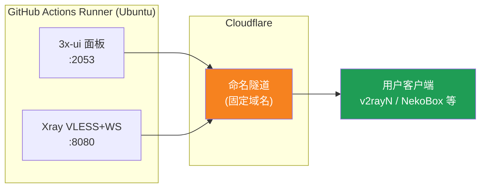
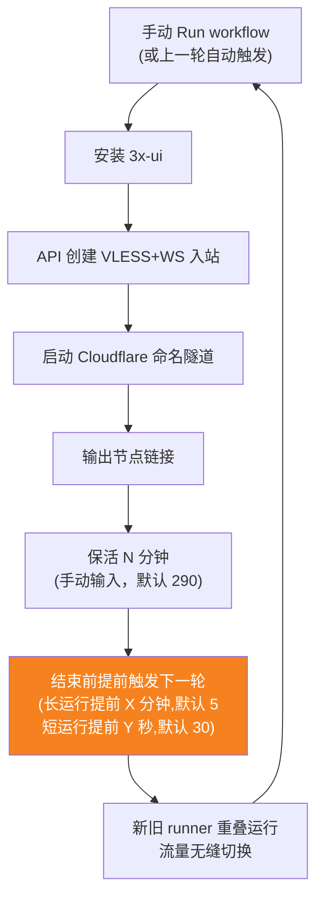
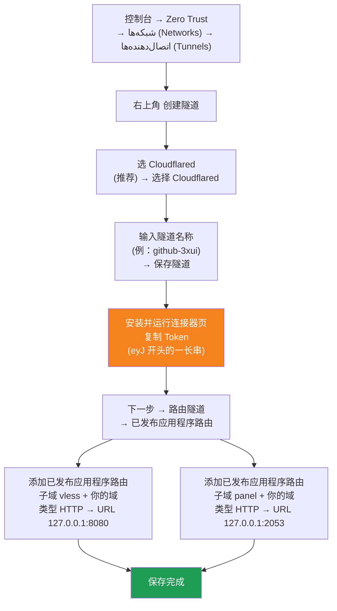

[简体中文](README.md) | [English](README.en.md) | [Русский](README.ru.md) | [日本語](README.ja.md) | [한국어](README.ko.md) | [Español](README.es.md) | [العربية](README.ar.md) | [Čeština](README.cs.md) | [Dansk](README.da.md) | [Deutsch](README.de.md) | [Esperanto](README.eo.md) | [فارسی](README.fa.md) | [Suomi](README.fi.md) | [Français](README.fr.md) | [Ελληνικά](README.gr.md) | [Magyar](README.hu.md) | [Bahasa Indonesia](README.id.md) | [Italiano](README.it.md) | [മലയാളം](README.ml.md) | [Nederlands](README.nl.md) | [Norsk](README.no.md) | [Polski](README.pl.md) | [Português](README.ptbr.md) | [Română](README.ro.md) | [Türkçe](README.tr.md) | [Українська](README.ua.md) | [Tiếng Việt](README.vn.md)

# ☁️ cloud-3xui — نود رایگان VLESS با GitHub

با سرورهای رایگان GitHub Actions به‌صورت خودکار پنل 3x-ui + نود VLESS بسازید؛ دامنهٔ ثابت، تمدید خودکار پس از قطعی.

## نمودار معماری



## روند تمدید خودکار



## تمدید خودکار

- **مدت زنده نگه داشتن را خودتان تعیین کنید**: هنگام کلیک روی Run workflow، فیلد `run_minutes` را به‌صورت دستی پر کنید؛ هر چقدر وارد کنید همان‌قدر اجرا می‌شود؛ اگر خالی بگذارید مقدار پیش‌فرض 290 استفاده می‌شود
- **ارث‌بری خودکار پارامترها**: هر دور `run_minutes` / `countdown_interval` / `countdown_unit` / `overlap_threshold` / `overlap_long` / `overlap_short` را از طریق API به دور بعدی منتقل می‌کند، پس کل زنجیره همان مقادیری را حفظ می‌کند که در ابتدا وارد کردید
- اگر می‌خواهید موقتاً تست کنید `5` وارد کنید؛ برای استفادهٔ روزمره خالی بگذارید تا همان 290 پیش‌فرض اعمال شود
- **راه‌اندازی هم‌پوشان (جابه‌جایی بدون وقفه)**: دور بعدی پیش از پایان دور جاری زودتر فعال می‌شود؛ رانر قدیمی و جدید هم‌زمان کار می‌کنند، تونل‌های Cloudflare از چند اتصال پشتیبانی می‌کنند، ترافیک به‌صورت خودکار به اتصالات در دسترس هدایت می‌شود، پس کاربران پایان دور قدیمی را به‌سختی متوجه می‌شوند. زمان شروع قابل تنظیم است: keep-alive طولانی‌تر از `overlap_threshold` (پیش‌فرض ۵ دقیقه) دور طولانی محسوب می‌شود و `overlap_long` (پیش‌فرض ۵ دقیقه) زودتر شروع می‌کند؛ کوتاه‌ترها دور کوتاه محسوب می‌شوند و `overlap_short` (پیش‌فرض ۳۰ ثانیه) زودتر شروع می‌کنند
- دامنه و UUID ثابت هستند؛ کلاینت را یک بار پیکربندی کنید و برای همیشه معتبر است
- برای توقف، به صفحهٔ Actions بروید و روی Cancel کلیک کنید؛ پس از لغو، دیگر به‌صورت خودکار راه‌اندازی نمی‌شود

## آدرس‌های ثابت

| کاربرد | آدرس |
|------|------|
| نود | `vless.mallow.ccwu.cc:443`（VLESS + WebSocket + TLS） |
| پنل | `https://panel.mallow.ccwu.cc/panel`（نام کاربری `admin`） |

> ⚠️ دامنه‌های بالا صرفاً نمونه هستند. برای تغییر آن‌ها، متغیرهای `VLESS_HOST` / `PANEL_HOST` را در Settings → Secrets and variables → Actions → Variables ویرایش کنید؛ نیازی به ویرایش فایل ورک‌فلو نیست.

## پیکربندی دامنه

دامنه‌های نود و پنل در متغیرهای GitHub قرار دارند و نیازی به ویرایش فایل ورک‌فلو نیست:

| متغیر | مقدار نمونه | توضیح |
|--------|------------|--------|
| `VLESS_HOST` | `vless.mallow.ccwu.cc` | آدرس نود (نام کامل هاست) |
| `PANEL_HOST` | `panel.mallow.ccwu.cc` | آدرس پنل (نام کامل هاست) |

**نحوه تغییر**: به **Settings** → **Secrets and variables** → **Actions** → زبانه **Variables** → **New repository variable** بروید و نام و مقدار را وارد کنید. تغییر از اجرای بعدی ورک‌فلو اعمال می‌شود.

**سه نکته**:
- هر متغیر **نام کامل هاست** را در خود دارد (شامل پیشوند زیردامنه)، پس نود و پنل می‌توانند به دامنه‌های متفاوتی اشاره کنند و لازم نیست دامنه والد یکسانی داشته باشند
- مقادیر باید با نام‌های هاست عمومی (Public Hostnames) ساخته‌شده در تونل Cloudflare در مرحله ۱ مطابقت داشته باشند (`vless` → 127.0.0.1:8080، `panel` → 127.0.0.1:2053)؛ در غیر این صورت لینک کار نمی‌کند
- اگر متغیری تنظیم نشده باشد، بنر برای آن مورد یک جای‌نما نشان می‌دهد (`vless.YOUR_DOMAIN` / `panel.YOUR_DOMAIN`)

## مراحل پیکربندی تفصیلی

### دامنه رایگان (دامنه ندارید؟ از اینجا شروع کنید)

دامنه اختصاصی ندارید؟ از https://my.dnshe.com/ یک دامنه رایگان بگیرید (مثلاً `.ccwu.cc`، با اعتبار ۱۰ ساله)، سپس رکوردهای NS دامنه را به Cloudflare منتقل کنید.

### گام اول: ساخت تونل نام‌دار (Named Tunnel) در Cloudflare


وب‌سایت رسمی Cloudflare: https://www.cloudflare-cn.com (چین) / https://www.cloudflare.com (بین‌المللی)
داشبورد: https://dash.cloudflare.com



مراحل تفصیلی:

1. [داشبورد Cloudflare](https://dash.cloudflare.com) را باز کنید و از منوی سمت چپ به **Zero Trust** ← **شبکه‌ها (Networks)** ← **اتصال‌دهنده‌ها (Tunnels)** بروید
2. روی **Create a tunnel** در گوشه بالا سمت راست کلیک کنید
3. **نوع تونل را انتخاب کنید**: **Cloudflared** (پیشنهادی) را انتخاب و روی **Select Cloudflared** کلیک کنید
4. **تونل را نام‌گذاری کنید**: نامی وارد کنید (مثلاً `github-3xui`) و روی **Save tunnel** کلیک کنید
5. **کانکتور را نصب و اجرا کنید**: صفحه یک دستور نصب نشان می‌دهد — **توکن** طولانی که با `eyJ` شروع می‌شود را کپی و ذخیره کنید (بعداً به‌عنوان GitHub Secret استفاده می‌شود). نیازی به نصب محلی **نیست**؛ ادامه دهید
6. **تونل را مسیریابی کنید**: به زبانه **Public hostnames** بروید، روی **Add a public hostname** کلیک کنید و دو مورد اضافه کنید:

   **مورد اول (نود):**
   - زیردامنه: `vless`
   - دامنه: دامنه خود را انتخاب کنید
   - نوع: `HTTP`
   - آدرس: `127.0.0.1:8080`

   **مورد دوم (پنل):**
   - زیردامنه: `panel`
   - دامنه: دامنه خود را انتخاب کنید
   - نوع: `HTTP`
   - آدرس: `127.0.0.1:2053`
7. ذخیره کنید. Cloudflare رکوردهای DNS را خودکار می‌سازد. وضعیت **Healthy** در فهرست اتصال‌دهنده‌ها (Tunnels) یعنی پیکربندی موفق.


### گام دوم: تولید UUID

1. https://1024tools.com/uuid/ را باز کنید.
2. UUID تولیدشده را کپی کنید (شبیه `cbfc229f-9d34-4fef-9990-8baa82a7327b`).
3. **حتماً این UUID را نگه دارید**؛ در لاگ‌های ورک‌فلو به‌صورت متن ساده نمایش داده نمی‌شود و هر بار برای ساخت لینک نود به آن نیاز دارید.

### گام سوم: افزودن Secrets و Variables در GitHub

1. وارد همین مخزن شوید و روی زبانهٔ **Settings** کلیک کنید.
2. از سمت چپ **Secrets and variables** → **Actions**.
3. روی **New repository secret** در گوشهٔ بالا-راست کلیک کنید و این سه مورد را به‌ترتیب اضافه کنید:

   | Name | Secret（مقدار） | توضیح |
   |------|-------------|------|
   | `CF_TUNNEL_TOKEN` | Tunnel Token کپی‌شده در گام اول | اعتبارنامهٔ تونل Cloudflare |
   | `PANEL_PASSWORD` | رمز عبوری که خودتان تعیین می‌کنید | رمز ورود به پنل 3x-ui |
   | `VLESS_UUID` | UUID تولیدشده در گام دوم | UUID نود، ثابت و بدون تغییر |

4. به زبانه **Variables** بروید، روی **New repository variable** کلیک کنید و دو متغیر اضافه کنید (به بخش پیکربندی دامنه در بالا مراجعه کنید):

   | Name | مقدار | توضیح |
   |------|--------|--------|
   | `VLESS_HOST` | `vless.mallow.ccwu.cc` | آدرس نود |
   | `PANEL_HOST` | `panel.mallow.ccwu.cc` | آدرس پنل |

### گام چهارم: اجرای ورک‌فلو

1. روی زبانهٔ **Actions** در بالای مخزن کلیک کنید.
2. از سمت چپ **3x-ui VLESS Node** را انتخاب کنید.
3. روی دکمهٔ **Run workflow** در سمت راست کلیک کنید.
4. در فرم بازشده:
   - **Panel password**: خالی بگذارید (به‌صورت خودکار از secret مربوط به `PANEL_PASSWORD` استفاده می‌شود)
     رمز پنل (خالی بگذارید تا از secret مربوط به PANEL_PASSWORD استفاده شود)
   - **Run duration**: پیش‌فرض `290` (دقیقه)؛ برای تست اول می‌توانید `5` وارد کنید تا سریع بررسی شود؛ برای استفادهٔ روزمره خالی بگذارید
   - **Countdown output interval**: فاصلهٔ نمایش شمارش معکوس، پیش‌فرض `1`، برای غیرفعال‌سازی `0` وارد کنید
   - **Countdown interval unit**: واحد فاصلهٔ نمایش شمارش معکوس، از منوی کشویی `minutes` یا `seconds` را انتخاب کنید
   - **Overlap threshold**: آستانهٔ هم‌پوشانی (دقیقه، پیش‌فرض `5`) — keep-alive طولانی‌تر از این، دور طولانی محسوب می‌شود
   - **Overlap long**: چند دقیقه زودتر دور بعدی در دورهای طولانی شروع شود (پیش‌فرض `5`)
   - **Overlap short**: چند ثانیه زودتر دور بعدی در دورهای کوتاه شروع شود (پیش‌فرض `30`)
     مدت اجرا (دقیقه، پیش‌فرض 290، حداکثر 340)
5. روی دکمهٔ سبز **Run workflow** کلیک کنید تا اجرا شروع شود.

### گام پنجم: دریافت لینک نود

1. حدود 2 تا 3 دقیقه صبر کنید، سپس روی اجرای در حال انجام کلیک کنید تا وارد صفحهٔ جزئیات شوید.
2. مرحلهٔ **Start named Cloudflare tunnel** را باز کنید و خروجی لاگ را ببینید:
   ```
   ==================================================
     پنل Panel: https://panel.mallow.ccwu.cc/panel  (admin / رمز شما your password)

     نود VLESS node:
     vless://YOUR_UUID@vless.mallow.ccwu.cc:443?encryption=none&security=tls&sni=vless.mallow.ccwu.cc&type=ws&path=%2Fws#GitHub-3xui

     YOUR_UUID را با UUIDای که در secret مربوط به VLESS_UUID وارد کرده‌اید جایگزین کنید
     Replace YOUR_UUID with the UUID from your VLESS_UUID secret
     域名：去 Settings → Secrets and variables → Actions → Variables 改 VLESS_HOST / PANEL_HOST 变量
     Domain: set the VLESS_HOST / PANEL_HOST variables in Settings → Secrets and variables → Actions → Variables
   ==================================================
   ```
3. لینک `vless://` را کپی کنید و `YOUR_UUID` را با UUID خودتان جایگزین کنید. (دامنه از قبل همان دامنه واقعی از متغیرهای شماست و نیازی به جایگزینی آن نیست.)
4. آن را در کلاینت‌هایی مانند v2rayN / v2rayNG / Streisand / NekoBox بچسبانید تا استفاده کنید.

### گام ششم: بررسی تمدید خودکار (اختیاری)

1. در اجرای اول، مدت زمان را `5` دقیقه تنظیم کنید.
2. پس از 5 دقیقه، لاگ مرحلهٔ پایانی **Trigger next run** را بررسی کنید؛ باید این را نشان دهد:
   ```
   HTTP 204
   اجرای بعدی فعال شد Next run triggered
   ```
3. به فهرست Actions برگردید؛ باید یک اجرای جدیدِ فعال‌شدهٔ خودکار ظاهر شده باشد.
4. پس از اطمینان، دوباره اجرا کنید و مدت زمان را به `290` برگردانید تا به‌صورت عادی استفاده شود.

## توضیح مراحل ورک‌فلو

| مرحله | فارسی | English | توضیحات |
|------|------|---------|------|
| Install 3x-ui | نصب 3x-ui | Install 3x-ui | نصب غیرتعاملی پنل با اسکریپت رسمی |
| Create VLESS+WS inbound via API | ساخت اینباند VLESS+WS از طریق API | Create VLESS+WS inbound via API | ورود با API Token و ساخت خودکار اینباند |
| Start named Cloudflare tunnel | راه‌اندازی تونل نام‌دار Cloudflare | Start named Cloudflare tunnel | اتصال تونل دامنهٔ ثابت با Token |
| Keep alive | زنده نگه داشتن | Keep alive | خواب برای دقایق مشخص‌شده، پایش وضعیت سرویس‌ها و نمایش شمارش معکوس با فاصلهٔ تنظیم‌شده |
| Trigger next run | فعال‌سازی اجرای بعدی | Trigger next run | فراخوانی API برای راه‌اندازی خودکار دور بعدی |

## پرسش‌های متداول

**س: UUID در لینک نود داخل لاگ به‌صورت `***` نمایش داده می‌شود؟**
ج: این مکانیزم محافظت از secret در GitHub است. `YOUR_UUID` را با UUIDای که خودتان در secret مربوط به `VLESS_UUID` وارد کرده‌اید جایگزین کنید.

**س: دامنه در لاگ به‌صورت `YOUR_DOMAIN` نمایش داده می‌شود؟**
ج: به Settings → Secrets and variables → Actions → Variables بروید و متغیرهای `VLESS_HOST` / `PANEL_HOST` را با نام‌های کامل هاست بسازید؛ مطمئن شوید با نام‌های هاست عمومی در تونل Cloudflare شما مطابقت دارند.

**س: تست کلاینت ناموفق است (-1)؟**
ج: سه مورد را بررسی کنید: ① آیا UUID درست جایگزین شده است؛ ② آیا نسخهٔ کلاینت جدید است (v2rayN نسخهٔ 7.x به بالا)؛ ③ آیا تونل Cloudflare به‌درستی متصل است (لاگ را ببینید).

**س: راه‌اندازی مجدد خودکار فعال نشد؟**
ج: لاگ مرحلهٔ **Trigger next run** را بررسی کنید. اگر کد وضعیت HTTP غیر از 204 نمایش داده شد، تنظیمات دسترسی Actions مخزن را بررسی کنید.

**س: آیا هنگام چرخش، اتصال قطع می‌شود؟**
ج: از راه‌اندازی هم‌پوشان استفاده می‌شود — دور بعدی پیش از پایان دور جاری فعال می‌شود و رانر قدیمی و جدید هم‌زمان آنلاین هستند، پس در تئوری وقفه‌ای احساس نمی‌شود. در شرایط حدی مانند صف GitHub ممکن است نوسان کوتاهی رخ دهد؛ کلاینت به‌صورت خودکار دوباره متصل می‌شود.

**س: چطور تمدید خودکار را متوقف کنم؟**
ج: به صفحهٔ Actions بروید و اجرای جاری را Cancel کنید؛ دیگر به‌صورت خودکار فعال نمی‌شود.

## نکات

- **سرعت**: ترافیک از Cloudflare ← دیتاسنترهای GitHub (آمریکا/اروپا) عبور می‌کند؛ فقط برای استفادهٔ موقت/سبک مناسب است
- **جابه‌جایی بدون وقفه**: از راه‌اندازی هم‌پوشان استفاده می‌شود — دور بعدی ۵ دقیقه پیش از پایان هر دور فعال می‌شود و رانر قدیمی و جدید هم‌زمان آنلاین‌اند، پس در حالت عادی کاربران چیزی حس نمی‌کنند؛ در شرایط خاص (مثل صف GitHub) ممکن است نوسان کوتاهی رخ دهد
- **مقررات**: اجرای پروکسی در GitHub Actions ممکن است خلاف ToS باشد و خطر مسدود شدن حساب را دارد؛ خودتان ارزیابی کنید
- **امنیت**: `CF_TUNNEL_TOKEN` / `PANEL_PASSWORD` / `VLESS_UUID` را در جاهای عمومی منتشر نکنید
