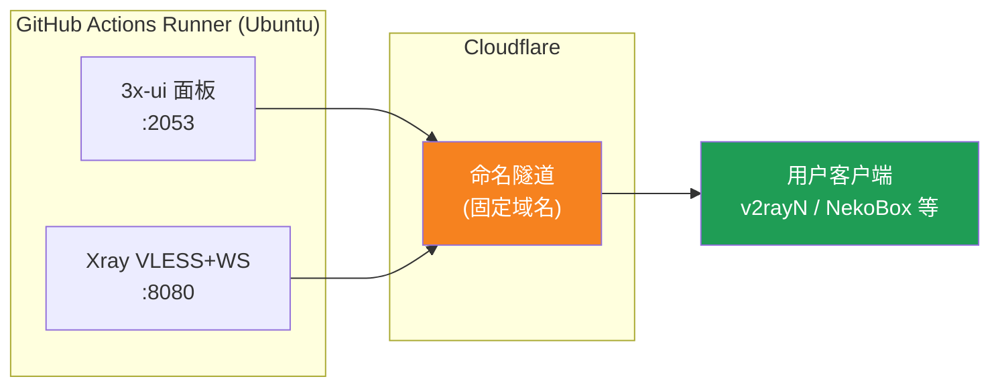
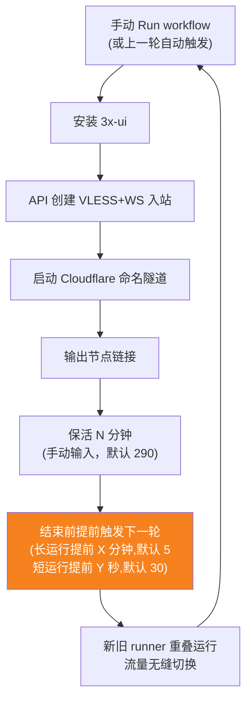
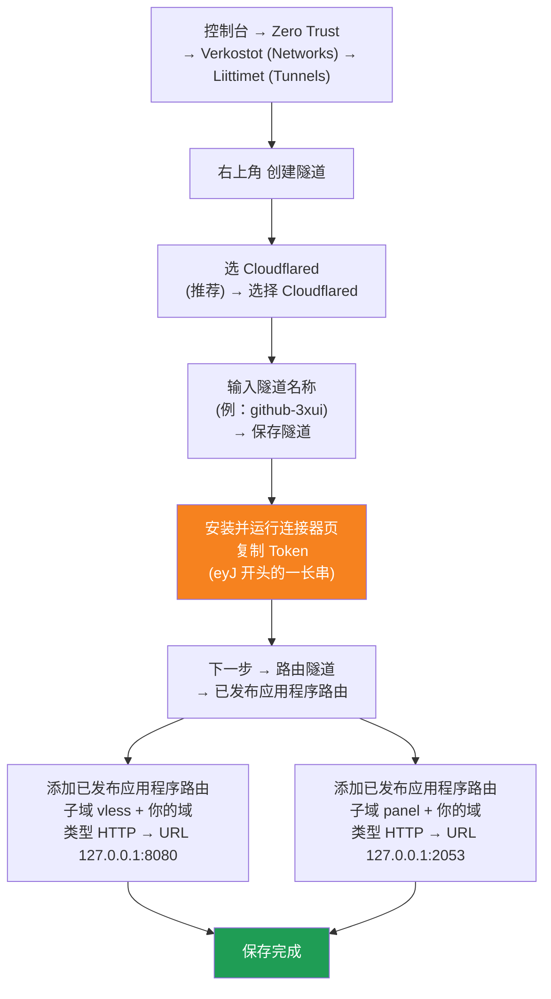

[简体中文](README.md) | [English](README.en.md) | [Русский](README.ru.md) | [日本語](README.ja.md) | [한국어](README.ko.md) | [Español](README.es.md) | [العربية](README.ar.md) | [Čeština](README.cs.md) | [Dansk](README.da.md) | [Deutsch](README.de.md) | [Esperanto](README.eo.md) | [فارسی](README.fa.md) | [Suomi](README.fi.md) | [Français](README.fr.md) | [Ελληνικά](README.gr.md) | [Magyar](README.hu.md) | [Bahasa Indonesia](README.id.md) | [Italiano](README.it.md) | [മലയാളം](README.ml.md) | [Nederlands](README.nl.md) | [Norsk](README.no.md) | [Polski](README.pl.md) | [Português](README.ptbr.md) | [Română](README.ro.md) | [Türkçe](README.tr.md) | [Українська](README.ua.md) | [Tiếng Việt](README.vn.md)

# ☁️ cloud-3xui — Ilmainen VLESS-solmu GitHubissa

Rakenna automaattisesti 3x-ui-paneeli + VLESS-solmu GitHub Actionsin ilmaisilla palvelimilla, kiinteällä verkkotunnuksella ja automaattisella elvytyksellä katkoksen jälkeen.

## Arkkitehtuurikaavio



## Automaattisen elvytyksen prosessi



## Automaattinen elvytys

- **Elossaoloaika on sinun päätettävissäsi**: syötä `run_minutes` manuaalisesti, kun napsautat Run workflow – mitä syötät, niin monta minuuttia se toimii; jos jätät tyhjäksi, käytetään oletusarvoa 290
- **Parametrit periytyvät automaattisesti**: jokainen kierros välittää `run_minutes` / `countdown_interval` / `countdown_unit` / `overlap_threshold` / `overlap_long` / `overlap_short` seuraavalle kierrokselle API:n kautta, joten koko ketju säilyttää ensimmäisellä kerralla syöttämäsi arvot
- Jos haluat kokeilla väliaikaisesti, syötä `5`; normaalikäytössä jätä tyhjäksi, niin käytetään oletusta 290
- **Päällekkäinen käynnistys (saumaton vaihto)**: seuraava kierros käynnistetään etukäteen ennen nykyisen kierroksen päättymistä; vanha ja uusi runner toimivat yhtä aikaa, Cloudflare-tunnelit tukevat useita yhteyksiä, liikenne ohjataan automaattisesti käytettävissä oleviin yhteyksiin, joten käyttäjät tuskin huomaavat vanhan kierroksen päättymistä. Käynnistysajankohta on säädettävissä: `overlap_threshold` (oletus 5 minuuttia) pidempi keep-alive on pitkä kierros ja käynnistää `overlap_long` (oletus 5 minuuttia) etukäteen; lyhyemmät ovat lyhyitä kierroksia ja käynnistävät `overlap_short` (oletus 30 sekuntia) etukäteen
- Verkkotunnus ja UUID ovat kiinteät – määritä asiakasohjelma kerran, niin se toimii pysyvästi
- Jos haluat pysäyttää, siirry Actions-sivulle ja napsauta Cancel – peruutuksen jälkeen se ei enää käynnisty automaattisesti

## Kiinteät osoitteet

| Käyttötarkoitus | Osoite |
|------|------|
| Solmu | `vless.mallow.ccwu.cc:443`（VLESS + WebSocket + TLS） |
| Paneeli | `https://panel.mallow.ccwu.cc/panel`（käyttäjänimi `admin`） |

> ⚠️ Yllä olevat verkkotunnukset ovat esimerkkejä; korvaa ne omalla verkkotunnuksellasi.

## Yksityiskohtaiset määritysvaiheet

### Ilmainen verkkotunnus (eikö sinulla ole verkkotunnusta? aloita tästä)

Eikö sinulla ole omaa verkkotunnusta? Hae ilmainen osoitteesta https://my.dnshe.com/ (esim. `.ccwu.cc`, voimassa 10 vuotta) ja osoita sen jälkeen verkkotunnuksen NS-tietueet Cloudflareen.

### Vaihe 1: Luo nimetty tunneli Cloudflaressa


Cloudflaren virallinen sivusto: https://www.cloudflare-cn.com (Kiina) / https://www.cloudflare.com (kansainvälinen)
Hallintapaneeli: https://dash.cloudflare.com



Yksityiskohtaiset vaiheet:

1. Avaa [Cloudflare Dashboard](https://dash.cloudflare.com) ja siirry vasemmasta valikosta kohtaan **Zero Trust** → **Verkostot (Networks)** → **Liittimet (Tunnels)**
2. Napsauta oikeassa yläkulmassa **Create a tunnel**
3. **Valitse tunnelityyppi**: valitse **Cloudflared** (suositus) ja napsauta **Select Cloudflared**
4. **Nimeä tunneli**: kirjoita nimi (esim. `github-3xui`) ja napsauta **Save tunnel**
5. **Asenna ja käynnistä liitin**: sivu näyttää asennuskomennon — kopioi pitkä `eyJ`-alkuinen **tunniste** ja tallenna se (käytät sitä myöhemmin GitHub Secretinä). Paikallista asennusta **ei** tarvita; jatka eteenpäin
6. **Reititä tunneli**: siirry **Public hostnames** -välilehdelle, napsauta **Add a public hostname** ja lisää kaksi merkintää:

   **Ensimmäinen (solmu):**
   - Alidomain: `vless`
   - Domain: valitse oma domainisi
   - Tyyppi: `HTTP`
   - URL: `127.0.0.1:8080`

   **Toinen (paneeli):**
   - Alidomain: `panel`
   - Domain: valitse oma domainisi
   - Tyyppi: `HTTP`
   - URL: `127.0.0.1:2053`
7. Tallenna. Cloudflare luo DNS-tietueet automaattisesti. Tila **Healthy** Liittimet (Tunnels) -listassa tarkoittaa onnistunutta määritystä.


### Vaihe 2: Luo UUID

1. Avaa https://1024tools.com/uuid/
2. Kopioi luotu UUID (esim. `cbfc229f-9d34-4fef-9990-8baa82a7327b`)
3. **Pidä tämä UUID ehdottomasti tallessa** – se ei näy selväkielisenä työnkulun lokeissa, ja tarvitset sitä joka kerta kootessasi solmulinkkiä

### Vaihe 3: Lisää GitHub-secretsit

1. Siirry tähän repositorioon ja napsauta **Settings**-välilehteä.
2. Valitse vasemmalta **Secrets and variables** → **Actions**.
3. Napsauta oikeassa yläkulmassa **New repository secret** ja lisää nämä kolme järjestyksessä:

   | Name | Secret (arvo) | Selitys |
   |------|-------------|------|
   | `CF_TUNNEL_TOKEN` | Vaiheessa 1 kopioitu Tunnel Token | Cloudflare-tunnelin tunnistetieto |
   | `PANEL_PASSWORD` | Itse asettamasi paneelin salasana | 3x-ui-paneelin kirjautumissalasana |
   | `VLESS_UUID` | Vaiheessa 2 luotu UUID | Solmun UUID, pysyvästi muuttumaton |

### Vaihe 4: Aja työnkulku

1. Napsauta repositorion yläosassa olevaa **Actions**-välilehteä.
2. Valitse vasemmalta **3x-ui VLESS Node**.
3. Napsauta oikealla olevaa **Run workflow**-painiketta.
4. Avautuvassa lomakkeessa:
   - **Panel password**: jätä tyhjäksi (käyttää automaattisesti `PANEL_PASSWORD`-secretiä)
     Paneelin salasana (tyhjä = käytetään PANEL_PASSWORD-secretiä)
   - **Run duration**: oletus `290` (minuuttia); ensimmäisessä testissä voit syöttää `5` nopeaa varmennusta varten; normaalikäytössä jätä tyhjäksi
   - **Countdown output interval**: Lähtölaskennan tulostusväli, oletus `1`, poista käytöstä syöttämällä `0`
   - **Countdown interval unit**: Lähtölaskennan tulostusvälin yksikkö, valitse `minutes` tai `seconds` pudotusvalikosta
   - **Overlap threshold**: Päällekkäisyyden raja (minuuttia, oletus `5`) — tätä pidempi keep-alive on pitkä kierros
   - **Overlap long**: Kuinka monta minuuttia ennen loppua seuraava kierros käynnistetään pitkillä kierroksilla (oletus `5`)
   - **Overlap short**: Kuinka monta sekuntia ennen loppua seuraava kierros käynnistetään lyhyillä kierroksilla (oletus `30`)
     Ajoaika (minuuttia, oletus 290, enintään 340)
5. Napsauta vihreää **Run workflow**-painiketta aloittaaksesi ajon.

### Vaihe 5: Hae solmulinkki

1. Odota noin 2–3 minuuttia ja napsauta käynnissä olevaa ajoa siirtyäksesi sen tietosivulle.
2. Laajenna vaihe **Start named Cloudflare tunnel** ja tarkista lokituloste:
   ```
   ==================================================
     Paneeli Panel: https://panel.mallow.ccwu.cc/panel  (admin / salasanasi your password)

     VLESS-solmu node:
     vless://YOUR_UUID@vless.mallow.ccwu.cc:443?encryption=none&security=tls&sni=vless.mallow.ccwu.cc&type=ws&path=%2Fws#GitHub-3xui

     Korvaa YOUR_UUID sillä UUID:llä, jonka syötit VLESS_UUID-secretiin
     Replace YOUR_UUID with the UUID from your VLESS_UUID secret
     域名：去 Settings → Secrets and variables → Actions → Variables 改 VLESS_HOST / PANEL_HOST 变量
     Domain: set the VLESS_HOST / PANEL_HOST variables in Settings → Secrets and variables → Actions → Variables
   ==================================================
   ```
3. Kopioi `vless://`-linkki ja korvaa `YOUR_UUID` omalla UUID:lläsi.
4. Liitä se v2rayN / v2rayNG / Streisand / NekoBox -asiakasohjelmaan, niin voit käyttää sitä.

### Vaihe 6: Varmista automaattinen elvytys (valinnainen)

1. Aseta ensimmäisessä ajossa kesto `5` minuutiksi.
2. Tarkista 5 minuutin kuluttua viimeisen vaiheen **Trigger next run** loki; sen pitäisi näyttää:
   ```
   HTTP 204
   Seuraava ajo käynnistetty Next run triggered
   ```
3. Palaa Actions-listaan – siinä pitäisi näkyä uusi automaattisesti käynnistetty ajo.
4. Kun olet varmistunut, aja uudelleen ja palauta kesto arvoon `290` normaalia käyttöä varten.

## Työnkulun vaiheiden selitykset

| Vaihe | Suomeksi | English | Selitys |
|------|------|---------|------|
| Install 3x-ui | Asenna 3x-ui | Install 3x-ui | Asenna paneeli virallisella komentosarjalla ilman vuorovaikutusta |
| Create VLESS+WS inbound via API | Luo VLESS+WS-saapuva API:n kautta | Create VLESS+WS inbound via API | Kirjaudu API-tokenilla, luo saapuva automaattisesti |
| Start named Cloudflare tunnel | Käynnistä Cloudflaren nimetty tunneli | Start named Cloudflare tunnel | Yhdistä kiinteän verkkotunnuksen tunneli tokenilla |
| Keep alive | Pidä elossa | Keep alive | Lepää määritetyt minuutit, valvo palveluiden tilaa ja tulosta lähtölaskenta määritetyllä välillä |
| Trigger next run | Käynnistä seuraava ajo | Trigger next run | Kutsu API:ia käynnistääksesi seuraavan kierroksen automaattisesti |

## Usein kysytyt kysymykset

**K: Solmulinkin UUID näkyy lokeissa muodossa `***`?**
V: Tämä on GitHubin secret-suojausmekanismi. Korvaa `YOUR_UUID` sillä UUID:llä, jonka syötit `VLESS_UUID`-secretiin.

**K: Asiakasohjelman testi ei mene läpi (-1)?**
V: Tarkista kolme asiaa: ① onko UUID korvattu oikein; ② onko asiakasohjelman versio tarpeeksi uusi (v2rayN 7.x+); ③ onko Cloudflare-tunneli yhdistetty normaalisti (katso lokia).

**K: Automaattinen uudelleenkäynnistys ei käynnistynyt?**
V: Tarkista vaiheen **Trigger next run** loki. Jos näet muun kuin 204:n HTTP-tilakoodin, tarkista repositorion Actions-käyttöoikeusasetukset.

**K: Katkeaako yhteys kierroksen vaihtuessa?**
V: Käytössä on päällekkäinen käynnistys — seuraava kierros käynnistetään ennen nykyisen päättymistä, vanha ja uusi runner ovat yhtä aikaa käytössä, joten teoriassa katkosta ei ole. Äärimmäisissä tapauksissa, kuten GitHub-jonotuksessa, voi esiintyä lyhyitä vaihteluita; asiakasohjelma yhdistää automaattisesti uudelleen.

**K: Haluatko pysäyttää automaattisen elvytyksen?**
V: Siirry Actions-sivulle ja peruuta (Cancel) nykyinen ajo – se ei enää käynnisty automaattisesti.

## Huomioitavaa

- **Nopeus**: liikenne kulkee Cloudflare → GitHubin palvelinkeskukset (Yhdysvallat/Eurooppa) -reitin kautta, sopii vain tilapäiseen/kevyeen käyttöön
- **Saumaton vaihto**: käytetään päällekkäistä käynnistystä — seuraava kierros käynnistetään 5 minuuttia ennen kunkin kierroksen päättymistä, vanha ja uusi runner ovat yhtä aikaa verkossa, joten käyttäjät eivät teoriassa huomaa mitään; äärimmäisissä tapauksissa (esim. GitHub-jono) voi silti esiintyä lyhyitä vaihteluita
- **Sääntöjenmukaisuus**: välityspalvelimen ajaminen GitHub Actionsissa saattaa rikkoa käyttöehtoja ja aiheuttaa tilin jäädytyksen riskin; arvioi itse
- **Turvallisuus**: älä julkaise `CF_TUNNEL_TOKEN` / `PANEL_PASSWORD` / `VLESS_UUID` julkisesti
