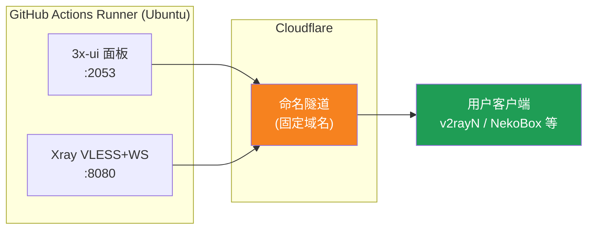
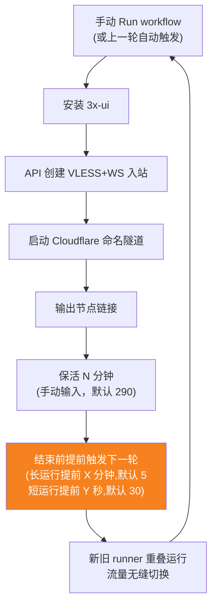
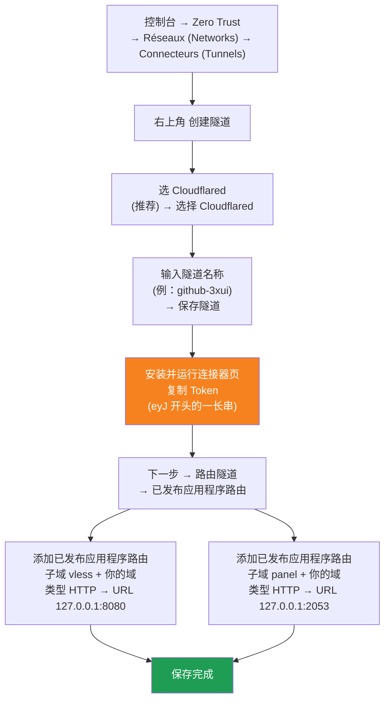

[简体中文](README.md) | [English](README.en.md) | [Русский](README.ru.md) | [日本語](README.ja.md) | [한국어](README.ko.md) | [Español](README.es.md) | [العربية](README.ar.md) | [Čeština](README.cs.md) | [Dansk](README.da.md) | [Deutsch](README.de.md) | [Esperanto](README.eo.md) | [فارسی](README.fa.md) | [Suomi](README.fi.md) | [Français](README.fr.md) | [Ελληνικά](README.gr.md) | [Magyar](README.hu.md) | [Bahasa Indonesia](README.id.md) | [Italiano](README.it.md) | [മലയാളം](README.ml.md) | [Nederlands](README.nl.md) | [Norsk](README.no.md) | [Polski](README.pl.md) | [Português](README.ptbr.md) | [Română](README.ro.md) | [Türkçe](README.tr.md) | [Українська](README.ua.md) | [Tiếng Việt](README.vn.md)

# ☁️ cloud-3xui — Nœud VLESS gratuit sur GitHub

Déployez automatiquement un panneau 3x-ui + un nœud VLESS sur les serveurs gratuits de GitHub Actions, avec un nom de domaine fixe et un renouvellement automatique en cas de coupure.

## Schéma d'architecture



## Processus de renouvellement automatique



## Renouvellement automatique

- **La durée de maintien en activité est entre vos mains** : saisissez manuellement `run_minutes` lorsque vous cliquez sur Run workflow – la valeur saisie correspond aux minutes d'exécution ; si vous laissez vide, la valeur par défaut 290 est utilisée
- **Héritage automatique des paramètres** : chaque cycle transmet `run_minutes` / `countdown_interval` / `countdown_unit` / `overlap_threshold` / `overlap_long` / `overlap_short` au cycle suivant via l’API, donc toute la chaîne conserve les valeurs que vous avez saisies au départ
- Pour un test ponctuel, saisissez `5` ; pour une utilisation quotidienne, laissez vide pour conserver les 290 par défaut
- **Démarrage en chevauchement (bascule transparente)** : le cycle suivant est déclenché en avance avant la fin du cycle en cours ; les anciens et nouveaux runners fonctionnent simultanément, les tunnels Cloudflare prennent en charge plusieurs connexions, le trafic est automatiquement dirigé vers les connexions disponibles, si bien que les utilisateurs remarquent à peine la fin de l'ancien cycle. Le moment du déclenchement est configurable : un keep-alive supérieur à `overlap_threshold` (défaut 5 minutes) est considéré comme un cycle long et déclenche `overlap_long` (défaut 5 minutes) en avance ; les plus courts sont considérés comme des cycles courts et déclenchent `overlap_short` (défaut 30 secondes) en avance
- Le nom de domaine et l'UUID sont fixes : configurez le client une fois, il reste valable en permanence
- Pour arrêter, accédez à la page Actions et cliquez sur Cancel ; après l'annulation, il ne redémarrera plus automatiquement

## Adresses fixes

| Usage | Adresse |
|------|------|
| Nœud | `vless.mallow.ccwu.cc:443`（VLESS + WebSocket + TLS） |
| Panneau | `https://panel.mallow.ccwu.cc/panel`（nom d'utilisateur `admin`） |

> ⚠️ Les noms de domaine ci-dessus sont des exemples. Pour les modifier, éditez les variables `VLESS_HOST` / `PANEL_HOST` dans Settings → Secrets and variables → Actions → Variables — pas besoin de modifier le fichier du workflow.

## Configuration du domaine

Les domaines du nœud et du panneau sont stockés dans des variables GitHub — pas besoin de modifier le fichier du workflow :

| Variable | Exemple de valeur | Description |
|----------|-------------------|-------------|
| `VLESS_HOST` | `vless.mallow.ccwu.cc` | Adresse du nœud (nom d'hôte complet) |
| `PANEL_HOST` | `panel.mallow.ccwu.cc` | Adresse du panneau (nom d'hôte complet) |

**Comment modifier** : allez dans **Settings** → **Secrets and variables** → **Actions** → l'onglet **Variables** → **New repository variable**, puis renseignez le nom et la valeur. La modification prend effet au prochain lancement du workflow.

**Trois points à noter** :
- Chaque variable contient le **nom d'hôte complet** (préfixe du sous-domaine inclus), donc le nœud et le panneau peuvent pointer vers des domaines différents — ils n'ont pas besoin de partager le même domaine parent
- Les valeurs doivent correspondre aux noms d'hôte publics (Public Hostnames) créés dans le tunnel Cloudflare à l'étape 1 (`vless` → 127.0.0.1:8080, `panel` → 127.0.0.1:2053), sinon le lien ne fonctionnera pas
- Si une variable n'est pas définie, la bannière affiche un espace réservé pour l'élément concerné (`vless.YOUR_DOMAIN` / `panel.YOUR_DOMAIN`)

## Étapes de configuration détaillées

### Domaine gratuit (pas de domaine ? commencez ici)

Pas de domaine à vous ? Demandez-en un gratuitement sur https://my.dnshe.com/ (par ex. `.ccwu.cc`, valable 10 ans), puis déléguez les enregistrements NS du domaine à Cloudflare.

### Étape 1 : Créer un tunnel nommé dans Cloudflare


Site officiel de Cloudflare : https://www.cloudflare-cn.com (Chine) / https://www.cloudflare.com (international)
Tableau de bord : https://dash.cloudflare.com



Étapes détaillées :

1. Ouvrez le [tableau de bord Cloudflare](https://dash.cloudflare.com), puis allez dans **Zero Trust** → **Réseaux (Networks)** → **Connecteurs (Tunnels)** dans le menu de gauche
2. Cliquez sur **Create a tunnel** en haut à droite
3. **Choisissez le type de tunnel** : sélectionnez **Cloudflared** (recommandé), puis cliquez sur **Select Cloudflared**
4. **Nommez le tunnel** : saisissez un nom (p. ex. `github-3xui`), puis cliquez sur **Save tunnel**
5. **Installez et exécutez le connecteur** : la page affiche une commande d'installation — copiez le long **jeton** commençant par `eyJ` et conservez-le (vous l'utiliserez comme GitHub Secret). Aucune installation locale n'est **nécessaire** ; continuez simplement
6. **Routez le tunnel** : allez dans l'onglet **Public hostnames**, cliquez sur **Add a public hostname** et ajoutez deux entrées :

   **Première (nœud) :**
   - Sous-domaine : `vless`
   - Domaine : choisissez votre domaine
   - Type : `HTTP`
   - URL : `127.0.0.1:8080`

   **Deuxième (panneau) :**
   - Sous-domaine : `panel`
   - Domaine : choisissez votre domaine
   - Type : `HTTP`
   - URL : `127.0.0.1:2053`
7. Enregistrez. Cloudflare crée les enregistrements DNS automatiquement. Le statut **Healthy** dans la liste des connecteurs (Tunnels) indique une configuration réussie.


### Étape 2 : Générer un UUID

1. Ouvrez https://1024tools.com/uuid/
2. Copiez l'UUID généré (du type `cbfc229f-9d34-4fef-9990-8baa82a7327b`)
3. **Conservez soigneusement cet UUID** : il n'apparaît pas en clair dans les journaux du workflow, et vous en aurez besoin à chaque fois que vous assemblerez le lien du nœud.

### Étape 3 : Ajouter les Secrets et les Variables dans GitHub

1. Accédez à ce dépôt et cliquez sur l'onglet **Settings**.
2. Dans la colonne de gauche : **Secrets and variables** → **Actions**.
3. Cliquez sur **New repository secret** en haut à droite et ajoutez les trois secrets suivants, dans l'ordre :

   | Name | Secret (valeur) | Description |
   |------|-------------|------|
   | `CF_TUNNEL_TOKEN` | Le Tunnel Token copié à l'étape 1 | Identifiant du tunnel Cloudflare |
   | `PANEL_PASSWORD` | Le mot de passe du panneau que vous définissez | Mot de passe de connexion au panneau 3x-ui |
   | `VLESS_UUID` | L'UUID généré à l'étape 2 | UUID du nœud, fixe et inchangé |

4. Basculez sur l'onglet **Variables**, cliquez sur **New repository variable** et ajoutez deux variables (voir la section Configuration du domaine ci-dessus) :

   | Name | Valeur | Description |
   |------|--------|-------------|
   | `VLESS_HOST` | `vless.mallow.ccwu.cc` | Adresse du nœud |
   | `PANEL_HOST` | `panel.mallow.ccwu.cc` | Adresse du panneau |

### Étape 4 : Exécuter le workflow

1. Cliquez sur l'onglet **Actions** en haut du dépôt.
2. Sélectionnez **3x-ui VLESS Node** dans la colonne de gauche.
3. Cliquez sur le bouton **Run workflow** à droite.
4. Dans le formulaire qui s'affiche :
   - **Panel password** : laissez vide (utilise automatiquement le secret `PANEL_PASSWORD`)
     Mot de passe du panneau (vide = utilise le secret PANEL_PASSWORD)
   - **Run duration** : `290` par défaut (en minutes) ; pour un premier test, vous pouvez saisir `5` pour une vérification rapide ; pour une utilisation quotidienne, laissez vide
   - **Countdown output interval**: Intervalle d'affichage du compte à rebours, par défaut `1`, saisissez `0` pour le désactiver
   - **Countdown interval unit**: Unité de l'intervalle d'affichage du compte à rebours, sélectionnez `minutes` ou `seconds` dans le menu déroulant
   - **Overlap threshold** : Seuil de chevauchement (minutes, défaut `5`) — un keep-alive plus long est considéré comme un cycle long
   - **Overlap long** : Minutes d'avance pour déclencher le cycle suivant pour les cycles longs (défaut `5`)
   - **Overlap short** : Secondes d'avance pour déclencher le cycle suivant pour les cycles courts (défaut `30`)
     Durée d'exécution (en minutes, 290 par défaut, 340 au maximum)
5. Cliquez sur le bouton vert **Run workflow** pour lancer l'exécution.

### Étape 5 : Obtenir le lien du nœud

1. Patientez environ 2 à 3 minutes, puis cliquez sur l'exécution en cours pour accéder à sa page de détail.
2. Développez l'étape **Start named Cloudflare tunnel** et consultez la sortie du journal :
   ```
   ==================================================
     Panneau Panel: https://panel.mallow.ccwu.cc/panel  (admin / votre mot de passe your password)

     Nœud VLESS node:
     vless://YOUR_UUID@vless.mallow.ccwu.cc:443?encryption=none&security=tls&sni=vless.mallow.ccwu.cc&type=ws&path=%2Fws#GitHub-3xui

     Remplacez YOUR_UUID par l'UUID renseigné dans votre secret VLESS_UUID
     Replace YOUR_UUID with the UUID from your VLESS_UUID secret
     域名：去 Settings → Secrets and variables → Actions → Variables 改 VLESS_HOST / PANEL_HOST 变量
     Domain: set the VLESS_HOST / PANEL_HOST variables in Settings → Secrets and variables → Actions → Variables
   ==================================================
   ```
3. Copiez le lien `vless://` et remplacez `YOUR_UUID` par votre UUID. (Le domaine est déjà le vrai, tiré de vos variables — pas besoin de le remplacer.)
4. Collez-le dans un client tel que v2rayN / v2rayNG / Streisand / NekoBox pour l'utiliser.

### Étape 6 : Vérifier le renouvellement automatique (facultatif)

1. Pour la première exécution, réglez la durée sur `5` minutes.
2. Au bout de 5 minutes, consultez le journal de la dernière étape **Trigger next run** ; il doit afficher :
   ```
   HTTP 204
   Exécution suivante déclenchée Next run triggered
   ```
3. Revenez à la liste Actions : une nouvelle exécution déclenchée automatiquement doit apparaître.
4. Une fois la vérification effectuée, relancez une exécution en remettant la durée à `290` pour une utilisation normale.

## Description des étapes du workflow

| Étape | Français | English | Description |
|------|------|---------|------|
| Install 3x-ui | Installer 3x-ui | Install 3x-ui | Installer le panneau de façon non interactive avec le script officiel |
| Create VLESS+WS inbound via API | Créer une entrée VLESS+WS via l'API | Create VLESS+WS inbound via API | Se connecter avec le jeton d'API et créer l'entrée automatiquement |
| Start named Cloudflare tunnel | Démarrer le tunnel nommé Cloudflare | Start named Cloudflare tunnel | Connecter le tunnel à domaine fixe avec le jeton |
| Keep alive | Maintien en activité | Keep alive | Mettre en veille pendant le nombre de minutes indiqué, surveiller l'état des services et afficher le compte à rebours à l'intervalle configuré |
| Trigger next run | Déclencher l'exécution suivante | Trigger next run | Appeler l'API pour lancer automatiquement le cycle suivant |

## Questions fréquentes

**Q : L'UUID du lien du nœud s'affiche comme `***` dans les journaux ?**
R : C'est le mécanisme de protection des secrets de GitHub. Remplacez `YOUR_UUID` par l'UUID que vous avez vous-même renseigné dans le secret `VLESS_UUID`.

**Q : Le domaine s'affiche comme `YOUR_DOMAIN` dans les journaux ?**
R : Allez dans Settings → Secrets and variables → Actions → Variables et créez les variables `VLESS_HOST` / `PANEL_HOST` avec les noms d'hôte complets ; vérifiez qu'elles correspondent aux noms d'hôte publics de votre tunnel Cloudflare.

**Q : Le test du client échoue (-1) ?**
R : Vérifiez trois points : ① l'UUID a-t-il été correctement remplacé ; ② la version du client est-elle suffisamment récente (v2rayN 7.x+) ; ③ le tunnel Cloudflare est-il correctement connecté (consultez le journal).

**Q : Le redémarrage automatique ne s'est pas déclenché ?**
R : Consultez le journal de l'étape **Trigger next run**. Si un code d'état HTTP autre que 204 s'affiche, vérifiez les paramètres d'autorisation Actions du dépôt.

**Q : La connexion sera-t-elle coupée lors de la rotation ?**
R : Un démarrage chevauchant est utilisé — le cycle suivant est lancé avant la fin du cycle en cours, les anciens et nouveaux runners sont en ligne simultanément, donc en théorie il n'y a aucune coupure. Dans des cas extrêmes comme les files d'attente GitHub, de brèves fluctuations peuvent survenir ; le client se reconnectera automatiquement.

**Q : Comment arrêter le renouvellement automatique ?**
R : Accédez à la page Actions et annulez (Cancel) l'exécution en cours ; elle ne se déclenchera plus automatiquement.

## Remarques

- **Vitesse** : le trafic transite via Cloudflare → les centres de données GitHub (Amérique/Europe) ; convient uniquement à un usage temporaire ou léger
- **Bascule transparente** : un démarrage en chevauchement est utilisé — le cycle suivant est lancé 5 minutes avant la fin de chaque cycle, les anciens et nouveaux runners sont en ligne simultanément, donc en théorie les utilisateurs ne remarquent rien ; dans des cas extrêmes (file d’attente GitHub par ex.), de brèves fluctuations restent possibles
- **Conformité** : exécuter un proxy sur GitHub Actions peut enfreindre les conditions d'utilisation et expose au risque de suspension du compte ; évaluez vous-même
- **Sécurité** : ne publiez jamais `CF_TUNNEL_TOKEN` / `PANEL_PASSWORD` / `VLESS_UUID` dans un endroit public
