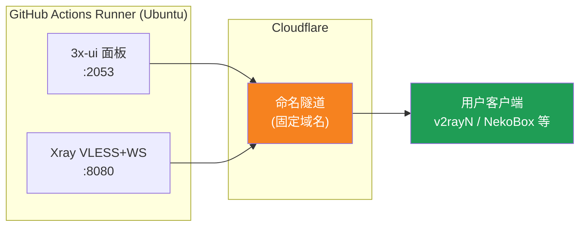
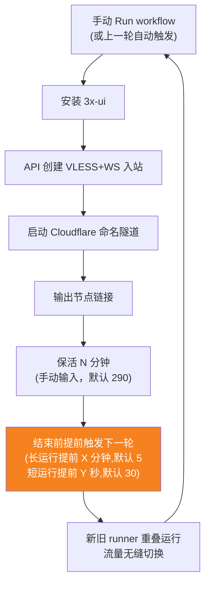
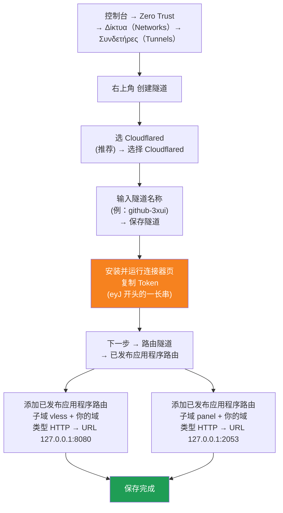

[简体中文](README.md) | [English](README.en.md) | [Русский](README.ru.md) | [日本語](README.ja.md) | [한국어](README.ko.md) | [Español](README.es.md) | [العربية](README.ar.md) | [Čeština](README.cs.md) | [Dansk](README.da.md) | [Deutsch](README.de.md) | [Esperanto](README.eo.md) | [فارسی](README.fa.md) | [Suomi](README.fi.md) | [Français](README.fr.md) | [Ελληνικά](README.gr.md) | [Magyar](README.hu.md) | [Bahasa Indonesia](README.id.md) | [Italiano](README.it.md) | [മലയാളം](README.ml.md) | [Nederlands](README.nl.md) | [Norsk](README.no.md) | [Polski](README.pl.md) | [Português](README.ptbr.md) | [Română](README.ro.md) | [Türkçe](README.tr.md) | [Українська](README.ua.md) | [Tiếng Việt](README.vn.md)

# ☁️ cloud-3xui — Δωρεάν κόμβος VLESS στο GitHub

Αυτόματη εγκατάσταση του πάνελ 3x-ui + κόμβου VLESS στους δωρεάν διακομιστές του GitHub Actions, με σταθερό domain και αυτόματη ανανέωση σε περίπτωση αποσύνδεσης.

## Διάγραμμα αρχιτεκτονικής



## Διαδικασία αυτόματης ανανέωσης



## Αυτόματη ανανέωση

- **Η διάρκεια ορίζεται από εσένα**: κατά το Run workflow συμπλήρωσε χειροκίνητα το `run_minutes`, τρέχει όσα λεπτά βάλεις· αν μείνει κενό χρησιμοποιείται η προεπιλογή 290
- **Η αυτόματη κληρονομικότητα παραμέτρων**: κάθε γύρος μεταβιβάζει τα `run_minutes` / `countdown_interval` / `countdown_unit` / `overlap_threshold` / `overlap_long` / `overlap_short` στον επόμενο, όλη η αλυσίδα χρησιμοποιεί τις αρχικές σου τιμές
- **Επικαλυπτόμενη εκκίνηση (απρόσκοπτη εναλλαγή)**: ενεργοποιεί νωρίς την επόμενη εκτέλεση πριν λήξει η τρέχουσα, παλιός και νέος runner είναι ταυτόχρονα online, η σήραγγα Cloudflare υποστηρίζει πολλαπλές συνδέσεις, η κίνηση κατανέμεται αυτόματα στις διαθέσιμες συνδέσεις, ο χρήστης σχεδόν δεν αντιλαμβάνεται την έξοδο του παλιού γύρου. Ο χρόνος ενεργοποίησης ρυθμίζεται: keep-alive μεγαλύτερο από `overlap_threshold` (προεπιλογή 5 λεπτά) θεωρείται μεγάλη εκτέλεση, ενεργοποιείται νωρίς κατά `overlap_long` (προεπιλογή 5 λεπτά)· μικρότερο θεωρείται σύντομη εκτέλεση, ενεργοποιείται νωρίς κατά `overlap_short` (προεπιλογή 30 δευτερόλεπτα)
- Για γρήγορη δοκιμή βάλε `5`, για καθημερινή χρήση άφησέ το κενό (290)
- Domain και UUID παραμένουν σταθερά, ρύθμισε τον client μία φορά
- Για να σταματήσει, πάτα Cancel στο Actions· μετά την ακύρωση δεν θα ξαναξεκινήσει αυτόματα

## Σταθερές διευθύνσεις

| Χρήση | Διεύθυνση |
|------|------|
| Κόμβος | `vless.mallow.ccwu.cc:443` (VLESS + WebSocket + TLS) |
| Πάνελ | `https://panel.mallow.ccwu.cc/panel` (όνομα χρήστη `admin`) |

> ⚠️ Τα παραπάνω domain είναι παραδείγματα, αντικαταστήστε τα με τα δικά σας.

## Αναλυτικά βήματα ρύθμισης

### Δωρεάν domain (αν δεν έχετε domain)

Δεν έχετε δικό σας domain; Μπορείτε να καταχωρήσετε ένα δωρεάν στο https://my.dnshe.com/ (π.χ. `.ccwu.cc`, ισχύ 10 ετών) και στη συνέχεια να φιλοξενήσετε τους διακομιστές ονομάτων (NS) του domain στο Cloudflare.

### Βήμα 1: Δημιουργία ονοματισμένης σήραγγας (named tunnel) στο Cloudflare

Επίσημη ιστοσελίδα Cloudflare: https://www.cloudflare-cn.com (Κίνα) / https://www.cloudflare.com (Διεθνής)

Κονσόλα: https://dash.cloudflare.com



Λεπτομερή βήματα:

1. Ανοίξτε το [Cloudflare Dashboard](https://dash.cloudflare.com) και από το αριστερό μενού μεταβείτε στο **Zero Trust** → **Δίκτυα（Networks）** → **Συνδετήρες（Tunnels）**
2. Κάντε κλικ στην επάνω δεξιά γωνία στο **Δημιουργία σήραγγας**
3. **Επιλογή τύπου σήραγγας**: επιλέξτε **Cloudflared** (συνιστάται) και κάντε κλικ στο **Επιλογή Cloudflared**
4. **Ονομασία σήραγγας**: εισαγάγετε ένα όνομα (π.χ. `github-3xui`) και κάντε κλικ στο **Αποθήκευση σήραγγας**
5. **Εγκατάσταση και εκτέλεση του συνδετήρα**: η σελίδα θα εμφανίσει μια εντολή εγκατάστασης· αντιγράψτε τη μεγάλη σειρά χαρακτήρων που ξεκινά με `eyJ` — αυτό είναι το **Token**. Φυλάξτε το καλά (θα το αποθηκεύσετε αργότερα ως GitHub Secret). **Δεν χρειάζεται** να το εγκαταστήσετε τοπικά — κάντε κλικ στο επόμενο για να συνεχίσετε
6. **Δρομολόγηση σήραγγας**: μεταβείτε στην καρτέλα **Δημοσιευμένες διαδρομές εφαρμογών** και κάντε κλικ στο **Προσθήκη δημοσιευμένης διαδρομής εφαρμογής** για να προσθέσετε δύο καταχωρήσεις:
   **Πρώτη (κόμβος):** Υποτομέας `vless`; Domain: επιλέξτε το δικό σας domain; Τύπος `HTTP`; URL `127.0.0.1:8080`
   **Δεύτερη (πάνελ):** Υποτομέας `panel`; Domain: επιλέξτε το δικό σας domain; Τύπος `HTTP`; URL `127.0.0.1:2053`
7. Αποθηκεύστε. Το Cloudflare θα δημιουργήσει αυτόματα τις εγγραφές DNS — δεν χρειάζεται χειροκίνητη προσθήκη. Επιστρέψτε στη λίστα Tunnels και αν η κατάσταση της σήραγγας είναι **υγιής (Healthy)**, η ρύθμιση ολοκληρώθηκε με επιτυχία.

### Βήμα 2: Δημιουργία UUID

1. Ανοίξτε το https://1024tools.com/uuid/
2. Αντιγράψτε το παραγόμενο UUID (όπως `cbfc229f-9d34-4fef-9990-8baa82a7327b`)
3. **Κρατήστε οπωσδήποτε σημειωμένο αυτό το UUID** — δεν εμφανίζεται σε καθαρό κείμενο στα logs του workflow και το χρειάζεστε κάθε φορά που συνθέτετε τον σύνδεσμο του κόμβου

### Βήμα 3: Προσθήκη Secrets στο GitHub

1. Μεταβείτε σε αυτό το αποθετήριο και κάντε κλικ στην καρτέλα **Settings**
2. Στα αριστερά, **Secrets and variables** → **Actions**
3. Κάντε κλικ στο **New repository secret** πάνω δεξιά και προσθέστε τα τρία διαδοχικά:

   | Name | Secret (τιμή) | Περιγραφή |
   |------|-------------|------|
   | `CF_TUNNEL_TOKEN` | Το Tunnel Token που αντιγράψατε στο βήμα 1 | Διαπιστευτήρια σήραγγας Cloudflare |
   | `PANEL_PASSWORD` | Ο κωδικός πάνελ που ορίσατε | Κωδικός σύνδεσης στο πάνελ 3x-ui |
   | `VLESS_UUID` | Το UUID που δημιουργήσατε στο βήμα 2 | UUID κόμβου, σταθερό |

### Βήμα 4: Εκτέλεση του workflow

1. Κάντε κλικ στην καρτέλα **Actions** στο πάνω μέρος του αποθετηρίου
2. Στα αριστερά επιλέξτε **3x-ui VLESS Node**
3. Κάντε κλικ στο κουμπί **Run workflow** στα δεξιά
4. Στη φόρμα που εμφανίζεται:
   - **Panel password**: αφήστε κενό (χρησιμοποιείται αυτόματα το secret `PANEL_PASSWORD`)
     Κωδικός πάνελ (αν μείνει κενό, χρησιμοποιείται το secret PANEL_PASSWORD)
   - **Run duration**: προεπιλογή `290` (λεπτά), για την πρώτη δοκιμή μπορείτε να βάλετε `5` για γρήγορη επαλήθευση
     Διάρκεια εκτέλεσης (σε λεπτά, προεπιλογή 290, μέγιστο 340)
   - **Countdown output interval**: διάστημα εξόδου αντίστροφης μέτρησης, προεπιλογή `1`, βάλτε `0` για απενεργοποίηση
     Διάστημα εξόδου αντίστροφης μέτρησης (προεπιλογή 1, βάλτε 0 για απενεργοποίηση)
   - **Countdown interval unit**: μονάδα διαστήματος αντίστροφης μέτρησης, επιλέξτε `minutes` ή `seconds` από το αναπτυσσόμενο μενού
     Μονάδα διαστήματος εξόδου αντίστροφης μέτρησης
   - **Overlap threshold**: κατώφλι επικάλυψης (λεπτά, προεπιλογή `5`), το keep-alive μεγαλύτερο από αυτό θεωρείται μεγάλη εκτέλεση
     Κατώφλι επικάλυψης (λεπτά, προεπιλογή 5): το keep-alive μεγαλύτερο από αυτό θεωρείται μεγάλη εκτέλεση
   - **Overlap long**: λεπτά πρόωρης ενεργοποίησης για μεγάλες εκτελέσεις (προεπιλογή `5`)
     Λεπτά πρόωρης ενεργοποίησης για μεγάλες εκτελέσεις (προεπιλογή 5)
   - **Overlap short**: δευτερόλεπτα πρόωρης ενεργοποίησης για σύντομες εκτελέσεις (προεπιλογή `30`)
     Δευτερόλεπτα πρόωρης ενεργοποίησης για σύντομες εκτελέσεις (προεπιλογή 30)
5. Κάντε κλικ στο πράσινο κουμπί **Run workflow** για να ξεκινήσει

### Βήμα 5: Λήψη του συνδέσμου του κόμβου

1. Περιμένετε περίπου 2-3 λεπτά και κάντε κλικ στην εκτελούμενη εργασία για να μπείτε στη σελίδα λεπτομερειών
2. Αναπτύξτε το βήμα **Start named Cloudflare tunnel** και δείτε την έξοδο του log:
   ```
   ==================================================
     面板 Panel: https://panel.mallow.ccwu.cc/panel  (admin / 你的面板密码)

     VLESS 节点 node:
     vless://YOUR_UUID@vless.mallow.ccwu.cc:443?encryption=none&security=tls&sni=vless.mallow.ccwu.cc&type=ws&path=%2Fws#GitHub-3xui

     把 YOUR_UUID 换成你在 VLESS_UUID secret 里填的 UUID
     Replace YOUR_UUID with the UUID from your VLESS_UUID secret
     域名：去 Settings → Secrets and variables → Actions → Variables 改 VLESS_HOST / PANEL_HOST 变量
     Domain: set the VLESS_HOST / PANEL_HOST variables in Settings → Secrets and variables → Actions → Variables
   ==================================================
   ```
3. Αντιγράψτε τον σύνδεσμο `vless://` και αντικαταστήστε το `YOUR_UUID` με το δικό σας UUID
4. Επικολλήστε τον σε έναν client όπως v2rayN / v2rayNG / Streisand / NekoBox και είστε έτοιμοι

### Βήμα 6: Επαλήθευση της αυτόματης ανανέωσης (προαιρετικό)

1. Για την πρώτη εκτέλεση, ορίστε τη διάρκεια στα `5` λεπτά
2. Μετά από 5 λεπτά, δείτε το log του τελευταίου βήματος **Trigger next run**, θα πρέπει να εμφανίζει:
   ```
   HTTP 204
   已触发下一次运行 Next run triggered
   ```
3. Επιστρέψτε στη λίστα Actions, θα πρέπει να εμφανιστεί μια νέα αυτόματα ενεργοποιημένη εκτέλεση
4. Αφού το επιβεβαιώσετε, εκτελέστε ξανά με τη διάρκεια πίσω στα `290` για κανονική χρήση

## Περιγραφή των βημάτων του workflow

| Βήμα | Ελληνικά | English | Περιγραφή |
|------|------|---------|------|
| Install 3x-ui | Εγκατάσταση 3x-ui | Install 3x-ui | Μη διαδραστική εγκατάσταση του πάνελ με το επίσημο script |
| Create VLESS+WS inbound via API | Δημιουργία VLESS+WS inbound μέσω API | Create VLESS+WS inbound via API | Σύνδεση με API Token, αυτόματη δημιουργία inbound |
| Start named Cloudflare tunnel | Εκκίνηση ονοματισμένης σήραγγας Cloudflare | Start named Cloudflare tunnel | Σύνδεση στη σήραγγα σταθερού domain με Token |
| Keep alive | Διατήρηση ενεργού (keep alive) | Keep alive | Κοιμάται τα καθορισμένα λεπτά, ελέγχει την κατάσταση των υπηρεσιών κάθε λεπτό, εμφανίζει την αντίστροφη μέτρηση στο καθορισμένο διάστημα |
| Trigger next run | Ενεργοποίηση επόμενης εκτέλεσης | Trigger next run | Κλήση API για αυτόματη εκκίνηση του επόμενου γύρου |

## Συχνές ερωτήσεις

**Q: Το UUID στον σύνδεσμο του κόμβου εμφανίζεται ως `***` στο log;**
A: Αυτό είναι ο μηχανισμός προστασίας secrets του GitHub. Αντικαταστήστε απλώς το `YOUR_UUID` με το UUID που βάλατε στο secret `VLESS_UUID`.

**Q: Ο client αποτυγχάνει στη δοκιμή (-1);**
A: Ελέγξτε τρία σημεία: ① αν το UUID αντικαταστάθηκε σωστά· ② αν η έκδοση του client είναι αρκετά νέα (v2rayN 7.x+)· ③ αν η σήραγγα Cloudflare συνδέθηκε κανονικά (δείτε το log).

**Q: Η αυτόματη επανεκκίνηση δεν ενεργοποιήθηκε;**
A: Δείτε το log του βήματος **Trigger next run**. Αν εμφανίζεται HTTP κωδικός διαφορετικός από 204, ελέγξτε τις ρυθμίσεις δικαιωμάτων Actions του αποθετηρίου.

**Q: Θα υπάρξει διακοπή κατά την εναλλαγή;**
A: Χρησιμοποιούμε επικάλυψη εκκίνησης: ο επόμενος γύρος ξεκινά πριν λήξει ο τρέχων, ο παλιός και ο νέος runner είναι ταυτόχρονα online, θεωρητικά ανεπαίσθητο. Σε ακραίες περιπτώσεις (π.χ. ουρά GitHub) μπορεί να υπάρξει σύντομη διακύμανση, ο client θα επανασυνδεθεί αυτόματα.

**Q: Θέλετε να σταματήσετε την αυτόματη ανανέωση;**
A: Μεταβείτε στη σελίδα Actions και κάντε Cancel την τρέχουσα εκτέλεση, δεν θα ενεργοποιηθεί ξανά αυτόματα.

## Σημειώσεις

- **Ταχύτητα**: η κίνηση περνά μέσω Cloudflare → κέντρων δεδομένων GitHub (ΗΠΑ/ΕΕ), κατάλληλο μόνο για προσωρινή/ελαφριά χρήση
- **Απρόσκοπτη εναλλαγή**: με επικαλυπτόμενη εκκίνηση, κάθε γύρος ξεκινά τον επόμενο 5 λεπτά νωρίτερα, παλιός και νέος runner είναι ταυτόχρονα online, θεωρητικά ο χρήστης δεν αντιλαμβάνεται τίποτα· σε ακραίες περιπτώσεις (π.χ. ουρά GitHub) μπορεί να υπάρξει σύντομη διακύμανση
- **Συμμόρφωση**: η εκτέλεση proxy στο GitHub Actions μπορεί να παραβιάζει τους Όρους Χρήσης (ToS) με κίνδυνο αποκλεισμού του λογαριασμού, αξιολογήστε το μόνοι σας
- **Ασφάλεια**: μην δημοσιεύετε τα `CF_TUNNEL_TOKEN` / `PANEL_PASSWORD` / `VLESS_UUID` σε δημόσιους χώρους
