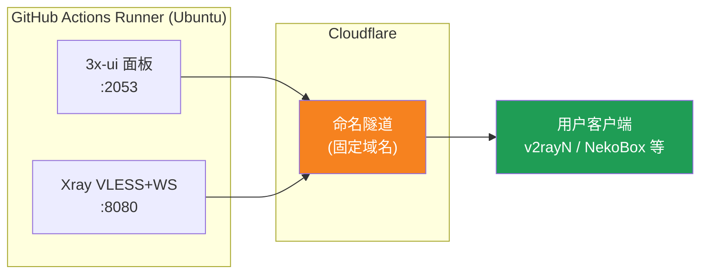
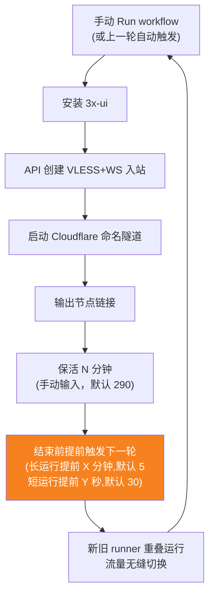
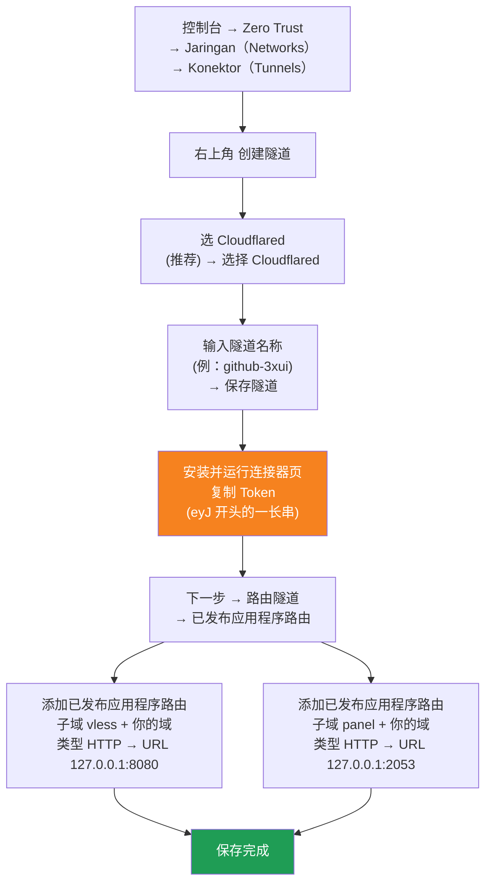

[简体中文](README.md) | [English](README.en.md) | [Русский](README.ru.md) | [日本語](README.ja.md) | [한국어](README.ko.md) | [Español](README.es.md) | [العربية](README.ar.md) | [Čeština](README.cs.md) | [Dansk](README.da.md) | [Deutsch](README.de.md) | [Esperanto](README.eo.md) | [فارسی](README.fa.md) | [Suomi](README.fi.md) | [Français](README.fr.md) | [Ελληνικά](README.gr.md) | [Magyar](README.hu.md) | [Bahasa Indonesia](README.id.md) | [Italiano](README.it.md) | [മലയാളം](README.ml.md) | [Nederlands](README.nl.md) | [Norsk](README.no.md) | [Polski](README.pl.md) | [Português](README.ptbr.md) | [Română](README.ro.md) | [Türkçe](README.tr.md) | [Українська](README.ua.md) | [Tiếng Việt](README.vn.md)

# ☁️ cloud-3xui — Node VLESS Gratis GitHub

Membangun panel 3x-ui + node VLESS secara otomatis di server gratis GitHub Actions, dengan domain tetap dan perpanjangan otomatis saat koneksi terputus.

## Diagram Arsitektur



## Alur Perpanjangan Otomatis



## Perpanjangan otomatis

- **Durasi kamu yang tentukan**: saat Run workflow isi `run_minutes` secara manual, berjalan sesuai menit yang diisi; kosongkan untuk memakai default 290
- **Pewarisan parameter otomatis**: setiap ronde meneruskan `run_minutes` / `countdown_interval` / `countdown_unit` / `overlap_threshold` / `overlap_long` / `overlap_short` ke ronde berikutnya, seluruh rantai memakai nilai awal yang kamu isi
- **Startup tumpang tindih (perpindahan mulus)**: memicu lebih awal ronde berikutnya sebelum ronde saat ini berakhir, runner lama dan baru online bersamaan, tunnel Cloudflare mendukung banyak koneksi, trafik otomatis dialihkan ke koneksi yang tersedia, pengguna hampir tidak merasakan ronde lama keluar. Waktu pemicu dapat dikonfigurasi: keep-alive lebih besar dari `overlap_threshold` (default 5 menit) dihitung sebagai run panjang, dipicu `overlap_long` (default 5 menit) lebih awal; jika lebih kecil dihitung sebagai run pendek, dipicu `overlap_short` (default 30 detik) lebih awal
- Untuk tes cepat isi `5`, pemakaian harian kosongkan saja (290)
- Domain dan UUID tetap, konfigurasi client sekali saja
- Untuk berhenti tekan Cancel di Actions· setelah dibatalkan tidak akan restart otomatis

## Alamat Tetap

| Kegunaan | Alamat |
|------|------|
| Node | `vless.mallow.ccwu.cc:443` (VLESS + WebSocket + TLS) |
| Panel | `https://panel.mallow.ccwu.cc/panel` (nama pengguna `admin`) |

> ⚠️ Domain di atas hanyalah contoh. Untuk mengubahnya, edit variabel `VLESS_HOST` / `PANEL_HOST` di Settings → Secrets and variables → Actions → Variables — tidak perlu mengedit file workflow.

## Pengaturan domain

Domain node dan panel tersimpan di variabel GitHub — tidak perlu mengedit file workflow:

| Variabel | Nilai contoh | Deskripsi |
|----------|--------------|-----------|
| `VLESS_HOST` | `vless.mallow.ccwu.cc` | Alamat node (nama host lengkap) |
| `PANEL_HOST` | `panel.mallow.ccwu.cc` | Alamat panel (nama host lengkap) |

**Cara mengubah**: buka **Settings** → **Secrets and variables** → **Actions** → tab **Variables** → **New repository variable**, lalu isi nama dan nilainya. Perubahan berlaku mulai eksekusi workflow berikutnya.

**Tiga hal yang perlu diperhatikan**:
- Setiap variabel berisi **nama host lengkap** (termasuk awalan subdomain), jadi node dan panel bisa mengarah ke domain yang berbeda — tidak harus memakai domain induk yang sama
- Nilai harus sama dengan Public Hostname yang kamu buat di tunnel Cloudflare pada langkah 1 (`vless` → 127.0.0.1:8080, `panel` → 127.0.0.1:2053), kalau tidak, link tidak akan berfungsi
- Jika suatu variabel belum diatur, banner menampilkan placeholder untuk entri tersebut (`vless.YOUR_DOMAIN` / `panel.YOUR_DOMAIN`)

## Langkah Konfigurasi Detail

### Domain gratis (belum punya domain?)

Belum punya domain sendiri? Anda bisa mendaftarkan satu secara gratis di https://my.dnshe.com/ (misalnya `.ccwu.cc`, berlaku 10 tahun), lalu arahkan NS domain tersebut ke Cloudflare.

### Langkah 1: Membuat named tunnel Cloudflare

Situs resmi Cloudflare: https://www.cloudflare-cn.com (domestik) / https://www.cloudflare.com (internasional)

Dasbor: https://dash.cloudflare.com



Langkah detail:

1. Buka [Cloudflare Dashboard](https://dash.cloudflare.com), lalu dari menu sebelah kiri masuk ke **Zero Trust** → **Jaringan（Networks）** → **Konektor（Tunnels）**
2. Klik tombol **Buat tunnel** di pojok kanan atas
3. **Pilih jenis tunnel**: pilih **Cloudflared** (disarankan), lalu klik **Pilih Cloudflared**
4. **Beri nama tunnel**: masukkan nama (misalnya `github-3xui`), lalu klik **Simpan tunnel**
5. **Instal dan jalankan konektor**: halaman akan menampilkan sebuah perintah instalasi — salin rangkaian panjang yang diawali `eyJ` di dalamnya, yaitu **Token**, dan simpan baik-baik (nanti akan disimpan sebagai GitHub Secret). **Tidak perlu** menginstal apa pun secara lokal — klik Berikutnya untuk melanjutkan
6. **Rute tunnel**: buka tab **Rute aplikasi yang dipublikasikan**, klik **Tambahkan rute aplikasi yang dipublikasikan**, lalu tambahkan dua entri:
   **Pertama (node):** Subdomain `vless`; Domain: pilih domain kamu; Jenis `HTTP`; URL `127.0.0.1:8080`
   **Kedua (panel):** Subdomain `panel`; Domain: pilih domain kamu; Jenis `HTTP`; URL `127.0.0.1:2053`
7. Simpan. Cloudflare akan otomatis membuat catatan DNS, tidak perlu menambahkannya secara manual. Kembali ke daftar Tunnels — jika status tunnel **Sehat (Healthy)**, berarti konfigurasi berhasil.

### Langkah 2: Membuat UUID

1. Buka https://1024tools.com/uuid/
2. Salin UUID yang dihasilkan (seperti `cbfc229f-9d34-4fef-9990-8baa82a7327b`)
3. **Pastikan mencatat UUID ini** — tidak akan tampil sebagai teks biasa di log workflow, dan dibutuhkan setiap kali menyusun link node

### Langkah 3: Menambahkan Secrets dan Variables GitHub

1. Masuk ke repo ini, klik tab **Settings**
2. Di kiri, **Secrets and variables** → **Actions**
3. Klik **New repository secret** di kanan atas, tambahkan ketiganya satu per satu:

   | Name | Secret (nilai) | Keterangan |
   |------|-------------|------|
   | `CF_TUNNEL_TOKEN` | Tunnel Token yang disalin di langkah 1 | Kredensial tunnel Cloudflare |
   | `PANEL_PASSWORD` | Kata sandi panel yang kamu tetapkan | Kata sandi login panel 3x-ui |
   | `VLESS_UUID` | UUID yang dibuat di langkah 2 | UUID node, tetap tidak berubah |

4. Beralih ke tab **Variables**, klik **New repository variable**, dan tambahkan dua variabel (lihat bagian Pengaturan domain di atas):

   | Name | Nilai | Deskripsi |
   |------|-------|-----------|
   | `VLESS_HOST` | `vless.mallow.ccwu.cc` | Alamat node |
   | `PANEL_HOST` | `panel.mallow.ccwu.cc` | Alamat panel |

### Langkah 4: Menjalankan workflow

1. Klik tab **Actions** di bagian atas repo
2. Di kiri pilih **3x-ui VLESS Node**
3. Klik tombol **Run workflow** di kanan
4. Pada formulir yang muncul:
   - **Panel password**: kosongkan (otomatis menggunakan secret `PANEL_PASSWORD`)
     Kata sandi panel (jika dikosongkan menggunakan secret PANEL_PASSWORD)
   - **Run duration**: default `290` (menit), untuk pengujian pertama isi `5` untuk verifikasi cepat
     Durasi berjalan (menit, default 290, maksimal 340)
   - **Countdown output interval**: interval keluaran hitung mundur, default `1`, isi `0` untuk menonaktifkan
     Interval keluaran hitung mundur (default 1, isi 0 untuk menonaktifkan)
   - **Countdown interval unit**: satuan interval hitung mundur, pilih `minutes` atau `seconds` dari dropdown
     Satuan interval keluaran hitung mundur
   - **Overlap threshold**: ambang batas tumpang tindih (menit, default `5`), keep-alive yang lebih lama dari ini dianggap run panjang
     Ambang batas tumpang tindih (menit, default 5): keep-alive yang lebih lama dari ini dianggap run panjang
   - **Overlap long**: menit pemicu awal untuk run panjang (default `5`)
     Menit pemicu awal untuk run panjang (default 5)
   - **Overlap short**: detik pemicu awal untuk run pendek (default `30`)
     Detik pemicu awal untuk run pendek (default 30)
5. Klik tombol hijau **Run workflow** untuk mulai menjalankan

### Langkah 5: Mendapatkan link node

1. Tunggu sekitar 2-3 menit, klik tugas yang sedang berjalan untuk masuk ke halaman detail
2. Perluas langkah **Start named Cloudflare tunnel**, lihat output log:
   ```
   ==================================================
     面板 Panel: https://panel.mallow.ccwu.cc/panel  (admin / 你的面板密码)

     VLESS 节点 node:
     vless://YOUR_UUID@vless.mallow.ccwu.cc:443?encryption=none&security=tls&sni=vless.mallow.ccwu.cc&type=ws&path=%2Fws#GitHub-3xui

     把 YOUR_UUID 换成你在 VLESS_UUID secret 里填的 UUID
     Replace YOUR_UUID with the UUID from your VLESS_UUID secret
     域名：去 Settings → Secrets and variables → Actions → Variables 改 VLESS_HOST / PANEL_HOST 变量
     Domain: set the VLESS_HOST / PANEL_HOST variables in Settings → Secrets and variables → Actions → Variables
   ==================================================
   ```
3. Salin link `vless://`, ganti `YOUR_UUID` dengan UUID milikmu (Domainnya sudah yang asli dari variabelmu — tidak perlu diganti.)
4. Tempel ke klien seperti v2rayN / v2rayNG / Streisand / NekoBox, lalu siap digunakan

### Langkah 6: Verifikasi perpanjangan otomatis (opsional)

1. Pada eksekusi pertama, atur durasi menjadi `5` menit
2. Setelah 5 menit, lihat log langkah terakhir **Trigger next run**, seharusnya menampilkan:
   ```
   HTTP 204
   已触发下一次运行 Next run triggered
   ```
3. Kembali ke daftar Actions, seharusnya muncul eksekusi baru yang terpicu otomatis
4. Setelah memastikan tidak ada masalah, jalankan ulang dan kembalikan durasi ke `290` untuk penggunaan normal

## Penjelasan Langkah Workflow

| Langkah | Indonesia | English | Keterangan |
|------|------|---------|------|
| Install 3x-ui | Menginstal 3x-ui | Install 3x-ui | Menginstal panel secara non-interaktif dengan skrip resmi |
| Create VLESS+WS inbound via API | Membuat inbound VLESS+WS via API | Create VLESS+WS inbound via API | Login dengan API Token, membuat inbound otomatis |
| Start named Cloudflare tunnel | Memulai named tunnel Cloudflare | Start named Cloudflare tunnel | Menghubungkan ke tunnel domain tetap dengan Token |
| Keep alive | Menjaga tetap hidup | Keep alive | Tidur selama menit yang ditentukan, memeriksa status layanan setiap menit, menampilkan hitung mundur sesuai interval yang ditetapkan |
| Trigger next run | Memicu eksekusi berikutnya | Trigger next run | Memanggil API untuk memicu putaran berikutnya secara otomatis |

## Pertanyaan Umum

**Q: UUID pada link node di log tampil sebagai `***`?**
A: Itu mekanisme perlindungan secret GitHub. Cukup ganti `YOUR_UUID` dengan UUID yang kamu isi di secret `VLESS_UUID`.

**Q: Domain di log tampil sebagai `YOUR_DOMAIN`?**
A: Buka Settings → Secrets and variables → Actions → Variables dan buat variabel `VLESS_HOST` / `PANEL_HOST` dengan nama host lengkap; pastikan sama dengan Public Hostname di tunnel Cloudflare kamu.

**Q: Tes klien tidak berhasil (-1)?**
A: Periksa tiga hal: ① apakah UUID diganti dengan benar; ② apakah versi klien cukup baru (v2rayN 7.x+); ③ apakah tunnel Cloudflare terhubung dengan normal (lihat log).

**Q: Restart otomatis tidak terpicu?**
A: Lihat log langkah **Trigger next run**. Jika menampilkan kode status HTTP selain 204, periksa pengaturan izin Actions repo.

**Q: Apakah koneksi akan terputus saat rotasi?**
A: Menggunakan overlapping startup: run berikutnya dipicu sebelum run saat ini berakhir, runner lama dan baru online bersamaan, secara teori tidak terasa. Pada kasus ekstrem (mis. antrean GitHub) mungkin ada fluktuasi singkat, klien akan reconnect otomatis.

**Q: Ingin menghentikan perpanjangan otomatis?**
A: Buka halaman Actions dan Cancel eksekusi yang sedang berjalan, tidak akan terpicu lagi secara otomatis.

## Hal yang Perlu Diperhatikan

- **Kecepatan**: lalu lintas melewati Cloudflare → pusat data GitHub (AS/EU), hanya cocok untuk penggunaan sementara/ringan
- **Perpindahan mulus**: dengan startup tumpang tindih, setiap ronde memicu ronde berikutnya 5 menit lebih awal, runner lama dan baru online bersamaan, secara teori pengguna tidak merasakan apa-apa; dalam kasus ekstrem (mis. antrean GitHub) mungkin ada fluktuasi singkat
- **Kepatuhan**: menjalankan proxy di GitHub Actions berisiko melanggar ToS dan akun diblokir, pertimbangkan sendiri
- **Keamanan**: jangan mempublikasikan `CF_TUNNEL_TOKEN` / `PANEL_PASSWORD` / `VLESS_UUID` di tempat umum
