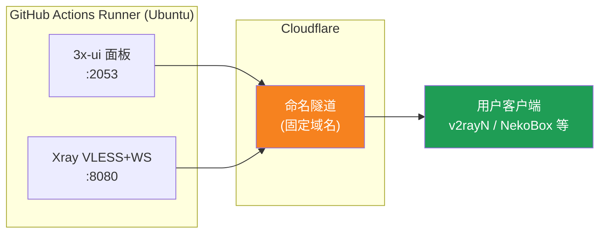
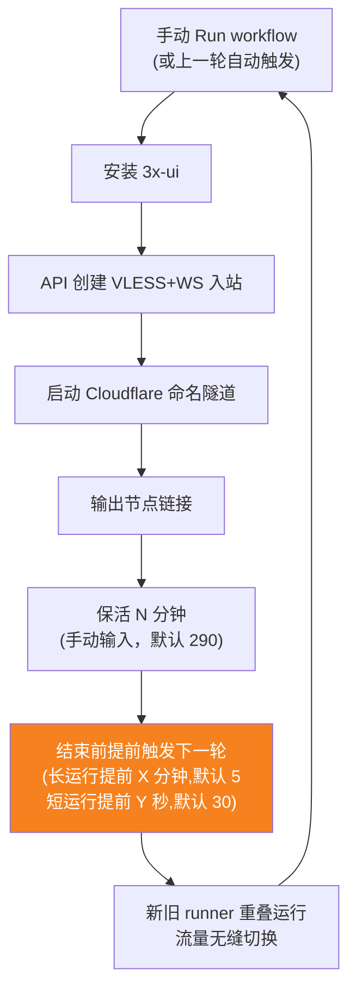
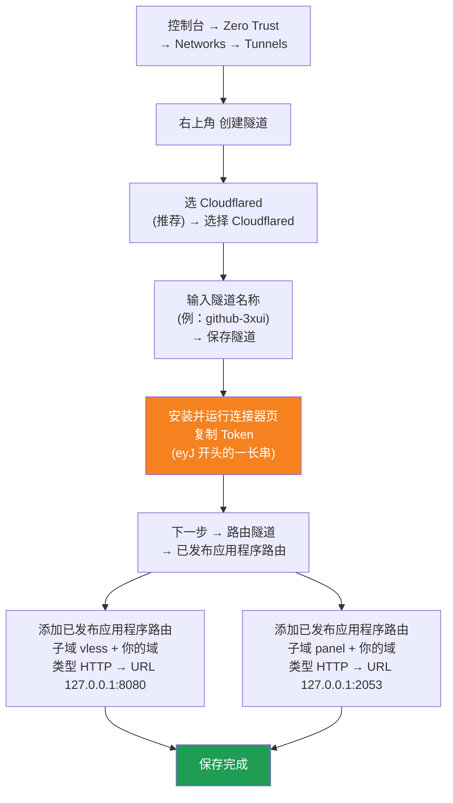

[简体中文](README.md) | [English](README.en.md) | [Русский](README.ru.md) | [日本語](README.ja.md) | [한국어](README.ko.md) | [Español](README.es.md) | [العربية](README.ar.md) | [Čeština](README.cs.md) | [Dansk](README.da.md) | [Deutsch](README.de.md) | [Esperanto](README.eo.md) | [فارسی](README.fa.md) | [Suomi](README.fi.md) | [Français](README.fr.md) | [Ελληνικά](README.gr.md) | [Magyar](README.hu.md) | [Bahasa Indonesia](README.id.md) | [Italiano](README.it.md) | [മലയാളം](README.ml.md) | [Nederlands](README.nl.md) | [Norsk](README.no.md) | [Polski](README.pl.md) | [Português](README.ptbr.md) | [Română](README.ro.md) | [Türkçe](README.tr.md) | [Українська](README.ua.md) | [Tiếng Việt](README.vn.md)

# ☁️ cloud-3xui — Nodo VLESS gratuito su GitHub

Crea automaticamente un pannello 3x-ui + un nodo VLESS sui server gratuiti di GitHub Actions, con dominio fisso e rinnovo automatico in caso di disconnessione.

## Diagramma dell'architettura



## Flusso di rinnovo automatico



## Rinnovo automatico

- **La durata la decidi tu**: quando avvii Run workflow compila manualmente `run_minutes`, dura i minuti inseriti; se lasciato vuoto usa il predefinito 290
- **Ereditarietà automatica dei parametri**: ogni ciclo passa `run_minutes` / `countdown_interval` / `countdown_unit` / `overlap_threshold` / `overlap_long` / `overlap_short` al successivo, l'intera catena usa i valori iniziali inseriti
- **Avvio sovrapposto (passaggio senza interruzioni)**: attiva in anticipo l'esecuzione successiva prima che termini quella corrente, i runner vecchi e nuovi sono online contemporaneamente, il tunnel Cloudflare supporta più connessioni, il traffico viene distribuito automaticamente sulle connessioni disponibili, l'utente quasi non percepisce l'uscita del vecchio ciclo. Il momento di attivazione è configurabile: un keep-alive maggiore di `overlap_threshold` (predefinito 5 minuti) è considerato un'esecuzione lunga, attivata in anticipo di `overlap_long` (predefinito 5 minuti); se minore è considerata esecuzione breve, attivata in anticipo di `overlap_short` (predefinito 30 secondi)
- Per un test rapido inserisci `5`, per l'uso quotidiano lascia vuoto (290)
- Dominio e UUID sono fissi, configura il client una sola volta
- Per fermarlo premi Cancel in Actions· dopo l'annullamento non si riavvierà da solo

## Indirizzi fissi

| Uso | Indirizzo |
|------|------|
| Nodo | `vless.mallow.ccwu.cc:443` (VLESS + WebSocket + TLS) |
| Pannello | `https://panel.mallow.ccwu.cc/panel` (nome utente `admin`) |

> ⚠️ I domini sopra sono esempi, sostituiscili con i tuoi.

## Passaggi di configurazione dettagliati

### Dominio gratuito (non hai un dominio?)

Non hai un tuo dominio? Puoi registrarne uno gratis su https://my.dnshe.com/ (es. `.ccwu.cc`, valido 10 anni), poi punta i server dei nomi (NS) del dominio su Cloudflare.

### Primo passo: creare un named tunnel su Cloudflare

Sito ufficiale di Cloudflare: https://www.cloudflare-cn.com (nazionale) / https://www.cloudflare.com (internazionale)

Dashboard: https://dash.cloudflare.com



Passaggi dettagliati:

1. Apri la [Cloudflare Dashboard](https://dash.cloudflare.com) e dal menu a sinistra vai su **Zero Trust** → **Networks** → **Tunnels**
2. Fai clic in alto a destra su **Crea tunnel**
3. **Seleziona il tipo di tunnel**: scegli **Cloudflared** (consigliato) e fai clic su **Seleziona Cloudflared**
4. **Assegna un nome al tunnel**: inserisci un nome (ad esempio `github-3xui`) e fai clic su **Salva tunnel**
5. **Installa ed esegui il connettore**: la pagina mostrerà un comando di installazione — copia la lunga stringa che inizia con `eyJ` al suo interno, ovvero il **Token**, e conservala con cura (la salverai in seguito come GitHub Secret). **Non è necessario** installare nulla in locale — fai clic su Avanti per continuare
6. **Instrada il tunnel**: apri la scheda **Route app pubblicate** e fai clic su **Aggiungi route app pubblicata**, quindi aggiungi due voci:
   **Prima (nodo):** Sottodominio `vless`; Dominio: seleziona il tuo dominio; Tipo `HTTP`; URL `127.0.0.1:8080`
   **Seconda (pannello):** Sottodominio `panel`; Dominio: seleziona il tuo dominio; Tipo `HTTP`; URL `127.0.0.1:2053`
7. Salva. Cloudflare creerà automaticamente i record DNS, non è necessario aggiungerli manualmente. Torna all'elenco Tunnels — se lo stato del tunnel è **Integro (Healthy)**, la configurazione è riuscita.

### Secondo passo: generare un UUID

1. Apri https://1024tools.com/uuid/
2. Copia l'UUID generato (come `cbfc229f-9d34-4fef-9990-8baa82a7327b`)
3. **Assicurati di annotare questo UUID** — non verrà mostrato in chiaro nei log del workflow e ti servirà ogni volta che componi il link del nodo

### Terzo passo: aggiungere i Secrets su GitHub

1. Entra in questo repository e clicca sulla scheda **Settings**
2. A sinistra, **Secrets and variables** → **Actions**
3. Clicca su **New repository secret** in alto a destra e aggiungi i tre secrets in sequenza:

   | Name | Secret (valore) | Descrizione |
   |------|-------------|------|
   | `CF_TUNNEL_TOKEN` | Il Tunnel Token copiato al primo passo | Credenziale del tunnel Cloudflare |
   | `PANEL_PASSWORD` | La password del pannello che hai impostato | Password di accesso al pannello 3x-ui |
   | `VLESS_UUID` | L'UUID generato al secondo passo | UUID del nodo, fisso e invariabile |

### Quarto passo: eseguire il workflow

1. Clicca sulla scheda **Actions** in alto nel repository
2. A sinistra seleziona **3x-ui VLESS Node**
3. Clicca sul pulsante **Run workflow** a destra
4. Nel modulo che appare:
   - **Panel password**: lascia vuoto (verrà usato automaticamente il secret `PANEL_PASSWORD`)
     Password del pannello (se vuota usa il secret PANEL_PASSWORD)
   - **Run duration**: predefinito `290` (minuti), per il primo test puoi inserire `5` per una verifica rapida
     Durata di esecuzione (minuti, predefinito 290, massimo 340)
   - **Countdown output interval**: intervallo di output del conto alla rovescia, predefinito `1`, inserire `0` per disabilitare
     Intervallo di output del conto alla rovescia (predefinito 1, 0 per disabilitare)
   - **Countdown interval unit**: unità dell'intervallo del conto alla rovescia, selezionare `minutes` o `seconds` dal menu a tendina
     Unità dell'intervallo di output del conto alla rovescia
   - **Overlap threshold**: soglia di sovrapposizione (minuti, predefinito `5`), un keep-alive più lungo è considerato un'esecuzione lunga
     Soglia di sovrapposizione (minuti, predefinito 5): un keep-alive più lungo è considerato un'esecuzione lunga
   - **Overlap long**: minuti di attivazione anticipata per esecuzioni lunghe (predefinito `5`)
     Minuti di attivazione anticipata per esecuzioni lunghe (predefinito 5)
   - **Overlap short**: secondi di attivazione anticipata per esecuzioni brevi (predefinito `30`)
     Secondi di attivazione anticipata per esecuzioni brevi (predefinito 30)
5. Clicca sul pulsante verde **Run workflow** per avviare

### Quinto passo: ottenere il link del nodo

1. Attendi circa 2-3 minuti e clicca sull'attività in esecuzione per entrare nella pagina dei dettagli
2. Espandi il passo **Start named Cloudflare tunnel** e guarda l'output del log:
   ```
   ==================================================
     面板 Panel: https://panel.mallow.ccwu.cc/panel  (admin / 你的面板密码)

     VLESS 节点 node:
     vless://YOUR_UUID@vless.mallow.ccwu.cc:443?encryption=none&security=tls&sni=vless.mallow.ccwu.cc&type=ws&path=%2Fws#GitHub-3xui

     把 YOUR_UUID 换成你在 VLESS_UUID secret 里填的 UUID
     Replace YOUR_UUID with the UUID from your VLESS_UUID secret
     域名：去 Settings → Secrets and variables → Actions → Variables 改 VLESS_HOST / PANEL_HOST 变量
     Domain: set the VLESS_HOST / PANEL_HOST variables in Settings → Secrets and variables → Actions → Variables
   ==================================================
   ```
3. Copia il link `vless://` e sostituisci `YOUR_UUID` con il tuo UUID
4. Incollalo in un client come v2rayN / v2rayNG / Streisand / NekoBox ed è pronto all'uso

### Sesto passo: verificare il rinnovo automatico (facoltativo)

1. Alla prima esecuzione imposta la durata a `5` minuti
2. Dopo 5 minuti guarda il log dell'ultimo passo **Trigger next run**, dovrebbe mostrare:
   ```
   HTTP 204
   已触发下一次运行 Next run triggered
   ```
3. Torna alla lista Actions, dovrebbe apparire una nuova esecuzione attivata automaticamente
4. Dopo aver verificato che tutto funzioni, esegui di nuovo e riporta la durata a `290` per l'uso normale

## Descrizione dei passaggi del workflow

| Passo | Italiano | English | Descrizione |
|------|------|---------|------|
| Install 3x-ui | Installare 3x-ui | Install 3x-ui | Installa il pannello in modo non interattivo con lo script ufficiale |
| Create VLESS+WS inbound via API | Creare l'inbound VLESS+WS via API | Create VLESS+WS inbound via API | Accede con l'API Token, crea automaticamente l'inbound |
| Start named Cloudflare tunnel | Avviare il named tunnel di Cloudflare | Start named Cloudflare tunnel | Connette il tunnel a dominio fisso usando il Token |
| Keep alive | Mantenere attivo | Keep alive | Sospende per i minuti specificati, controlla lo stato dei servizi ogni minuto, mostra il conto alla rovescia all'intervallo impostato |
| Trigger next run | Attivare l'esecuzione successiva | Trigger next run | Chiama l'API per avviare automaticamente il round successivo |

## Domande frequenti

**Q: L'UUID nel link del nodo appare come `***` nel log?**
A: È il meccanismo di protezione dei secrets di GitHub. Sostituisci semplicemente `YOUR_UUID` con l'UUID che hai inserito nel secret `VLESS_UUID`.

**Q: Il test del client fallisce (-1)?**
A: Controlla tre cose: ① che l'UUID sia stato sostituito correttamente; ② che la versione del client sia abbastanza recente (v2rayN 7.x+); ③ che il tunnel Cloudflare sia connesso correttamente (guarda il log).

**Q: Il riavvio automatico non si è attivato?**
A: Guarda il log del passo **Trigger next run**. Se mostra un codice di stato HTTP diverso da 204, controlla le impostazioni dei permessi Actions del repository.

**Q: Ci saranno disconnessioni durante il passaggio?**
A: Usiamo l'avvio sovrapposto: il round successivo viene avviato prima della fine di quello corrente, i runner vecchi e nuovi sono online contemporaneamente, in teoria impercettibile. In casi estremi (es. coda GitHub) potrebbero esserci brevi fluttuazioni, il client si riconnetterà automaticamente.

**Q: Vuoi fermare il rinnovo automatico?**
A: Vai alla pagina Actions e fai Cancel sull'esecuzione corrente, non si riattiverà più automaticamente.

## Note

- **Velocità**: il traffico passa per Cloudflare → i data center di GitHub (USA/UE), adatto solo a un uso temporaneo/leggero
- **Passaggio senza interruzioni**: con avvio sovrapposto, ogni ciclo avvia il successivo 5 minuti prima, vecchio e nuovo runner online contemporaneamente, teoricamente l'utente non percepisce nulla; in casi estremi (es. coda GitHub) possono esserci brevi fluttuazioni
- **Conformità**: eseguire un proxy su GitHub Actions può violare i ToS con il rischio di ban dell'account, valuta tu stesso
- **Sicurezza**: non pubblicare `CF_TUNNEL_TOKEN` / `PANEL_PASSWORD` / `VLESS_UUID` in luoghi pubblici
