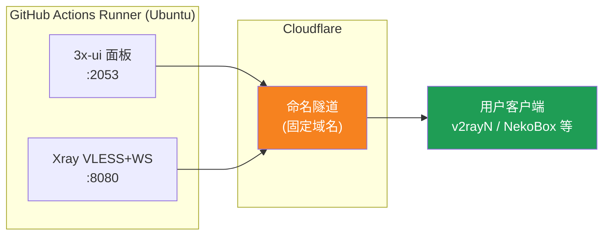
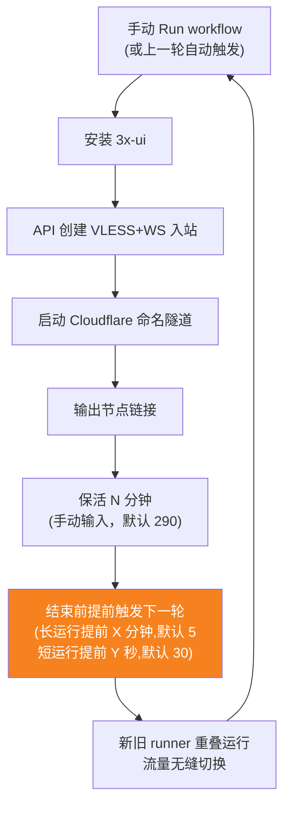
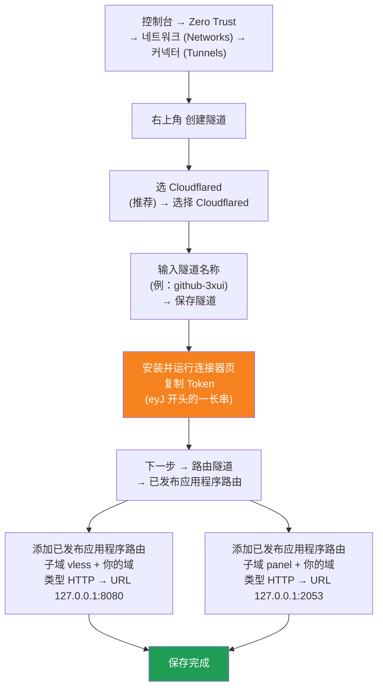

[简体中文](README.md) | [English](README.en.md) | [Русский](README.ru.md) | [日本語](README.ja.md) | [한국어](README.ko.md) | [Español](README.es.md) | [العربية](README.ar.md) | [Čeština](README.cs.md) | [Dansk](README.da.md) | [Deutsch](README.de.md) | [Esperanto](README.eo.md) | [فارسی](README.fa.md) | [Suomi](README.fi.md) | [Français](README.fr.md) | [Ελληνικά](README.gr.md) | [Magyar](README.hu.md) | [Bahasa Indonesia](README.id.md) | [Italiano](README.it.md) | [മലയാളം](README.ml.md) | [Nederlands](README.nl.md) | [Norsk](README.no.md) | [Polski](README.pl.md) | [Português](README.ptbr.md) | [Română](README.ro.md) | [Türkçe](README.tr.md) | [Українська](README.ua.md) | [Tiếng Việt](README.vn.md)

# ☁️ cloud-3xui — GitHub 무료 VLESS 노드

GitHub Actions 무료 서버에 3x-ui 패널 + VLESS 노드를 자동으로 구축합니다. 고정 도메인을 사용하고, 연결이 끊기면 자동으로 복구됩니다.

## 아키텍처



## 자동 복구 흐름



## 자동 복구

- **킵얼라이브 시간은 직접 정합니다**: Run workflow를 클릭할 때 `run_minutes`를 수동으로 입력합니다. 입력한 만큼 분 단위로 실행되며, 비워 두면 기본값 290을 사용합니다
- **매개변수 자동 상속**: 각 라운드는 API를 통해 `run_minutes` / `countdown_interval` / `countdown_unit` / `overlap_threshold` / `overlap_long` / `overlap_short`을 다음 라운드에 전달하므로, 전체 체인에서 처음 입력한 값이 계속 사용됩니다
- 잠깐 테스트하려면 `5`를 입력하고, 일상적으로 사용할 때는 비워 두어 기본값 290으로 사용합니다
- **중첩 시작 (끊김 없는 전환)**: 현재 라운드 종료 전에 다음 라운드를 미리 시작합니다. 기존 runner와 새 runner가 동시에 실행되고, Cloudflare 터널은 다중 연결을 지원하므로 트래픽이 자동으로 사용 가능한 연결로 분산되어, 기존 라운드 종료를 사용자가 거의 느끼지 못합니다. 시작 시점은 설정 가능합니다: keep-alive가 `overlap_threshold`(기본값 5분)보다 길면 장시간 라운드로 간주되어 `overlap_long`(기본값 5분) 전에 시작하고, 그보다 짧으면 단시간 라운드로 간주되어 `overlap_short`(기본값 30초) 전에 시작합니다
- 도메인과 UUID는 고정되어 있어 클라이언트는 한 번 설정하면 계속 사용할 수 있습니다
- 중지하려면 Actions에서 Cancel을 클릭하면 됩니다. 취소 후에는 자동으로 다시 시작되지 않습니다


## 고정 주소

| 용도 | 주소 |
|------|------|
| 노드 | `vless.mallow.ccwu.cc:443` (VLESS + WebSocket + TLS) |
| 패널 | `https://panel.mallow.ccwu.cc/panel` (사용자 이름 `admin`) |

> ⚠️ 위 도메인은 예시입니다. 변경하려면 Settings → Secrets and variables → Actions → Variables에서 `VLESS_HOST` / `PANEL_HOST` 두 변수를 편집하세요. 워크플로 파일을 편집할 필요는 없습니다.

## 도메인 설정

노드와 패널의 도메인은 GitHub 변수에 저장되어 있으며, 워크플로 파일을 편집할 필요가 없습니다.

| 변수 | 예시 값 | 설명 |
|------|---------|------|
| `VLESS_HOST` | `vless.mallow.ccwu.cc` | 노드 주소(전체 호스트 이름) |
| `PANEL_HOST` | `panel.mallow.ccwu.cc` | 패널 주소(전체 호스트 이름) |

**변경 방법**: **Settings** → **Secrets and variables** → **Actions** → **Variables** 탭 → **New repository variable**에서 이름과 값을 입력합니다. 변경 사항은 다음 워크플로 실행부터 적용됩니다.

**참고 사항 3가지**:
- 각 변수에는 **전체 호스트 이름**(서브도메인 접두사 포함)이 들어가므로, 노드와 패널은 서로 다른 도메인을 가리킬 수 있으며, 같은 상위 도메인일 필요는 없습니다
- 값은 1단계에서 Cloudflare 터널에 만든 퍼블릭 호스트 이름(Public Hostname)과 일치해야 합니다(`vless` → 127.0.0.1:8080, `panel` → 127.0.0.1:2053). 일치하지 않으면 링크가 동작하지 않습니다
- 변수가 설정되지 않은 경우, 배너에는 해당 항목의 자리 표시자(`vless.YOUR_DOMAIN` / `panel.YOUR_DOMAIN`)가 표시됩니다

## 상세 설정 단계

### 무료 도메인 (도메인이 없으신가요?)

자체 도메인이 없으신가요? https://my.dnshe.com/ 에서 무료로 신청하세요 (예: `.ccwu.cc`, 유효기간 10년). 그 다음 도메인의 NS를 Cloudflare로 이전하면 됩니다.

### 1단계: Cloudflare에서 이름 있는 터널 만들기


Cloudflare 공식 사이트: https://www.cloudflare-cn.com (중국) / https://www.cloudflare.com (국제)
대시보드: https://dash.cloudflare.com



상세 단계:

1. [Cloudflare Dashboard](https://dash.cloudflare.com)를 열고 왼쪽 메뉴에서 **Zero Trust** → **네트워크 (Networks)** → **커넥터 (Tunnels)**로 이동
2. 오른쪽 위의 **Create a tunnel** 클릭
3. **터널 유형 선택**: **Cloudflared**(권장)를 선택하고 **Select Cloudflared** 클릭
4. **터널 이름 지정**: 이름(예: `github-3xui`)을 입력하고 **Save tunnel** 클릭
5. **커넥터 설치 및 실행**: 페이지에 설치 명령이 표시되면 `eyJ`로 시작하는 긴 **Token**을 복사해 저장(나중에 GitHub Secret에 등록). 로컬에 설치할 **필요 없음**. 다음으로 진행
6. **터널 라우팅**: **Public hostnames** 탭에서 **Add a public hostname**을 클릭해 2개를 추가:

   **첫 번째(노드):**
   - 서브도메인: `vless`
   - 도메인: 자신의 도메인 선택
   - 유형: `HTTP`
   - URL: `127.0.0.1:8080`

   **두 번째(패널):**
   - 서브도메인: `panel`
   - 도메인: 자신의 도메인 선택
   - 유형: `HTTP`
   - URL: `127.0.0.1:2053`
7. 저장. Cloudflare가 DNS 레코드를 자동으로 생성. 커넥터 (Tunnels) 목록에서 상태가 **Healthy**이면 설정 성공.


### 2단계: UUID 생성

1. https://1024tools.com/uuid/ 를 엽니다
2. 생성된 UUID를 복사합니다(예: `cbfc229f-9d34-4fef-9990-8baa82a7327b`)
3. **이 UUID를 꼭 기억해 두세요**. 워크플로 로그에는 평문으로 표시되지 않으며, 노드 링크를 만들 때마다 필요합니다

### 3단계: GitHub에 Secrets 및 Variables 추가

1. 이 저장소를 열고 **Settings** 탭을 클릭합니다
2. 왼쪽 **Secrets and variables** → **Actions**로 들어갑니다
3. 오른쪽 위의 **New repository secret**을 클릭하고 다음 3개를 추가합니다:

   | Name | Secret(값) | 설명 |
   |------|-----------|------|
   | `CF_TUNNEL_TOKEN` | 1단계에서 복사한 Tunnel Token | Cloudflare 터널 자격 증명 |
   | `PANEL_PASSWORD` | 직접 정한 패널 비밀번호 | 3x-ui 패널 로그인 비밀번호 |
   | `VLESS_UUID` | 2단계에서 생성한 UUID | 노드 UUID, 변경되지 않음 |

4. **Variables** 탭으로 전환하여 **New repository variable**을 클릭하고 두 개의 변수를 추가합니다(위의 도메인 설정 섹션 참조):

   | Name | 값 | 설명 |
   |------|----|------|
   | `VLESS_HOST` | `vless.mallow.ccwu.cc` | 노드 주소 |
   | `PANEL_HOST` | `panel.mallow.ccwu.cc` | 패널 주소 |

### 4단계: 워크플로 실행

1. 저장소 상단의 **Actions** 탭을 클릭합니다
2. 왼쪽에서 **3x-ui VLESS Node**를 선택합니다
3. 오른쪽의 **Run workflow** 버튼을 클릭합니다
4. 팝업 폼에서:
   - **Panel password**: 비워 두기(`PANEL_PASSWORD` secret 자동 사용)
     패널 비밀번호(비워 두면 PANEL_PASSWORD secret 사용)
   - **Run duration**: 기본값 `290`(분). 처음 테스트할 때는 `5`를 입력해 빠르게 검증 가능하고, 일상적으로 사용할 때는 비워 두면 됩니다
   - **Countdown output interval**: 카운트다운 출력 간격, 기본값 `1`, `0` 입력 시 비활성화
   - **Countdown interval unit**: 카운트다운 출력 간격 단위, 드롭다운에서 `minutes` 또는 `seconds` 선택
   - **Overlap threshold**: 중첩 시작 임계값(분, 기본값 `5`) — keep-alive가 이보다 길면 장시간 라운드로 간주
   - **Overlap long**: 장시간 라운드에서 종료 몇 분 전에 다음 라운드를 시작할지(기본값 `5`)
   - **Overlap short**: 단시간 라운드에서 종료 몇 초 전에 다음 라운드를 시작할지(기본값 `30`)
     실행 시간(분, 기본값 290, 최대 340)
5. 녹색 **Run workflow** 버튼을 클릭해 실행합니다

### 5단계: 노드 링크 가져오기

1. 약 2~3분 기다린 뒤 실행 중인 작업을 클릭해 상세 페이지로 들어갑니다
2. **Start named Cloudflare tunnel** 단계를 펼쳐 로그 출력을 확인합니다:
   ```
   ==================================================
     面板 Panel: https://panel.mallow.ccwu.cc/panel  (admin / 你的面板密码)

     VLESS 节点 node:
     vless://YOUR_UUID@vless.mallow.ccwu.cc:443?encryption=none&security=tls&sni=vless.mallow.ccwu.cc&type=ws&path=%2Fws#GitHub-3xui

     把 YOUR_UUID 换成你在 VLESS_UUID secret 里填的 UUID
     Replace YOUR_UUID with the UUID from your VLESS_UUID secret
     域名：去 Settings → Secrets and variables → Actions → Variables 改 VLESS_HOST / PANEL_HOST 变量
     Domain: set the VLESS_HOST / PANEL_HOST variables in Settings → Secrets and variables → Actions → Variables
   ==================================================
   ```
3. `vless://` 링크를 복사하고 `YOUR_UUID`를 자신의 UUID로 바꿉니다 (도메인은 이미 변수에서 가져온 실제 도메인이므로 바꿀 필요가 없습니다.)
4. v2rayN / v2rayNG / Streisand / NekoBox 등 클라이언트에 붙여넣으면 사용할 수 있습니다

### 6단계: 자동 복구 확인(선택)

1. 처음 실행할 때는 시간을 `5`분으로 설정합니다
2. 5분 후 마지막 **Trigger next run** 단계의 로그를 확인합니다. 다음과 같이 표시되어야 합니다:
   ```
   HTTP 204
   已触发下一次运行 Next run triggered
   ```
3. Actions 목록으로 돌아가면 새로 자동 트리거된 실행이 나타납니다
4. 확인 후 시간을 `290`으로 되돌려 다시 실행하면 정상적으로 사용할 수 있습니다

## 워크플로 단계 설명

| 단계 | 中文 | English | 설명 |
|------|------|---------|------|
| Install 3x-ui | 安装 3x-ui | Install 3x-ui | 공식 스크립트로 패널을 비대화식으로 설치 |
| Create VLESS+WS inbound via API | 通过 API 创建 VLESS+WS 入站 | Create VLESS+WS inbound via API | API Token으로 로그인하고 인바운드를 자동 생성 |
| Start named Cloudflare tunnel | 启动 Cloudflare 命名隧道 | Start named Cloudflare tunnel | Token으로 고정 도메인 터널에 연결 |
| Keep alive | 保活 | Keep alive | 지정된 분만큼 대기하며 서비스 상태를 모니터링하고, 설정된 간격으로 카운트다운 출력 |
| Trigger next run | 触发下一次运行 | Trigger next run | API를 호출해 다음 라운드를 자동 시작 |

## 자주 묻는 질문

**Q: 로그의 노드 링크에서 UUID가 `***`로 표시되나요?**
A: GitHub의 secret 보호 기능 때문입니다. `YOUR_UUID`를 `VLESS_UUID` secret에 입력한 자신의 UUID로 바꾸면 됩니다.

**Q: 로그에 도메인이 `YOUR_DOMAIN`으로 표시되나요?**
A: Settings → Secrets and variables → Actions → Variables에서 전체 호스트 이름으로 `VLESS_HOST` / `PANEL_HOST` 변수를 만드세요. Cloudflare 터널의 퍼블릭 호스트 이름과 일치하는지 확인하세요.

**Q: 클라이언트 테스트가 실패하나요(-1)?**
A: 세 가지를 확인하세요: ① UUID가 올바르게 교체되었는지; ② 클라이언트 버전이 충분히 최신인지(v2rayN 7.x+); ③ Cloudflare 터널이 정상적으로 연결되었는지(로그 확인).

**Q: 자동 재시작이 트리거되지 않나요?**
A: **Trigger next run** 단계의 로그를 확인하세요. 204가 아닌 HTTP 상태 코드가 표시되면 저장소의 Actions 권한 설정을 확인하세요.

**Q: 로테이션 시 연결이 끊기나요?**
A: 중첩 시작 방식을 사용합니다. 현재 라운드 종료 전에 다음 라운드를 미리 실행하고, 이전/새 runner가 동시에 온라인 상태이므로 이론상 끊김이 없습니다. GitHub 대기열 등 극단적인 상황에서는 잠시 변동이 있을 수 있으며, 클라이언트는 자동으로 재연결됩니다.

**Q: 자동 복구를 중지하려면 어떻게 하나요?**
A: Actions 페이지에서 현재 실행을 Cancel 하면 됩니다. 자동으로 다시 트리거되지 않습니다.

## 주의 사항

- **속도**: 트래픽이 Cloudflare → GitHub 데이터센터(미국/유럽)를 경유하므로 임시/가벼운 용도로만 적합합니다
- **끊김 없는 전환**: 중첩 시작 방식을 사용합니다. 각 라운드 종료 5분 전에 다음 라운드를 미리 시작하고, 기존 runner와 새 runner가 동시에 온라인 상태가 되므로 이론상 사용자는 아무것도 느끼지 못합니다. 극단적인 경우(GitHub 대기열 등)에는 짧은 변동이 있을 수 있습니다
- **규정 준수**: GitHub Actions에서 프록시를 실행하면 ToS 위반으로 계정이 정지될 위험이 있으니 스스로 판단하세요
- **보안**: `CF_TUNNEL_TOKEN` / `PANEL_PASSWORD` / `VLESS_UUID`를 공개된 곳에 올리지 마세요
