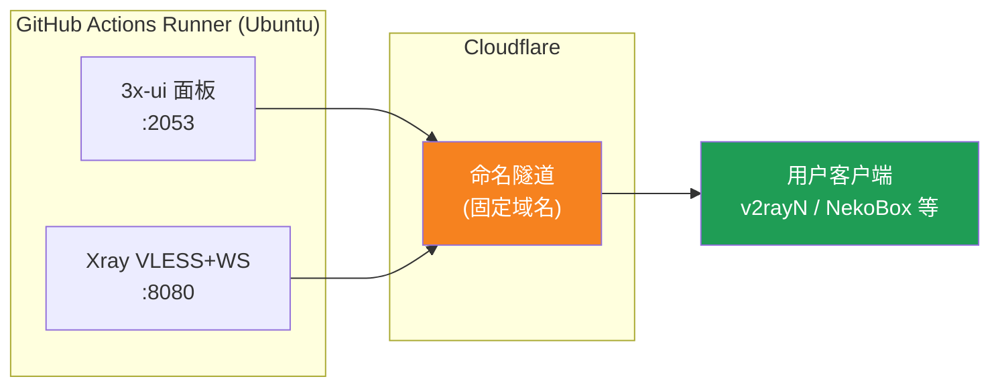
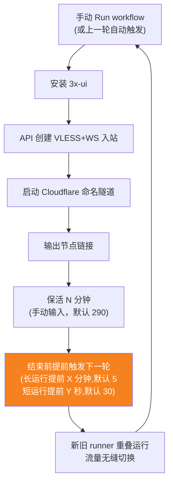
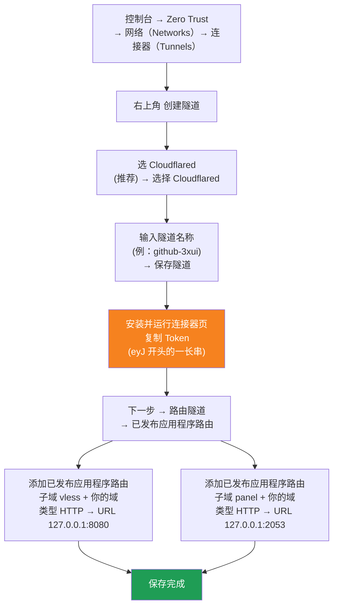

[简体中文](README.md) | [English](README.en.md) | [Русский](README.ru.md) | [日本語](README.ja.md) | [한국어](README.ko.md) | [Español](README.es.md) | [العربية](README.ar.md) | [Čeština](README.cs.md) | [Dansk](README.da.md) | [Deutsch](README.de.md) | [Esperanto](README.eo.md) | [فارسی](README.fa.md) | [Suomi](README.fi.md) | [Français](README.fr.md) | [Ελληνικά](README.gr.md) | [Magyar](README.hu.md) | [Bahasa Indonesia](README.id.md) | [Italiano](README.it.md) | [മലയാളം](README.ml.md) | [Nederlands](README.nl.md) | [Norsk](README.no.md) | [Polski](README.pl.md) | [Português](README.ptbr.md) | [Română](README.ro.md) | [Türkçe](README.tr.md) | [Українська](README.ua.md) | [Tiếng Việt](README.vn.md)

# ☁️ cloud-3xui — GitHub 免费 VLESS 节点

用 GitHub Actions 的免费服务器自动搭建 3x-ui 面板 + VLESS 节点，固定域名，断线自动续命。

## 架构图



## 自动续命流程



## 自动续命

- **保活时长由你定**：点 Run workflow 时手动填写 `run_minutes`，填多少就跑多少分钟；留空则用默认值 290
- **参数自动继承**：每轮触发下一轮时会把所有输入参数都传过去（`run_minutes` / `countdown_interval` / `countdown_unit` / `overlap_threshold` / `overlap_long` / `overlap_short`），整条链沿用你最初填的值
- 想临时测一下就填 `5`，日常用留空走默认 290
- **重叠启动（无缝切换）**：本轮结束前提前触发下一轮，新旧两个 runner 同时在线，Cloudflare 隧道支持多连接，流量自动分到可用的连接上，旧轮退出时用户侧基本无感。触发时机可配：保活大于 `overlap_threshold`（默认 5 分钟）算长运行，提前 `overlap_long`（默认 5 分钟）触发；小于则算短运行，提前 `overlap_short`（默认 30 秒）触发
- 域名、UUID 都固定，客户端配置一次永久有效
- 想停止就去 Actions 点 Cancel，取消后不会自动重启

## 固定地址

| 用途 | 地址 |
|------|------|
| 节点 | `vless.mallow.ccwu.cc:443`（VLESS + WebSocket + TLS） |
| 面板 | `https://panel.mallow.ccwu.cc/panel`（用户名 `admin`） |

> ⚠️ 上面的域名是示例。改域名去 Settings → Secrets and variables → Actions → Variables 里改 `VLESS_HOST` / `PANEL_HOST` 两个变量，不用改工作流文件。

## 域名配置

节点和面板的域名存在 GitHub 变量里，改域名不用改工作流文件：

| 变量 | 示例值 | 说明 |
|------|--------|------|
| `VLESS_HOST` | `vless.mallow.ccwu.cc` | 节点地址（完整主机名） |
| `PANEL_HOST` | `panel.mallow.ccwu.cc` | 面板地址（完整主机名） |

**怎么改**：仓库 **Settings** → 左侧 **Secrets and variables** → **Actions** → **Variables** 页签 → **New repository variable**，填名字和值。改完下次运行工作流自动生效。

**注意三点**：
- 两个变量存的是**完整主机名**（含子域名前缀），节点和面板可以指向不同的域名，不必是同一个父域名
- 变量里填的必须和第一步在 Cloudflare 隧道里建的 Public Hostname 一致（`vless` → 127.0.0.1:8080，`panel` → 127.0.0.1:2053），两边对不上链接打不开
- 哪个变量没填，日志横幅里那一项就显示占位符（`vless.YOUR_DOMAIN` / `panel.YOUR_DOMAIN`）

## 详细配置步骤

### 免费域名（没有域名看这里）

没有自己的域名？可以去 https://my.dnshe.com/ 免费申请一个（如 `.ccwu.cc`，有效期 10 年），然后把域名的 NS 托管到 Cloudflare 即可。

### 第一步：Cloudflare 创建命名隧道

Cloudflare 官网：https://www.cloudflare-cn.com （国内）/ https://www.cloudflare.com （国际）
控制台：https://dash.cloudflare.com



详细步骤：

1. 打开 [Cloudflare Dashboard](https://dash.cloudflare.com)，左侧菜单进入 **Zero Trust** → **网络（Networks）** → **连接器（Tunnels）**
2. 点击右上角 **创建隧道**
3. **选择隧道类型**：选 **Cloudflared**（推荐），点击 **选择 Cloudflared**
4. **为隧道命名**：输入名称（例如 `github-3xui`），点击 **保存隧道**
5. **安装并运行连接器**：页面会显示一条安装命令，复制其中 `eyJ` 开头的一长串 **Token**，保存好（后面存到 GitHub Secret 用）。**不需要**在本地安装，点下一步继续
6. **路由隧道**：进入 **已发布应用程序路由** 标签页，点击 **添加已发布应用程序路由**，添加两条：

   **第一条（节点）：**
   - 子域名：`vless`
   - 域：选择你的域名
   - 类型：`HTTP`
   - URL：`127.0.0.1:8080`

   **第二条（面板）：**
   - 子域名：`panel`
   - 域：选择你的域名
   - 类型：`HTTP`
   - URL：`127.0.0.1:2053`

7. 保存。Cloudflare 会自动创建 DNS 解析，无需手动添加。回到连接器列表能看到隧道状态为 **正常** 即配置成功。

### 第二步：生成 UUID

1. 打开 https://1024tools.com/uuid/
2. 复制生成的 UUID（形如 `cbfc229f-9d34-4fef-9990-8baa82a7327b`）
3. **务必记好这个 UUID**，工作流日志里不会明文显示，每次拼接节点链接都要用它

### 第三步：GitHub 添加 Secrets 和 Variables

1. 进入本仓库，点击 **Settings** 标签页
2. 左侧 **Secrets and variables** → **Actions**
3. 点击右上角 **New repository secret**，依次添加三个：

   | Name | Secret（值） | 说明 |
   |------|-------------|------|
   | `CF_TUNNEL_TOKEN` | 第一步复制的 Tunnel Token | Cloudflare 隧道凭证 |
   | `PANEL_PASSWORD` | 你设定的面板密码 | 3x-ui 面板登录密码 |
   | `VLESS_UUID` | 第二步生成的 UUID | 节点 UUID，固定不变 |

4. 切换到 **Variables** 页签，点击 **New repository variable**，添加两个变量（域名配置见 [域名配置](#域名配置)）：

   | Name | 值 | 说明 |
   |------|----|------|
   | `VLESS_HOST` | `vless.mallow.ccwu.cc` | 节点地址 |
   | `PANEL_HOST` | `panel.mallow.ccwu.cc` | 面板地址 |

### 第四步：运行工作流

1. 点击仓库顶部的 **Actions** 标签页
2. 左侧选择 **3x-ui VLESS Node**
3. 点击右侧 **Run workflow** 按钮
4. 在弹出的表单中：
   - **Panel password**：留空（自动使用 `PANEL_PASSWORD` secret）
     面板密码（留空则使用 PANEL_PASSWORD secret）
   - **Run duration**：默认 `290`（分钟），首次测试可填 `5` 快速验证；日常使用留空即可
     运行时长（分钟，默认 290，最多 340）
   - **Countdown output interval**：倒计时输出间隔，默认 `1`，填 `0` 关闭
     倒计时输出间隔（默认 1，填 0 关闭）
   - **Countdown interval unit**：倒计时输出间隔单位，下拉选择 `minutes` 或 `seconds`
     倒计时输出间隔单位
   - **Overlap threshold**：重叠阈值（分钟，默认 `5`），保活大于此值算长运行
     重叠阈值（分钟，默认 5）：保活大于此值算长运行
   - **Overlap long**：长运行提前触发分钟数（默认 `5`）
     长运行提前触发分钟数（默认 5）
   - **Overlap short**：短运行提前触发秒数（默认 `30`）
     短运行提前触发秒数（默认 30）
5. 点击绿色的 **Run workflow** 开始运行

### 第五步：获取节点链接

1. 等待约 2-3 分钟，点击正在运行的任务进入详情页
2. 展开 **Start named Cloudflare tunnel** 步骤，查看日志输出：
   ```
   ==================================================
     面板 Panel: https://panel.mallow.ccwu.cc/panel  (admin / 你的面板密码)

     VLESS 节点 node:
     vless://YOUR_UUID@vless.mallow.ccwu.cc:443?encryption=none&security=tls&sni=vless.mallow.ccwu.cc&type=ws&path=%2Fws#GitHub-3xui

     把 YOUR_UUID 换成你在 VLESS_UUID secret 里填的 UUID
     Replace YOUR_UUID with the UUID from your VLESS_UUID secret
     域名：去 Settings → Secrets and variables → Actions → Variables 改 VLESS_HOST / PANEL_HOST 变量
     Domain: set the VLESS_HOST / PANEL_HOST variables in Settings → Secrets and variables → Actions → Variables
   ==================================================
   ```
3. 复制 `vless://` 链接，把 `YOUR_UUID` 替换成你的 UUID（域名已经是变量里填的真实域名，不用再替换）
4. 粘贴到 v2rayN / v2rayNG / Streisand / NekoBox 等客户端即可使用

### 第六步：验证自动续命（可选）

1. 首次运行时把时长设为 `5` 分钟
2. 5 分钟后查看最后一步 **Trigger next run** 的日志，应显示：
   ```
   HTTP 204
   已触发下一次运行 Next run triggered
   ```
3. 回到 Actions 列表，应出现一个新的自动触发的运行
4. 确认无误后，重新运行并把时长改回 `290` 正常使用

## 工作流步骤说明

| 步骤 | 中文 | English | 说明 |
|------|------|---------|------|
| Install 3x-ui | 安装 3x-ui | Install 3x-ui | 用官方脚本非交互安装面板 |
| Create VLESS+WS inbound via API | 通过 API 创建 VLESS+WS 入站 | Create VLESS+WS inbound via API | 用 API Token 登录，自动建入站 |
| Start named Cloudflare tunnel | 启动 Cloudflare 命名隧道 | Start named Cloudflare tunnel | 用 Token 连接固定域名隧道 |
| Keep alive | 保活 | Keep alive | 休眠指定分钟数，每分钟检查服务状态，按设定间隔输出倒计时 |
| Trigger next run | 触发下一次运行 | Trigger next run | 调用 API 自动拉起下一轮 |

## 常见问题

**Q: 日志里节点链接的 UUID 显示为 `***`？**
A: 这是 GitHub 的 secret 保护机制。用你自己在 `VLESS_UUID` secret 里填的 UUID 替换掉 `YOUR_UUID` 即可。

**Q: 日志里域名显示为 `YOUR_DOMAIN`？**
A: 去 Settings → Secrets and variables → Actions → Variables 里建 `VLESS_HOST` / `PANEL_HOST` 两个变量，填完整主机名；注意要和 Cloudflare 隧道里的 Public Hostname 一致。

**Q: 客户端测试不通（-1）？**
A: 检查三点：① UUID 是否替换正确；② 客户端版本是否较新（v2rayN 7.x+）；③ Cloudflare 隧道是否正常连接（看日志）。

**Q: 自动重启没有触发？**
A: 查看 **Trigger next run** 步骤的日志。如果显示非 204 的 HTTP 状态码，检查仓库的 Actions 权限设置。

**Q: 轮换时会断线吗？**
A: 采用重叠启动，本轮结束前提前拉起下一轮，新旧 runner 同时在线，理论上无感知。如遇 GitHub 排队等极端情况可能有短暂波动，客户端会自动重连。

**Q: 想停止自动续命？**
A: 去 Actions 页面 Cancel 掉当前运行即可，不会自动再触发。

## 注意事项

- **速度**：流量经 Cloudflare → GitHub 机房（美欧），仅适合临时/轻度使用
- **无缝切换**：采用重叠启动，每轮结束前 5 分钟提前拉起下一轮，新旧 runner 同时在线，理论上用户侧无感知；极端情况下（如 GitHub 排队）仍可能有短暂波动
- **合规**：在 GitHub Actions 跑代理有违反 ToS 被封号的风险，自行评估
- **安全**：不要把 `CF_TUNNEL_TOKEN` / `PANEL_PASSWORD` / `VLESS_UUID` 发到公开地方
