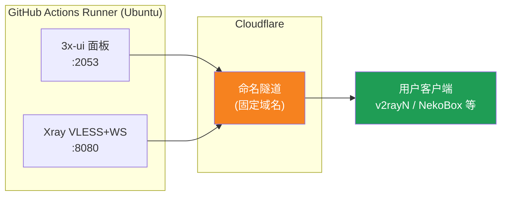
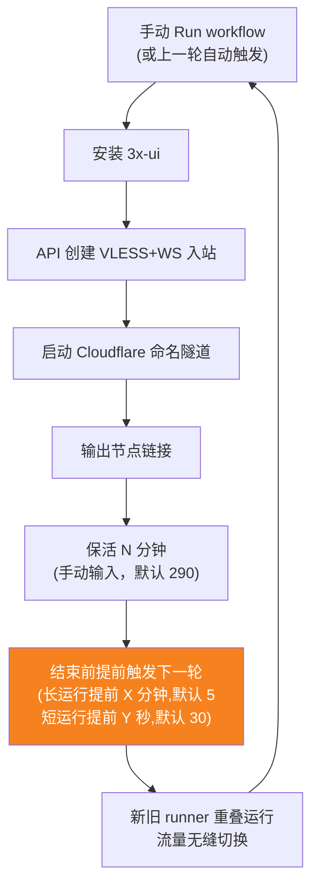
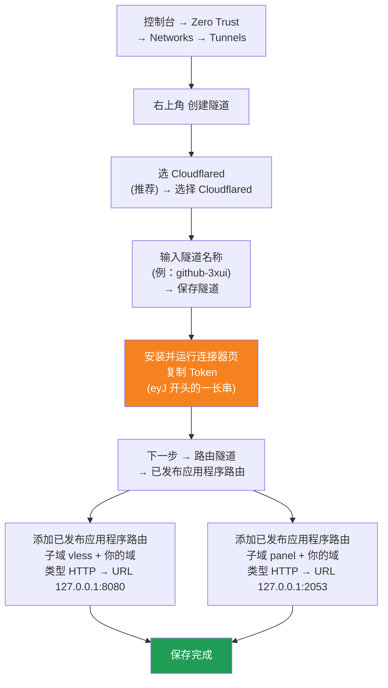

[简体中文](README.md) | [English](README.en.md) | [Русский](README.ru.md) | [日本語](README.ja.md) | [한국어](README.ko.md) | [Español](README.es.md) | [العربية](README.ar.md) | [Čeština](README.cs.md) | [Dansk](README.da.md) | [Deutsch](README.de.md) | [Esperanto](README.eo.md) | [فارسی](README.fa.md) | [Suomi](README.fi.md) | [Français](README.fr.md) | [Ελληνικά](README.gr.md) | [Magyar](README.hu.md) | [Bahasa Indonesia](README.id.md) | [Italiano](README.it.md) | [മലയാളം](README.ml.md) | [Nederlands](README.nl.md) | [Norsk](README.no.md) | [Polski](README.pl.md) | [Português](README.ptbr.md) | [Română](README.ro.md) | [Türkçe](README.tr.md) | [Українська](README.ua.md) | [Tiếng Việt](README.vn.md)

# ☁️ cloud-3xui — GitHub സൗജന്യ VLESS നോഡ്

GitHub Actions-ന്റെ സൗജന്യ സെർവറുകളിൽ 3x-ui പാനൽ + VLESS നോഡ് യാന്ത്രികമായി സജ്ജമാക്കുക, സ്ഥിരമായ ഡൊമെയിനോടെ, വിച്ഛേദനത്തിൽ യാന്ത്രിക പുതുക്കലോടെ.

## ആർക്കിടെക്ചർ ഡയഗ്രം



## യാന്ത്രിക പുതുക്കൽ പ്രക്രിയ



## ഓട്ടോമാറ്റിക് പുതുക്കൽ

- **ദൈർഘ്യം നിങ്ങൾ തീരുമാനിക്കുക**: Run workflow ചെയ്യുമ്പോൾ `run_minutes` മാനുവലായി പൂരിപ്പിക്കുക, നൽകുന്ന മിനിറ്റുകൾ ഓടും; ശൂന്യമെങ്കിൽ ഡിഫോൾട്ട് 290
- **പാരാമീറ്റർ ഓട്ടോമാറ്റിക് പാരമ്പര്യം**: ഓരോ റൗണ്ടും `run_minutes` / `countdown_interval` / `countdown_unit` / `overlap_threshold` / `overlap_long` / `overlap_short` അടുത്തതിലേക്ക് കൈമാറുന്നു, മുഴുവൻ ശൃംഖലയും നിങ്ങൾ ആദ്യം നൽകിയ മൂല്യങ്ങൾ ഉപയോഗിക്കുന്നു
- **ഓവർലാപ്പിംഗ് സ്റ്റാർട്ടപ്പ് (തടസ്സമില്ലാത്ത മാറ്റം)**: നിലവിലെ റണ്ണ് അവസാനിക്കുന്നതിന് മുമ്പ് അടുത്ത റണ്ണ് നേരത്തെ ട്രിഗർ ചെയ്യുന്നു, പഴയതും പുതിയതുമായ runner ഒരേസമയം ഓൺലൈനിൽ, Cloudflare ടണൽ ഒന്നിലധികം കണക്ഷനുകളെ പിന്തുണയ്ക്കുന്നു, ട്രാഫിക് യാന്ത്രികമായി ലഭ്യമായ കണക്ഷനുകളിലേക്ക് പോകുന്നു, പഴയ റണ്ണ് പുറത്തുപോകുമ്പോൾ ഉപയോക്താവിന് ഏതാണ്ട് അനുഭവപ്പെടില്ല. ട്രിഗർ സമയം ക്രമീകരിക്കാം: `overlap_threshold` (സ്ഥിരസ്ഥിതി 5 മിനിറ്റ്) എന്നതിനേക്കാൾ വലിയ keep-alive ദീർഘ റണ്ണായി കണക്കാക്കുന്നു, `overlap_long` (സ്ഥിരസ്ഥിതി 5 മിനിറ്റ്) നേരത്തെ ട്രിഗർ ചെയ്യുന്നു; ചെറുതാണെങ്കിൽ ഹ്രസ്വ റണ്ണായി കണക്കാക്കുന്നു, `overlap_short` (സ്ഥിരസ്ഥിതി 30 സെക്കൻഡ്) നേരത്തെ ട്രിഗർ ചെയ്യുന്നു
- പെട്ടെന്നുള്ള പരിശോധനയ്ക്ക് `5` നൽകുക, ദൈനംദിന ഉപയോഗത്തിന് ശൂന്യമായി വിടുക (290)
- ഡൊമെയ്ൻ, UUID എന്നിവ സ്ഥിരം, ക്ലയന്റ് ഒരിക്കൽ ക്രമീകരിച്ചാൽ മതി
- നിർത്താൻ Actions-ൽ Cancel അമർത്തുക· റദ്ദാക്കിയ ശേഷം ഓട്ടോമാറ്റിക്കായി പുനരാരംഭിക്കില്ല

## സ്ഥിര വിലാസങ്ങൾ

| ഉപയോഗം | വിലാസം |
|------|------|
| നോഡ് | `vless.mallow.ccwu.cc:443` (VLESS + WebSocket + TLS) |
| പാനൽ | `https://panel.mallow.ccwu.cc/panel` (ഉപയോക്തൃനാമം `admin`) |

> ⚠️ മുകളിലുള്ള ഡൊമെയ്നുകൾ ഉദാഹരണങ്ങളാണ്, നിങ്ങളുടെ സ്വന്തം ഡൊമെയ്ൻ ഉപയോഗിക്കുക.

## വിശദമായ കോൺഫിഗറേഷൻ ഘട്ടങ്ങൾ

### സൗജന്യ ഡൊമെയ്ൻ (ഡൊമെയ്ൻ ഇല്ലേ?)

സ്വന്തം ഡൊമെയ്ൻ ഇല്ലേ? https://my.dnshe.com/ എന്നതിൽ നിന്ന് ഒരെണ്ണം സൗജന്യമായി രജിസ്റ്റർ ചെയ്യാം (ഉദാ. `.ccwu.cc`, 10 വർഷം സാധുത), തുടർന്ന് ഡൊമെയ്‌നിന്റെ NS Cloudflare-ലേക്ക് നയിക്കുക.

### ഒന്നാം ഘട്ടം: Cloudflare നെയിംഡ് ടണൽ സൃഷ്ടിക്കുക

Cloudflare ഔദ്യോഗിക വെബ്സൈറ്റ്: https://www.cloudflare-cn.com (ആഭ്യന്തരം) / https://www.cloudflare.com (അന്തർദ്ദേശീയം)

ഡാഷ്ബോർഡ്: https://dash.cloudflare.com



വിശദമായ ഘട്ടങ്ങൾ:

1. [Cloudflare Dashboard](https://dash.cloudflare.com) തുറന്ന് ഇടത് മെനുവിൽ നിന്ന് **Zero Trust** → **Networks** → **Tunnels** എന്നതിലേക്ക് പോകുക
2. മുകളിൽ വലത് മൂലയിലുള്ള **ടണൽ സൃഷ്ടിക്കുക** ക്ലിക്ക് ചെയ്യുക
3. **ടണൽ തരം തിരഞ്ഞെടുക്കുക**: **Cloudflared** (ശുപാർശ ചെയ്യുന്നത്) തിരഞ്ഞെടുത്ത് **Cloudflared തിരഞ്ഞെടുക്കുക** ക്ലിക്ക് ചെയ്യുക
4. **ടണലിന് പേര് നൽകുക**: ഒരു പേര് നൽകുക (ഉദാ: `github-3xui`), തുടർന്ന് **ടണൽ സംരക്ഷിക്കുക** ക്ലിക്ക് ചെയ്യുക
5. **കണക്ടർ ഇൻസ്റ്റാൾ ചെയ്ത് പ്രവർത്തിപ്പിക്കുക**: പേജിൽ ഒരു ഇൻസ്റ്റലേഷൻ കമാൻഡ് കാണിക്കും — അതിലുള്ള `eyJ` എന്നതിൽ തുടങ്ങുന്ന നീളമുള്ള **Token** പകർത്തി സൂക്ഷിക്കുക (പിന്നീട് GitHub Secret ആയി സംരക്ഷിക്കാനുള്ളതാണ്). ലോക്കലായി **ഇൻസ്റ്റാൾ ചെയ്യേണ്ടതില്ല** — തുടരാൻ അടുത്തത് ക്ലിക്ക് ചെയ്യുക
6. **ടണൽ റൂട്ട് ചെയ്യുക**: **പ്രസിദ്ധീകരിച്ച ആപ്ലിക്കേഷൻ റൂട്ടുകൾ** ടാബിലേക്ക് പോയി **പ്രസിദ്ധീകരിച്ച ആപ്ലിക്കേഷൻ റൂട്ട് ചേർക്കുക** ക്ലിക്ക് ചെയ്ത് രണ്ട് എൻട്രികൾ ചേർക്കുക:
   **ആദ്യത്തേത് (നോഡ്):** സബ്ഡൊമെയിൻ `vless`; ഡൊമെയിൻ: നിങ്ങളുടെ ഡൊമെയിൻ തിരഞ്ഞെടുക്കുക; തരം `HTTP`; URL `127.0.0.1:8080`
   **രണ്ടാമത്തേത് (പാനൽ):** സബ്ഡൊമെയിൻ `panel`; ഡൊമെയിൻ: നിങ്ങളുടെ ഡൊമെയിൻ തിരഞ്ഞെടുക്കുക; തരം `HTTP`; URL `127.0.0.1:2053`
7. സംരക്ഷിക്കുക. Cloudflare DNS റെക്കോർഡുകൾ സ്വയം സൃഷ്ടിക്കും, സ്വമേധയാ ചേർക്കേണ്ടതില്ല. Tunnels പട്ടികയിലേക്ക് മടങ്ങുക — ടണലിന്റെ നില **ആരോഗ്യകരം (Healthy)** ആണെങ്കിൽ ക്രമീകരണം വിജയകരമായി.

### രണ്ടാം ഘട്ടം: UUID സൃഷ്ടിക്കുക

1. https://1024tools.com/uuid/ തുറക്കുക
2. സൃഷ്ടിച്ച UUID പകർത്തുക (`cbfc229f-9d34-4fef-9990-8baa82a7327b` പോലെ)
3. **ഈ UUID തീർച്ചയായും കുറിച്ചുവെക്കുക** — വർക്ക്ഫ്ലോ ലോഗുകളിൽ ഇത് പ്ലെയിൻ ടെക്സ്റ്റായി കാണിക്കില്ല, ഓരോ തവണ നോഡ് ലിങ്ക് കൂട്ടിച്ചേർക്കുമ്പോഴും ഇത് ആവശ്യമാണ്

### മൂന്നാം ഘട്ടം: GitHub Secrets ചേർക്കുക

1. ഈ റിപ്പോയിലേക്ക് പ്രവേശിച്ച് **Settings** ടാബ് ക്ലിക്ക് ചെയ്യുക
2. ഇടതുവശത്ത് **Secrets and variables** → **Actions**
3. മുകളിൽ വലതുവശത്ത് **New repository secret** ക്ലിക്ക് ചെയ്ത് മൂന്നെണ്ണം ക്രമത്തിൽ ചേർക്കുക:

   | Name | Secret (മൂല്യം) | വിവരണം |
   |------|-------------|------|
   | `CF_TUNNEL_TOKEN` | ഒന്നാം ഘട്ടത്തിൽ പകർത്തിയ Tunnel Token | Cloudflare ടണൽ ക്രെഡൻഷ്യൽ |
   | `PANEL_PASSWORD` | നിങ്ങൾ സജ്ജമാക്കിയ പാനൽ പാസ്വേഡ് | 3x-ui പാനൽ ലോഗിൻ പാസ്വേഡ് |
   | `VLESS_UUID` | രണ്ടാം ഘട്ടത്തിൽ സൃഷ്ടിച്ച UUID | നോഡ് UUID, സ്ഥിരം, മാറില്ല |

### നാലാം ഘട്ടം: വർക്ക്ഫ്ലോ പ്രവർത്തിപ്പിക്കുക

1. റിപ്പോയുടെ മുകളിലുള്ള **Actions** ടാബ് ക്ലിക്ക് ചെയ്യുക
2. ഇടതുവശത്ത് **3x-ui VLESS Node** തിരഞ്ഞെടുക്കുക
3. വലതുവശത്തെ **Run workflow** ബട്ടൺ ക്ലിക്ക് ചെയ്യുക
4. പ്രത്യക്ഷപ്പെടുന്ന ഫോമിൽ:
   - **Panel password**: ശൂന്യമായി വിടുക (സ്വയം `PANEL_PASSWORD` secret ഉപയോഗിക്കും)
     പാനൽ പാസ്വേഡ് (ശൂന്യമെങ്കിൽ PANEL_PASSWORD secret ഉപയോഗിക്കും)
   - **Run duration**: സ്ഥിരസ്ഥിതി `290` (മിനിറ്റ്), ആദ്യ പരിശോധനയ്ക്ക് വേഗത്തിലുള്ള പരിശോധനയ്ക്കായി `5` നൽകാം
     പ്രവർത്തന കാലയളവ് (മിനിറ്റിൽ, സ്ഥിരസ്ഥിതി 290, പരമാവധി 340)
   - **Countdown output interval**: കൗണ്ട്ഡൗൺ ഔട്ട്പുട്ട് ഇടവേള, ഡിഫോൾട്ട് `1`, പ്രവർത്തനരഹിതമാക്കാൻ `0` നൽകുക
     കൗണ്ട്ഡൗൺ ഔട്ട്പുട്ട് ഇടവേള (ഡിഫോൾട്ട് 1, പ്രവർത്തനരഹിതമാക്കാൻ 0 നൽകുക)
   - **Countdown interval unit**: കൗണ്ട്ഡൗൺ ഇടവേള യൂണിറ്റ്, ഡ്രോപ്പ്ഡൗണിൽ നിന്ന് `minutes` അല്ലെങ്കിൽ `seconds` തിരഞ്ഞെടുക്കുക
     കൗണ്ട്ഡൗൺ ഔട്ട്പുട്ട് ഇടവേള യൂണിറ്റ്
   - **Overlap threshold**: ഓവർലാപ് പരിധി (മിനിറ്റ്, സ്ഥിരസ്ഥിതി `5`), ഇതിലും ദൈർഘ്യമേറിയ keep-alive ദീർഘ റണ്ണായി കണക്കാക്കുന്നു
     ഓവർലാപ് പരിധി (മിനിറ്റ്, സ്ഥിരസ്ഥിതി 5): ഇതിലും ദൈർഘ്യമേറിയ keep-alive ദീർഘ റണ്ണായി കണക്കാക്കുന്നു
   - **Overlap long**: ദീർഘ റണ്ണുകൾക്കുള്ള നേരത്തെയെയുള്ള ട്രിഗർ മിനിറ്റുകൾ (സ്ഥിരസ്ഥിതി `5`)
     ദീർഘ റണ്ണുകൾക്കുള്ള നേരത്തെയെയുള്ള ട്രിഗർ മിനിറ്റുകൾ (സ്ഥിരസ്ഥിതി 5)
   - **Overlap short**: ഹ്രസ്വ റണ്ണുകൾക്കുള്ള നേരത്തെയെയുള്ള ട്രിഗർ സെക്കൻഡുകൾ (സ്ഥിരസ്ഥിതി `30`)
     ഹ്രസ്വ റണ്ണുകൾക്കുള്ള നേരത്തെയെയുള്ള ട്രിഗർ സെക്കൻഡുകൾ (സ്ഥിരസ്ഥിതി 30)
5. പ്രവർത്തനം ആരംഭിക്കാൻ പച്ച **Run workflow** ബട്ടൺ ക്ലിക്ക് ചെയ്യുക

### അഞ്ചാം ഘട്ടം: നോഡ് ലിങ്ക് നേടുക

1. ഏകദേശം 2-3 മിനിറ്റ് കാത്തിരുന്ന് പ്രവർത്തിച്ചുകൊണ്ടിരിക്കുന്ന ടാസ്ക് ക്ലിക്ക് ചെയ്ത് വിശദാംശ പേജിലേക്ക് പ്രവേശിക്കുക
2. **Start named Cloudflare tunnel** ഘട്ടം വികസിപ്പിച്ച് ലോഗ് ഔട്ട്പുട്ട് കാണുക:
   ```
   ==================================================
     面板 Panel: https://panel.mallow.ccwu.cc/panel  (admin / 你的面板密码)

     VLESS 节点 node:
     vless://YOUR_UUID@vless.mallow.ccwu.cc:443?encryption=none&security=tls&sni=vless.mallow.ccwu.cc&type=ws&path=%2Fws#GitHub-3xui

     把 YOUR_UUID 换成你在 VLESS_UUID secret 里填的 UUID
     Replace YOUR_UUID with the UUID from your VLESS_UUID secret
     域名：去 Settings → Secrets and variables → Actions → Variables 改 VLESS_HOST / PANEL_HOST 变量
     Domain: set the VLESS_HOST / PANEL_HOST variables in Settings → Secrets and variables → Actions → Variables
   ==================================================
   ```
3. `vless://` ലിങ്ക് പകർത്തി `YOUR_UUID` നിങ്ങളുടെ UUID ഉപയോഗിച്ച് മാറ്റിസ്ഥാപിക്കുക
4. v2rayN / v2rayNG / Streisand / NekoBox പോലുള്ള ക്ലയന്റുകളിൽ ഒട്ടിച്ച് ഉപയോഗിക്കുക

### ആറാം ഘട്ടം: യാന്ത്രിക പുതുക്കൽ പരിശോധിക്കുക (ഓപ്ഷണൽ)

1. ആദ്യ പ്രവർത്തനത്തിൽ കാലയളവ് `5` മിനിറ്റായി സജ്ജമാക്കുക
2. 5 മിനിറ്റിന് ശേഷം അവസാന ഘട്ടമായ **Trigger next run**-ന്റെ ലോഗ് കാണുക, ഇത് കാണിക്കണം:
   ```
   HTTP 204
   已触发下一次运行 Next run triggered
   ```
3. Actions പട്ടികയിലേക്ക് മടങ്ങുക, പുതിയതായി യാന്ത്രികമായി ട്രിഗർ ചെയ്ത ഒരു റൺ കാണണം
4. ശരിയാണെന്ന് ഉറപ്പാക്കിയ ശേഷം വീണ്ടും പ്രവർത്തിപ്പിച്ച് കാലയളവ് സാധാരണ ഉപയോഗത്തിനായി `290` ആയി മാറ്റുക

## വർക്ക്ഫ്ലോ ഘട്ടങ്ങളുടെ വിവരണം

| ഘട്ടം | മലയാളം | English | വിവരണം |
|------|------|---------|------|
| Install 3x-ui | 3x-ui ഇൻസ്റ്റാൾ ചെയ്യുക | Install 3x-ui | ഔദ്യോഗിക സ്ക്രിപ്റ്റ് ഉപയോഗിച്ച് പാനൽ നോൺ-ഇന്ററാക്ടീവായി ഇൻസ്റ്റാൾ ചെയ്യുക |
| Create VLESS+WS inbound via API | API വഴി VLESS+WS ഇൻബൗണ്ട് സൃഷ്ടിക്കുക | Create VLESS+WS inbound via API | API Token ഉപയോഗിച്ച് ലോഗിൻ ചെയ്ത് ഇൻബൗണ്ട് യാന്ത്രികമായി സൃഷ്ടിക്കുക |
| Start named Cloudflare tunnel | Cloudflare നെയിംഡ് ടണൽ ആരംഭിക്കുക | Start named Cloudflare tunnel | Token ഉപയോഗിച്ച് സ്ഥിര ഡൊമെയ്ൻ ടണലിലേക്ക് കണക്ട് ചെയ്യുക |
| Keep alive | സജീവമായി നിലനിർത്തുക | Keep alive | നിർദ്ദിഷ്ട മിനിറ്റുകൾ ഉറങ്ങുന്നു, ഓരോ മിനിറ്റിലും സേവന നില പരിശോധിക്കുന്നു, സജ്ജീകരിച്ച ഇടവേളയിൽ കൗണ്ട്ഡൗൺ പ്രദർശിപ്പിക്കുന്നു |
| Trigger next run | അടുത്ത റൺ ട്രിഗർ ചെയ്യുക | Trigger next run | API വിളിച്ച് അടുത്ത റൗണ്ട് യാന്ത്രികമായി ആരംഭിക്കുക |

## പതിവ് ചോദ്യങ്ങൾ

**Q: ലോഗിൽ നോഡ് ലിങ്കിന്റെ UUID `***` ആയി കാണിക്കുന്നുവോ?**
A: ഇത് GitHub-ന്റെ secret സംരക്ഷണ സംവിധാനമാണ്. `YOUR_UUID` എന്നത് `VLESS_UUID` secret-ൽ നിങ്ങൾ നൽകിയ UUID ഉപയോഗിച്ച് മാറ്റിസ്ഥാപിച്ചാൽ മതി.

**Q: ക്ലയന്റ് ടെസ്റ്റ് വിജയിക്കുന്നില്ല (-1)?**
A: മൂന്ന് കാര്യങ്ങൾ പരിശോധിക്കുക: ① UUID ശരിയായി മാറ്റിസ്ഥാപിച്ചിട്ടുണ്ടോ; ② ക്ലയന്റ് പതിപ്പ് പുതിയതാണോ (v2rayN 7.x+); ③ Cloudflare ടണൽ സാധാരണഗതിയിൽ കണക്ട് ചെയ്തിട്ടുണ്ടോ (ലോഗ് കാണുക).

**Q: യാന്ത്രിക പുനരാരംഭം ട്രിഗർ ചെയ്തില്ലേ?**
A: **Trigger next run** ഘട്ടത്തിന്റെ ലോഗ് കാണുക. 204 അല്ലാത്ത HTTP സ്റ്റാറ്റസ് കോഡ് കാണിച്ചാൽ റിപ്പോയുടെ Actions അനുമതി ക്രമീകരണങ്ങൾ പരിശോധിക്കുക.

**Q: റൊട്ടേഷൻ സമയത്ത് കണക്ഷൻ വിച്ഛേദിക്കപ്പെടുമോ?**
A: ഓവർലാപ്പിംഗ് സ്റ്റാർട്ടപ്പ് ഉപയോഗിക്കുന്നു: നിലവിലെ റൗണ്ട് അവസാനിക്കുന്നതിന് മുമ്പ് അടുത്ത റൗണ്ട് ആരംഭിക്കും, പഴയതും പുതിയതുമായ runner ഒരേസമയം ഓൺലൈനായിരിക്കും, സൈദ്ധാന്തികമായി തിരിച്ചറിയാൻ കഴിയില്ല. GitHub ക്യൂ പോലുള്ള അങ്ങേയറ്റത്തെ സാഹചര്യങ്ങളിൽ ചെറിയ ഏറ്റക്കുറച്ചിലുകൾ ഉണ്ടാകാം, ക്ലയന്റ് യാന്ത്രികമായി വീണ്ടും കണക്റ്റുചെയ്യും.

**Q: യാന്ത്രിക പുതുക്കൽ നിർത്തണോ?**
A: Actions പേജിൽ പോയി നിലവിലെ റൺ Cancel ചെയ്യുക, പിന്നീട് യാന്ത്രികമായി ട്രിഗർ ചെയ്യില്ല.

## ശ്രദ്ധിക്കേണ്ട കാര്യങ്ങൾ

- **വേഗത**: ട്രാഫിക് Cloudflare → GitHub ഡാറ്റാ സെന്ററുകൾ (അമേരിക്ക/യൂറോപ്പ്) വഴി പോകുന്നു, താൽക്കാലിക/ലഘു ഉപയോഗത്തിന് മാത്രം അനുയോജ്യം
- **തടസ്സമില്ലാത്ത മാറ്റം**: ഓവർലാപ്പിംഗ് സ്റ്റാർട്ടപ്പ് ഉപയോഗിച്ച്, ഓരോ റൗണ്ടും 5 മിനിറ്റ് നേരത്തേ അടുത്തത് ആരംഭിക്കുന്നു, പഴയതും പുതിയതുമായ runner ഒരേസമയം ഓൺലൈനിൽ, സൈദ്ധാന്തികമായി ഉപയോക്താവിന് ഒന്നും അനുഭവപ്പെടില്ല; അങ്ങേയറ്റത്തെ സാഹചര്യങ്ങളിൽ (ഉദാ. GitHub ക്യൂ) ഹ്രസ്വമായ ഏറ്റക്കുറച്ചിലുകൾ ഉണ്ടാകാം
- **അനുവർത്തനം**: GitHub Actions-ൽ പ്രോക്സി പ്രവർത്തിപ്പിക്കുന്നത് ToS ലംഘനത്തിനും അക്കൗണ്ട് ബാൻ സാധ്യതയ്ക്കും കാരണമാകാം, സ്വയം വിലയിരുത്തുക
- **സുരക്ഷ**: `CF_TUNNEL_TOKEN` / `PANEL_PASSWORD` / `VLESS_UUID` എന്നിവ പൊതു ഇടങ്ങളിൽ പ്രസിദ്ധീകരിക്കരുത്
