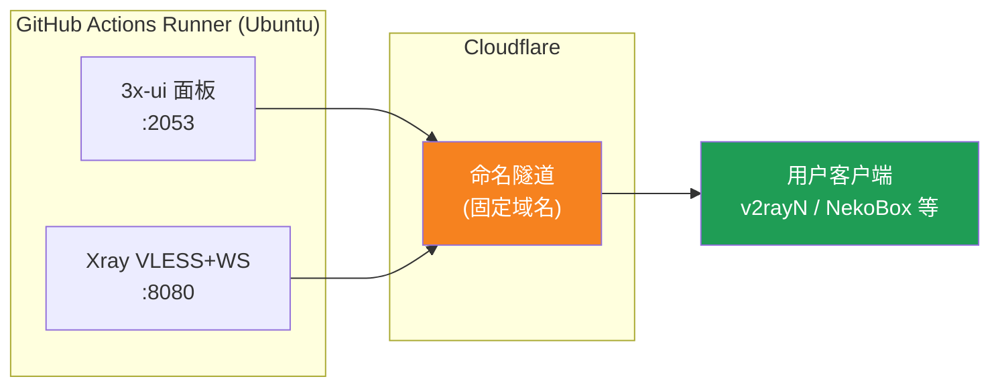
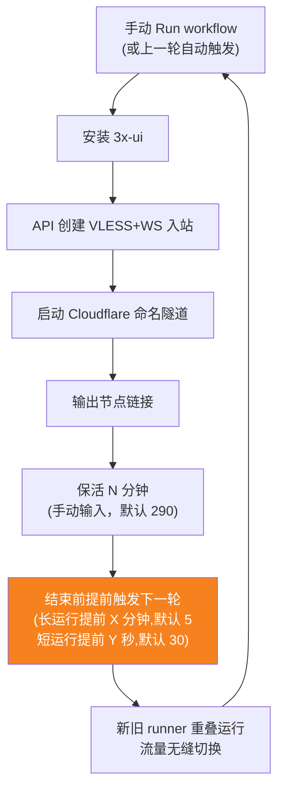
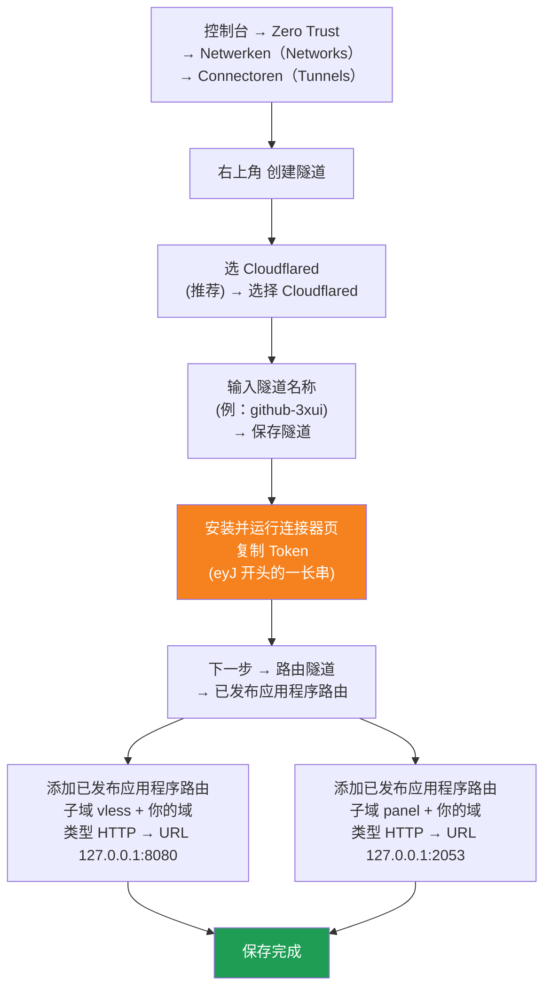

[简体中文](README.md) | [English](README.en.md) | [Русский](README.ru.md) | [日本語](README.ja.md) | [한국어](README.ko.md) | [Español](README.es.md) | [العربية](README.ar.md) | [Čeština](README.cs.md) | [Dansk](README.da.md) | [Deutsch](README.de.md) | [Esperanto](README.eo.md) | [فارسی](README.fa.md) | [Suomi](README.fi.md) | [Français](README.fr.md) | [Ελληνικά](README.gr.md) | [Magyar](README.hu.md) | [Bahasa Indonesia](README.id.md) | [Italiano](README.it.md) | [മലയാളം](README.ml.md) | [Nederlands](README.nl.md) | [Norsk](README.no.md) | [Polski](README.pl.md) | [Português](README.ptbr.md) | [Română](README.ro.md) | [Türkçe](README.tr.md) | [Українська](README.ua.md) | [Tiếng Việt](README.vn.md)

# ☁️ cloud-3xui — Gratis VLESS-node met GitHub

Zet met de gratis servers van GitHub Actions automatisch een 3x-ui-paneel + VLESS-node op, met een vast domein en automatische verlenging bij verbindingsverlies.

## Architectuurdiagram



## Stroomdiagram automatische verlenging



## Automatische verlenging

- **Jij bepaalt de duur**: vul bij Run workflow handmatig `run_minutes` in, hij draait zoveel minuten als je invult; leeg laten gebruikt de standaard 290
- **Automatische overerving van parameters**: elke ronde geeft `run_minutes` / `countdown_interval` / `countdown_unit` / `overlap_threshold` / `overlap_long` / `overlap_short` door aan de volgende, de hele keten gebruikt de waarden die je oorspronkelijk hebt ingevuld
- **Overlappende start (naadloze overgang)**: triggert de volgende run vroeg voordat de huidige eindigt, oude en nieuwe runners zijn tegelijk online, Cloudflare-tunnel ondersteunt meerdere verbindingen, verkeer wordt automatisch verdeeld over beschikbare verbindingen, de gebruiker merkt bijna niet dat de oude stopt. Triggermoment is configureerbaar: keep-alive groter dan `overlap_threshold` (standaard 5 minuten) telt als lange run, triggert `overlap_long` (standaard 5 minuten) eerder; kleiner telt als korte run, triggert `overlap_short` (standaard 30 seconden) eerder
- Voor een snelle test vul `5` in, voor dagelijks gebruik leeg laten (290)
- Domein en UUID zijn vast, client één keer configureren is genoeg
- Om te stoppen druk op Cancel in Actions· na annulering start hij niet automatisch opnieuw

## Vaste adressen

| Doel | Adres |
|------|------|
| Node | `vless.mallow.ccwu.cc:443`（VLESS + WebSocket + TLS） |
| Paneel | `https://panel.mallow.ccwu.cc/panel`（gebruikersnaam `admin`） |

> ⚠️ Bovenstaande domeinen zijn voorbeelden. Om ze te wijzigen, bewerk je de variabelen `VLESS_HOST` / `PANEL_HOST` in Settings → Secrets and variables → Actions → Variables — je hoeft het workflowbestand niet te bewerken.

## Domeininstelling

De domeinen van de node en het paneel staan in GitHub-variabelen — je hoeft het workflowbestand niet te bewerken:

| Variabele | Voorbeeldwaarde | Beschrijving |
|-----------|-----------------|--------------|
| `VLESS_HOST` | `vless.mallow.ccwu.cc` | Nodeadres (volledige hostnaam) |
| `PANEL_HOST` | `panel.mallow.ccwu.cc` | Paneeladres (volledige hostnaam) |

**Zo wijzig je ze**: Ga naar **Settings** → **Secrets and variables** → **Actions** → het tabblad **Variables** → **New repository variable** en vul de naam en waarde in. De wijziging geldt vanaf de volgende workflowuitvoering.

**Drie dingen om op te letten**:
- Elke variabele bevat de **volledige hostnaam** (inclusief het subdomeinvoorvoegsel), dus de node en het paneel kunnen naar verschillende domeinen verwijzen — ze hoeven geen bovenliggend domein te delen
- De waarden moeten overeenkomen met de openbare hostnamen (Public Hostnames) die je in stap 1 in de Cloudflare-tunnel hebt aangemaakt (`vless` → 127.0.0.1:8080, `panel` → 127.0.0.1:2053), anders werkt de link niet
- Als een variabele niet is ingesteld, toont de banner een tijdelijke aanduiding voor dat item (`vless.YOUR_DOMAIN` / `panel.YOUR_DOMAIN`)

## Gedetailleerde configuratiestappen

### Gratis domein (nog geen domein?)

Heb je geen eigen domein? Registreer er gratis een via https://my.dnshe.com/ (bijv. `.ccwu.cc`, 10 jaar geldig) en wijs de NS van het domein naar Cloudflare.

### Stap 1: Een benoemde tunnel aanmaken in Cloudflare

Officiële Cloudflare-website: https://www.cloudflare-cn.com (binnenlands) / https://www.cloudflare.com (internationaal)

Dashboard: https://dash.cloudflare.com



Gedetailleerde stappen:

1. Open het [Cloudflare-dashboard](https://dash.cloudflare.com) en ga in het linkermenu naar **Zero Trust** → **Netwerken（Networks）** → **Connectoren（Tunnels）**
2. Klik rechtsboven op **Een tunnel maken**
3. **Type tunnel kiezen**: selecteer **Cloudflared** (aanbevolen) en klik op **Cloudflared selecteren**
4. **De tunnel een naam geven**: voer een naam in (bijvoorbeeld `github-3xui`) en klik op **Tunnel opslaan**
5. **De connector installeren en uitvoeren**: de pagina toont een installatieopdracht. Kopieer de lange reeks tekens die begint met `eyJ` — dit is de **Token** — en bewaar hem goed (deze sla je later op als GitHub Secret). Je hoeft **niet** lokaal iets te installeren; klik op volgende om verder te gaan
6. **De tunnel routeren**: ga naar het tabblad **gepubliceerde applicatieroutes** en klik op **Een gepubliceerde applicatieroute toevoegen** om er twee toe te voegen:

   **Eerste (node):**
   - Subdomain (subdomein): `vless`
   - Domain (domein): kies je eigen domein
   - Service Type (servicetype): `HTTP`
   - URL: `127.0.0.1:8080`

   **Tweede (paneel):**
   - Subdomain (subdomein): `panel`
   - Domain (domein): kies je eigen domein
   - Service Type (servicetype): `HTTP`
   - URL: `127.0.0.1:2053`

7. Sla op. Cloudflare maakt automatisch de DNS-records aan; je hoeft niets handmatig toe te voegen. Als de tunnelstatus in de Connectoren-lijst **In orde** is, is de configuratie geslaagd.

### Stap 2: Een UUID genereren

1. Open https://1024tools.com/uuid/
2. Kopieer de gegenereerde UUID (bijvoorbeeld `cbfc229f-9d34-4fef-9990-8baa82a7327b`)
3. **Bewaar deze UUID goed** — hij wordt niet in platte tekst in de workflowlogs getoond, en je hebt hem elke keer nodig bij het samenstellen van de node-link

### Stap 3: Secrets en Variables toevoegen in GitHub

1. Open deze repository en klik op het tabblad **Settings**
2. Ga links naar **Secrets and variables** → **Actions**
3. Klik rechtsboven op **New repository secret** en voeg achtereenvolgens deze drie toe:

   | Name | Secret (waarde) | Beschrijving |
   |------|-------------|------|
   | `CF_TUNNEL_TOKEN` | De in stap 1 gekopieerde Tunnel Token | Cloudflare-tunnelreferentie |
   | `PANEL_PASSWORD` | Het door jou ingestelde paneelwachtwoord | Aanmeldwachtwoord van het 3x-ui-paneel |
   | `VLESS_UUID` | De in stap 2 gegenereerde UUID | UUID van de node, vast en onveranderlijk |

4. Ga naar het tabblad **Variables**, klik op **New repository variable** en voeg twee variabelen toe (zie de sectie Domeininstelling hierboven):

   | Name | Waarde | Beschrijving |
   |------|--------|--------------|
   | `VLESS_HOST` | `vless.mallow.ccwu.cc` | Nodeadres |
   | `PANEL_HOST` | `panel.mallow.ccwu.cc` | Paneeladres |

### Stap 4: De workflow uitvoeren

1. Klik bovenaan de repository op het tabblad **Actions**
2. Kies links **3x-ui VLESS Node**
3. Klik rechts op de knop **Run workflow**
4. In het formulier dat verschijnt:
   - **Panel password**：laat leeg (gebruikt automatisch de `PANEL_PASSWORD`-secret)
     Paneelwachtwoord (laat leeg om de `PANEL_PASSWORD`-secret te gebruiken)
   - **Run duration**：standaard `290` (minuten); voor de eerste test kun je `5` invullen voor een snelle verificatie
     Uitvoeringsduur (minuten, standaard 290, maximaal 340)
   - **Countdown output interval**: aftel-uitvoerinterval, standaard `1`, vul `0` in om uit te schakelen
     Aftel-uitvoerinterval (standaard 1, 0 om uit te schakelen)
   - **Countdown interval unit**: eenheid van aftelinterval, kies `minutes` of `seconds` uit de dropdown
     Eenheid van aftel-uitvoerinterval
   - **Overlap threshold**: overlapping drempel (minuten, standaard `5`), keep-alive langer dan dit telt als lange run
     Overlapping drempel (minuten, standaard 5): keep-alive langer dan dit telt als lange run
   - **Overlap long**: minuten vroege trigger voor lange runs (standaard `5`)
     Minuten vroege trigger voor lange runs (standaard 5)
   - **Overlap short**: seconden vroege trigger voor korte runs (standaard `30`)
     Seconden vroege trigger voor korte runs (standaard 30)
5. Klik op de groene **Run workflow** om te starten

### Stap 5: De node-link ophalen

1. Wacht ongeveer 2–3 minuten en klik op de lopende taak om de detailpagina te openen
2. Vouw de stap **Start named Cloudflare tunnel** uit en bekijk de loguitvoer:
   ```
   ==================================================
     Paneel Panel: https://panel.mallow.ccwu.cc/panel  (admin / je wachtwoord your password)

     VLESS-node node:
     vless://YOUR_UUID@vless.mallow.ccwu.cc:443?encryption=none&security=tls&sni=vless.mallow.ccwu.cc&type=ws&path=%2Fws#GitHub-3xui

     Vervang YOUR_UUID door de UUID uit je VLESS_UUID-secret
     Replace YOUR_UUID with the UUID from your VLESS_UUID secret
     域名：去 Settings → Secrets and variables → Actions → Variables 改 VLESS_HOST / PANEL_HOST 变量
     Domain: set the VLESS_HOST / PANEL_HOST variables in Settings → Secrets and variables → Actions → Variables
   ==================================================
   ```
3. Kopieer de `vless://`-link en vervang `YOUR_UUID` door je eigen UUID (Het domein is al het echte domein uit je variabelen — je hoeft het niet te vervangen.)
4. Plak hem in v2rayN / v2rayNG / Streisand / NekoBox of een andere client en je kunt hem gebruiken

### Stap 6: De automatische verlenging verifiëren (optioneel)

1. Zet de duur bij de eerste uitvoering op `5` minuten
2. Bekijk na 5 minuten het log van de laatste stap **Trigger next run**; het zou dit moeten tonen:
   ```
   HTTP 204
   Volgende uitvoering getriggerd Next run triggered
   ```
3. Keer terug naar de Actions-lijst — er zou een nieuwe, automatisch getriggerde uitvoering moeten verschijnen
4. Bevestig dat alles klopt, voer daarna opnieuw uit en zet de duur terug op `290` voor normaal gebruik

## Uitleg van de workflowstappen

| Stap | Nederlands | English | Beschrijving |
|------|------|---------|------|
| Install 3x-ui | 3x-ui installeren | Install 3x-ui | Paneel niet-interactief installeren met het officiële script |
| Create VLESS+WS inbound via API | VLESS+WS-inbound aanmaken via de API | Create VLESS+WS inbound via API | Inloggen met de API Token en de inbound automatisch aanmaken |
| Start named Cloudflare tunnel | Benoemde Cloudflare-tunnel starten | Start named Cloudflare tunnel | Met de Token verbinding maken met de tunnel met het vaste domein |
| Keep alive | Keep alive | Keep alive | Slaapt het opgegeven aantal minuten, controleert elke minuut de servicestatus, toont de aftelling met het ingestelde interval |
| Trigger next run | Volgende uitvoering triggeren | Trigger next run | De API aanroepen om automatisch de volgende ronde te starten |

## Veelgestelde vragen

**V: In het log wordt de UUID van de node-link weergegeven als `***`?**
A: Dat is het secret-beschermingsmechanisme van GitHub. Vervang `YOUR_UUID` door de UUID die je zelf in de `VLESS_UUID`-secret hebt ingevuld.

**V: In het log wordt het domein weergegeven als `YOUR_DOMAIN`?**
A: Ga naar Settings → Secrets and variables → Actions → Variables en maak de variabelen `VLESS_HOST` / `PANEL_HOST` aan met de volledige hostnamen; zorg ervoor dat ze overeenkomen met de openbare hostnamen in je Cloudflare-tunnel.

**V: De clienttest slaagt niet (-1)?**
A: Controleer drie punten: ① is de UUID correct vervangen; ② is de clientversie recent genoeg (v2rayN 7.x+); ③ is de Cloudflare-tunnel correct verbonden (zie het log).

**V: De automatische herstart wordt niet getriggerd?**
A: Bekijk het log van de stap **Trigger next run**. Als er een HTTP-statuscode anders dan 204 wordt getoond, controleer je de Actions-machtigingsinstellingen van de repository.

**V: Valt de verbinding weg tijdens de rotatie?**
A: We gebruiken overlappende start: de volgende run wordt getriggerd voordat de huidige eindigt, oude en nieuwe runners zijn tegelijk online, in theorie onmerkbaar. In extreme gevallen (bijv. GitHub-wachtrij) kan er een korte fluctuatie zijn, de client verbindt automatisch opnieuw.

**V: Wil je de automatische verlenging stoppen?**
A: Annuleer (Cancel) de huidige uitvoering op de Actions-pagina; er wordt dan niet automatisch opnieuw getriggerd.

## Opmerkingen

- **Snelheid**: het verkeer gaat via Cloudflare → GitHub-datacenters (VS/Europa), alleen geschikt voor tijdelijk/licht gebruik
- **Naadloze overgang**: met overlappende start wordt elke ronde 5 minuten eerder gestart, oude en nieuwe runner tegelijk online, theoretisch merkt de gebruiker niets; in extreme gevallen (bijv. GitHub-wachtrij) kan er een korte fluctuatie zijn
- **Naleving**: het draaien van een proxy op GitHub Actions kan in strijd zijn met de ToS, met risico op accountschorsing — beoordeel dit zelf
- **Veiligheid**: publiceer `CF_TUNNEL_TOKEN` / `PANEL_PASSWORD` / `VLESS_UUID` nergens openbaar