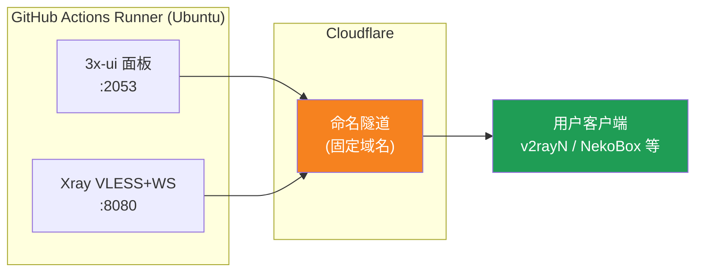
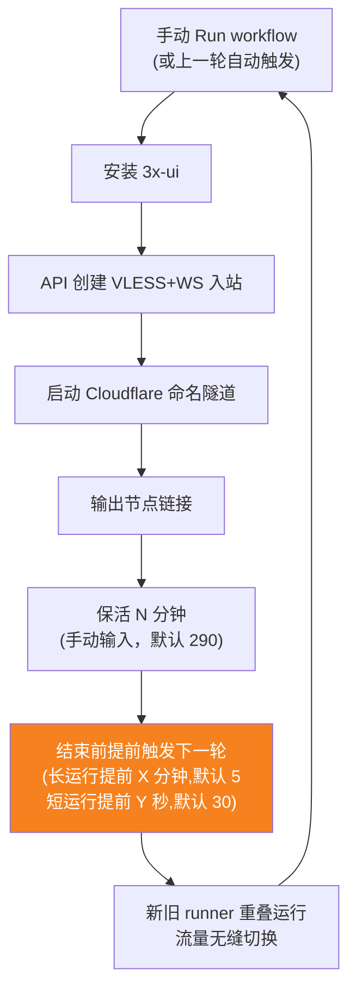
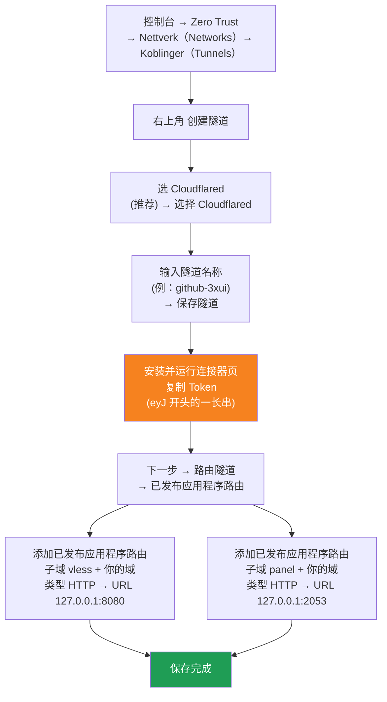

[简体中文](README.md) | [English](README.en.md) | [Русский](README.ru.md) | [日本語](README.ja.md) | [한국어](README.ko.md) | [Español](README.es.md) | [العربية](README.ar.md) | [Čeština](README.cs.md) | [Dansk](README.da.md) | [Deutsch](README.de.md) | [Esperanto](README.eo.md) | [فارسی](README.fa.md) | [Suomi](README.fi.md) | [Français](README.fr.md) | [Ελληνικά](README.gr.md) | [Magyar](README.hu.md) | [Bahasa Indonesia](README.id.md) | [Italiano](README.it.md) | [മലയാളം](README.ml.md) | [Nederlands](README.nl.md) | [Norsk](README.no.md) | [Polski](README.pl.md) | [Português](README.ptbr.md) | [Română](README.ro.md) | [Türkçe](README.tr.md) | [Українська](README.ua.md) | [Tiếng Việt](README.vn.md)

# ☁️ cloud-3xui — Gratis VLESS-node med GitHub

Sett opp et 3x-ui-panel + VLESS-node automatisk med de gratis serverne til GitHub Actions, med fast domene og automatisk fornyelse etter brudd.

## Arkitekturdiagram



## Flyt for automatisk fornyelse



## Automatisk fornyelse

- **Du bestemmer varigheten**: fyll inn `run_minutes` manuelt ved Run workflow, den kjører så mange minutter som du skriver; tomt felt bruker standard 290
- **Automatisk arv av parametere**: hver runde sender `run_minutes` / `countdown_interval` / `countdown_unit` / `overlap_threshold` / `overlap_long` / `overlap_short` videre til neste, hele kjeden bruker verdiene du opprinnelig fylte inn
- **Overlappende oppstart (sømløs overgang)**: utløser neste kjøring tidlig før den nåværende avsluttes, gamle og nye runnere er online samtidig, Cloudflare-tunnelen støtter flere tilkoblinger, trafikk fordeles automatisk på tilgjengelige tilkoblinger, brukeren merker nesten ikke at den gamle avslutter. Utløsningstidspunkt kan konfigureres: keep-alive større enn `overlap_threshold` (standard 5 minutter) regnes som lang kjøring, utløses `overlap_long` (standard 5 minutter) tidligere; mindre regnes som kort kjøring, utløses `overlap_short` (standard 30 sekunder) tidligere
- For rask test skriv `5`, til daglig bruk la stå tomt (290)
- Domene og UUID er faste, konfigurer klienten én gang
- For å stoppe trykk Cancel i Actions· etter avbrytelse starter den ikke automatisk igjen

## Faste adresser

| Formål | Adresse |
|------|------|
| Node | `vless.mallow.ccwu.cc:443`（VLESS + WebSocket + TLS） |
| Panel | `https://panel.mallow.ccwu.cc/panel`（brukernavn `admin`） |

> ⚠️ Domenene ovenfor er eksempler — bytt dem ut med ditt eget domene.

## Detaljerte konfigurasjonstrinn

### Gratis domene (har du ikke domene?)

Har du ikke eget domene? Du kan registrere et gratis på https://my.dnshe.com/ (f.eks. `.ccwu.cc`, gyldig i 10 år), og deretter peke domenets NS til Cloudflare.

### Trinn 1: Opprette en navngitt tunnel i Cloudflare

Cloudflares offisielle nettsted: https://www.cloudflare-cn.com (innenlands) / https://www.cloudflare.com (internasjonalt)

Kontrollpanel: https://dash.cloudflare.com



Detaljerte trinn:

1. Åpne [Cloudflare-dashboardet](https://dash.cloudflare.com) og gå til **Zero Trust** → **Nettverk（Networks）** → **Koblinger（Tunnels）** i menyen til venstre
2. Klikk på **Opprett tunnel** øverst til høyre
3. **Velg tunneltype**: velg **Cloudflared** (anbefalt) og klikk på **Velg Cloudflared**
4. **Gi tunnelen et navn**: skriv inn et navn (f.eks. `github-3xui`) og klikk på **Lagre tunnel**
5. **Installer og kjør kontakten**: siden viser en installasjonskommando. Kopier den lange tegnstrengen som starter med `eyJ` — dette er **Token** — og ta godt vare på den (den skal lagres som en GitHub Secret senere). Du trenger **ikke** å installere noe lokalt; klikk neste for å fortsette
6. **Rute tunnelen**: gå til fanen **publiserte applikasjonsruter** og klikk på **Legg til publisert applikasjonsrute** for å legge til to:

   **Første (node):**
   - Subdomain (underdomene): `vless`
   - Domain (domene): velg ditt eget domene
   - Service Type (tjenestetype): `HTTP`
   - URL: `127.0.0.1:8080`

   **Andre (panel):**
   - Subdomain (underdomene): `panel`
   - Domain (domene): velg ditt eget domene
   - Service Type (tjenestetype): `HTTP`
   - URL: `127.0.0.1:2053`

7. Lagre. Cloudflare oppretter DNS-oppføringer automatisk — ingen manuell tilføying er nødvendig. Når tunnelstatusen i Koblinger-listen er **sunn**, er konfigurasjonen vellykket.

### Trinn 2: Generere en UUID

1. Åpne https://1024tools.com/uuid/
2. Kopier den genererte UUID-en (f.eks. `cbfc229f-9d34-4fef-9990-8baa82a7327b`)
3. **Husk denne UUID-en** — den vises ikke i klartekst i workflow-loggene, og du trenger den hver gang du setter sammen node-lenken

### Trinn 3: Legge til Secrets i GitHub

1. Åpne dette repositoriet og klikk på fanen **Settings**
2. Gå til **Secrets and variables** → **Actions** til venstre
3. Klikk **New repository secret** øverst til høyre, og legg til disse tre i rekkefølge:

   | Name | Secret (verdi) | Beskrivelse |
   |------|-------------|------|
   | `CF_TUNNEL_TOKEN` | Tunnel Token kopiert i trinn 1 | Cloudflare-tunnellegitimasjon |
   | `PANEL_PASSWORD` | Passordet du har satt for panelet | Påloggingspassord for 3x-ui-panelet |
   | `VLESS_UUID` | UUID-en generert i trinn 2 | Node-UUID, fast og uendret |

### Trinn 4: Kjøre workflowen

1. Klikk på fanen **Actions** øverst i repositoriet
2. Velg **3x-ui VLESS Node** til venstre
3. Klikk på knappen **Run workflow** til høyre
4. I skjemaet som dukker opp:
   - **Panel password**：la stå tomt (bruker automatisk `PANEL_PASSWORD`-secretet)
     Panelpassord (la stå tomt for å bruke `PANEL_PASSWORD`-secretet)
   - **Run duration**：standard `290` (minutter); for første test kan du fylle inn `5` for rask verifisering
     Kjøretid (minutter, standard 290, maks 340)
   - **Countdown output interval**: nedtellingsutdataintervall, standard `1`, fyll inn `0` for å deaktivere
     Nedtelling utdataintervall (standard 1, 0 for å deaktivere)
   - **Countdown interval unit**: enhet for nedtellingsintervall, velg `minutes` eller `seconds` fra rullegardinmenyen
     Enhet for nedtelling utdataintervall
   - **Overlap threshold**: overlappingsterskel (minutter, standard `5`), keep-alive lenger enn dette regnes som lang kjøring
     Overlappingsterskel (minutter, standard 5): keep-alive lenger enn dette regnes som lang kjøring
   - **Overlap long**: minutter tidlig utløsning for lange kjøringer (standard `5`)
     Minutter tidlig utløsning for lange kjøringer (standard 5)
   - **Overlap short**: sekunder tidlig utløsning for korte kjøringer (standard `30`)
     Sekunder tidlig utløsning for korte kjøringer (standard 30)
5. Klikk på den grønne **Run workflow** for å starte

### Trinn 5: Hente node-lenken

1. Vent ca. 2–3 minutter, og klikk på den kjørende oppgaven for å åpne detaljsiden
2. Utvid trinnet **Start named Cloudflare tunnel** og se på loggutdataene:
   ```
   ==================================================
     Panel Panel: https://panel.mallow.ccwu.cc/panel  (admin / passordet ditt your password)

     VLESS-node node:
     vless://YOUR_UUID@vless.mallow.ccwu.cc:443?encryption=none&security=tls&sni=vless.mallow.ccwu.cc&type=ws&path=%2Fws#GitHub-3xui

     Bytt YOUR_UUID med UUID-en fra VLESS_UUID-secretet ditt
     Replace YOUR_UUID with the UUID from your VLESS_UUID secret
     域名：去 Settings → Secrets and variables → Actions → Variables 改 VLESS_HOST / PANEL_HOST 变量
     Domain: set the VLESS_HOST / PANEL_HOST variables in Settings → Secrets and variables → Actions → Variables
   ==================================================
   ```
3. Kopier `vless://`-lenken, og bytt `YOUR_UUID` med din egen UUID
4. Lim den inn i v2rayN / v2rayNG / Streisand / NekoBox eller en annen klient, så kan du bruke den

### Trinn 6: Verifisere automatisk fornyelse (valgfritt)

1. Sett varigheten til `5` minutter ved første kjøring
2. Etter 5 minutter, se på loggen for det siste trinnet **Trigger next run** — den skal vise:
   ```
   HTTP 204
   Neste kjøring utløst Next run triggered
   ```
3. Gå tilbake til Actions-listen — en ny, automatisk utløst kjøring skal vises
4. Når alt er bekreftet, kjør på nytt og sett varigheten tilbake til `290` for normal bruk

## Forklaring av workflow-trinnene

| Trinn | Norsk | English | Beskrivelse |
|------|------|---------|------|
| Install 3x-ui | Installere 3x-ui | Install 3x-ui | Installere panelet ikke-interaktivt med det offisielle skriptet |
| Create VLESS+WS inbound via API | Opprette VLESS+WS-inbound via API | Create VLESS+WS inbound via API | Logge inn med API Token og opprette inbound automatisk |
| Start named Cloudflare tunnel | Starte navngitt Cloudflare-tunnel | Start named Cloudflare tunnel | Koble til tunnelen med fast domene ved hjelp av Token |
| Keep alive | Keep alive | Keep alive | Sover det angitte antallet minutter, sjekker tjenestestatus hvert minutt, viser nedtelling med angitt intervall |
| Trigger next run | Utløse neste kjøring | Trigger next run | Kalle API-et for å automatisk starte neste runde |

## Vanlige spørsmål

**Q: UUID-en i node-lenken i loggen vises som `***`?**
A: Dette er GitHubs secret-beskyttelsesmekanisme. Bytt `YOUR_UUID` med UUID-en du selv fylte inn i `VLESS_UUID`-secretet.

**Q: Klienttesten lykkes ikke (-1)?**
A: Sjekk tre ting: ① om UUID-en er riktig byttet ut; ② om klientversjonen er ny nok (v2rayN 7.x+); ③ om Cloudflare-tunnelen er koblet til som normalt (se loggen).

**Q: Den automatiske omstarten ble ikke utløst?**
A: Se på loggen for trinnet **Trigger next run**. Hvis den viser en HTTP-statuskode som ikke er 204, sjekk Actions-tillatelsesinnstillingene for repositoriet.

**Q: Blir det brudd i forbindelsen under rotasjonen?**
A: Vi bruker overlappende oppstart: neste runde trigges før den nåværende avsluttes, gamle og nye runnere er online samtidig, i teorien umerkelig. I ekstreme tilfeller (f.eks. GitHub-kø) kan det være korte svingninger, klienten kobler til igjen automatisk.

**Q: Vil du stoppe automatisk fornyelse?**
A: Cancel den gjeldende kjøringen på Actions-siden, så utløses ikke ny automatisk.

## Merknader

- **Hastighet**: trafikken går via Cloudflare → GitHub-datasentre (USA/Europa), kun egnet for midlertidig/lett bruk
- **Sømløs overgang**: med overlappende oppstart starter hver runde neste 5 minutter tidligere, gammel og ny runner online samtidig, teoretisk merker brukeren ingenting; i ekstreme tilfeller (f.eks. GitHub-kø) kan det være korte svingninger
- **Samsvar**: å kjøre proxy på GitHub Actions kan bryte ToS, med risiko for utestengelse — vurder selv
- **Sikkerhet**: ikke publiser `CF_TUNNEL_TOKEN` / `PANEL_PASSWORD` / `VLESS_UUID` noe offentlig sted