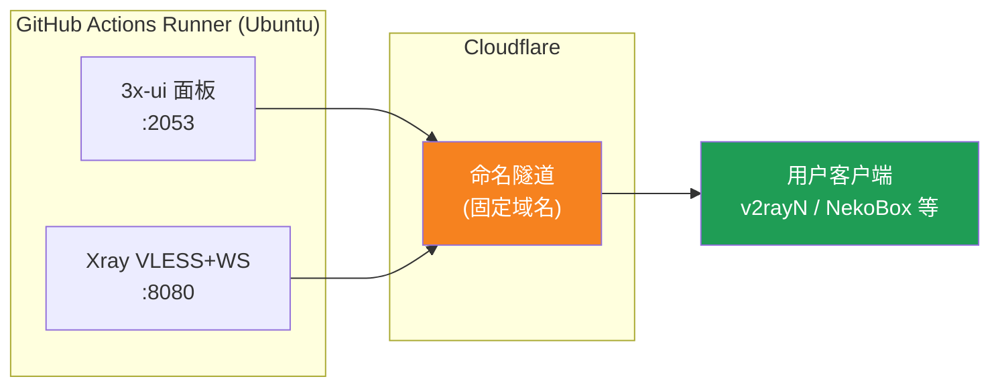
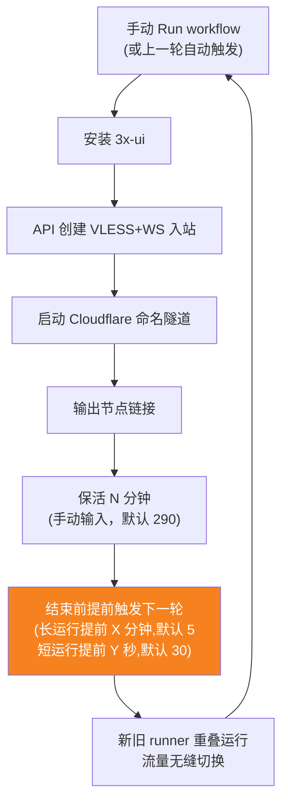
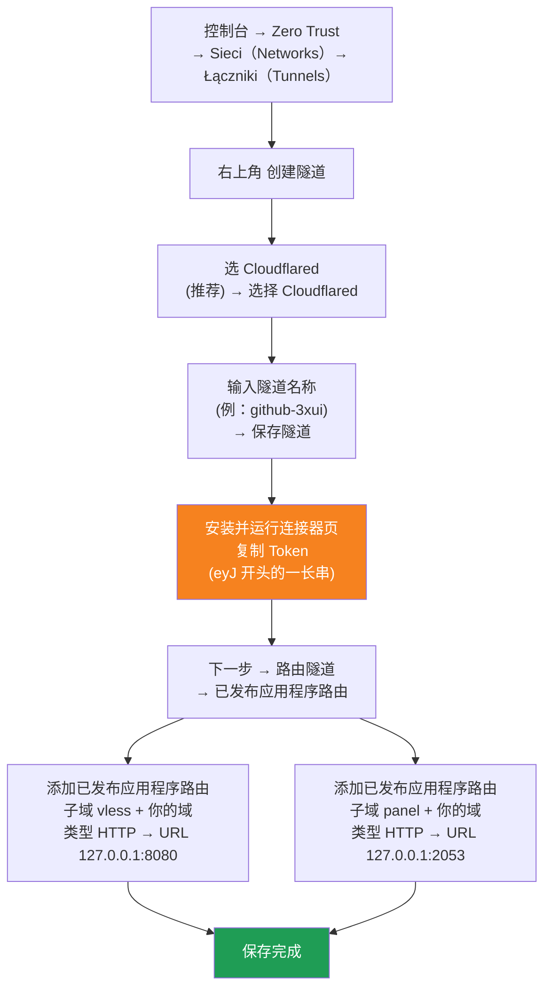

[简体中文](README.md) | [English](README.en.md) | [Русский](README.ru.md) | [日本語](README.ja.md) | [한국어](README.ko.md) | [Español](README.es.md) | [العربية](README.ar.md) | [Čeština](README.cs.md) | [Dansk](README.da.md) | [Deutsch](README.de.md) | [Esperanto](README.eo.md) | [فارسی](README.fa.md) | [Suomi](README.fi.md) | [Français](README.fr.md) | [Ελληνικά](README.gr.md) | [Magyar](README.hu.md) | [Bahasa Indonesia](README.id.md) | [Italiano](README.it.md) | [മലയാളം](README.ml.md) | [Nederlands](README.nl.md) | [Norsk](README.no.md) | [Polski](README.pl.md) | [Português](README.ptbr.md) | [Română](README.ro.md) | [Türkçe](README.tr.md) | [Українська](README.ua.md) | [Tiếng Việt](README.vn.md)

# ☁️ cloud-3xui — Darmowy węzeł VLESS na GitHub

Automatyczne wdrażanie panelu 3x-ui + węzła VLESS na darmowych serwerach GitHub Actions, ze stałą domeną i automatycznym odnawianiem po utracie połączenia.

## Schemat architektury



## Przebieg automatycznego odnawiania



## Automatyczne odnawianie

- **Czas trwania zależy od Ciebie**: przy Run workflow wpisz ręcznie `run_minutes`, działa tyle minut ile wpiszesz; puste pole używa domyślnych 290
- **Automatyczne dziedziczenie parametrów**: każda runda przekazuje `run_minutes` / `countdown_interval` / `countdown_unit` / `overlap_threshold` / `overlap_long` / `overlap_short` do następnej, cały łańcuch używa wartości początkowo wprowadzonych przez Ciebie
- **Nakładające się uruchamianie (płynne przejście)**: wyzwala wcześniej następne uruchomienie przed zakończeniem bieżącego, stare i nowe runnery są jednocześnie online, tunel Cloudflare obsługuje wiele połączeń, ruch jest automatycznie rozdzielany na dostępne połączenia, użytkownik prawie nie odczuwa zakończenia starego. Moment wyzwolenia jest konfigurowalny: keep-alive większy niż `overlap_threshold` (domyślnie 5 minut) to długie uruchomienie, wyzwalane wcześniej o `overlap_long` (domyślnie 5 minut); mniejszy to krótkie uruchomienie, wyzwalane wcześniej o `overlap_short` (domyślnie 30 sekund)
- Do szybkiego testu wpisz `5`, do codziennego użytku zostaw puste (290)
- Domena i UUID są stałe, klienta konfigurujesz raz
- Aby zatrzymać, kliknij Cancel w Actions· po anulowaniu nie uruchomi się ponownie sam

## Stałe adresy

| Przeznaczenie | Adres |
|------|------|
| Węzeł | `vless.mallow.ccwu.cc:443`（VLESS + WebSocket + TLS） |
| Panel | `https://panel.mallow.ccwu.cc/panel`（nazwa użytkownika `admin`） |

> ⚠️ Powyższe domeny to przykłady — zastąp je własną domeną.

## Szczegółowe kroki konfiguracji

### Darmowa domena (nie masz domeny?)

Nie masz własnej domeny? Możesz zarejestrować ją za darmo na https://my.dnshe.com/ (np. `.ccwu.cc`, ważna 10 lat), a następnie skierować serwery nazw (NS) domeny do Cloudflare.

### Krok 1: Utworzenie nazwanego tunelu w Cloudflare

Oficjalna strona Cloudflare: https://www.cloudflare-cn.com (krajowa) / https://www.cloudflare.com (międzynarodowa)

Konsola: https://dash.cloudflare.com



Szczegółowe kroki:

1. Otwórz [panel Cloudflare](https://dash.cloudflare.com) i z menu po lewej przejdź do **Zero Trust** → **Sieci（Networks）** → **Łączniki（Tunnels）**
2. Kliknij w prawym górnym rogu **Utwórz tunel**
3. **Wybierz typ tunelu**: wybierz **Cloudflared** (zalecane) i kliknij **Wybierz Cloudflared**
4. **Nazwij tunel**: wpisz nazwę (np. `github-3xui`) i kliknij **Zapisz tunel**
5. **Zainstaluj i uruchom konektor**: strona wyświetli polecenie instalacyjne. Skopiuj długi ciąg znaków zaczynający się od `eyJ` — to jest **Token** — i dobrze go zachowaj (przyda się później jako GitHub Secret). **Nie musisz** niczego instalować lokalnie; kliknij dalej, aby kontynuować
6. **Kieruj tunel**: przejdź do zakładki **opublikowane trasy aplikacji** i kliknij **Dodaj opublikowaną trasę aplikacji**, aby dodać dwa wpisy:

   **Pierwszy (węzeł):**
   - Subdomain (subdomena): `vless`
   - Domain (domena): wybierz własną domenę
   - Service Type (typ usługi): `HTTP`
   - URL: `127.0.0.1:8080`

   **Drugi (panel):**
   - Subdomain (subdomena): `panel`
   - Domain (domena): wybierz własną domenę
   - Service Type (typ usługi): `HTTP`
   - URL: `127.0.0.1:2053`

7. Zapisz. Cloudflare automatycznie utworzy rekordy DNS — nie trzeba nic dodawać ręcznie. Jeśli status tunelu na liście Łączniki to **Prawidłowy**, konfiguracja się powiodła.

### Krok 2: Wygenerowanie UUID

1. Otwórz https://1024tools.com/uuid/
2. Skopiuj wygenerowany UUID (np. `cbfc229f-9d34-4fef-9990-8baa82a7327b`)
3. **Koniecznie zapamiętaj ten UUID** — nie pojawia się on w logach workflowu w postaci jawnej, a jest potrzebny przy każdym składaniu linku do węzła

### Krok 3: Dodanie sekretów w GitHub

1. Wejdź do tego repozytorium i kliknij zakładkę **Settings**
2. Po lewej **Secrets and variables** → **Actions**
3. Kliknij w prawym górnym rogu **New repository secret** i dodaj kolejno te trzy:

   | Name | Secret (wartość) | Opis |
   |------|-------------|------|
   | `CF_TUNNEL_TOKEN` | Token tunelu skopiowany w kroku 1 | Poświadczenie tunelu Cloudflare |
   | `PANEL_PASSWORD` | Ustawione przez Ciebie hasło panelu | Hasło logowania do panelu 3x-ui |
   | `VLESS_UUID` | UUID wygenerowany w kroku 2 | UUID węzła, stały i niezmienny |

### Krok 4: Uruchomienie workflowu

1. Kliknij zakładkę **Actions** u góry repozytorium
2. Po lewej wybierz **3x-ui VLESS Node**
3. Kliknij po prawej przycisk **Run workflow**
4. W wyświetlonym formularzu:
   - **Panel password**：zostaw puste (automatycznie użyty zostanie sekret `PANEL_PASSWORD`)
     Hasło panelu (puste = użycie sekretu `PANEL_PASSWORD`)
   - **Run duration**：domyślnie `290` (minut); do pierwszego testu możesz wpisać `5` dla szybkiej weryfikacji
     Czas działania (minuty, domyślnie 290, maks. 340)
   - **Countdown output interval**: interwał wyświetlania odliczania, domyślnie `1`, wpisz `0` aby wyłączyć
     Interwał wyświetlania odliczania (domyślnie 1, 0 aby wyłączyć)
   - **Countdown interval unit**: jednostka interwału odliczania, wybierz `minutes` lub `seconds` z listy rozwijanej
     Jednostka interwału wyświetlania odliczania
   - **Overlap threshold**: próg nakładania (minuty, domyślnie `5`), keep-alive dłuższy niż ta wartość to długie uruchomienie
     Próg nakładania (minuty, domyślnie 5): keep-alive dłuższy niż ta wartość to długie uruchomienie
   - **Overlap long**: minuty wcześniejszego wyzwolenia dla długich uruchomień (domyślnie `5`)
     Minuty wcześniejszego wyzwolenia dla długich uruchomień (domyślnie 5)
   - **Overlap short**: sekundy wcześniejszego wyzwolenia dla krótkich uruchomień (domyślnie `30`)
     Sekundy wcześniejszego wyzwolenia dla krótkich uruchomień (domyślnie 30)
5. Kliknij zielony przycisk **Run workflow**, aby rozpocząć

### Krok 5: Pobranie linku do węzła

1. Odczekaj ok. 2–3 minuty i kliknij uruchomione zadanie, aby przejść do szczegółów
2. Rozwiń krok **Start named Cloudflare tunnel** i zobacz wyjście logu:
   ```
   ==================================================
     Panel Panel: https://panel.mallow.ccwu.cc/panel  (admin / twoje hasło your password)

     Węzeł VLESS node:
     vless://YOUR_UUID@vless.mallow.ccwu.cc:443?encryption=none&security=tls&sni=vless.mallow.ccwu.cc&type=ws&path=%2Fws#GitHub-3xui

     Zamień YOUR_UUID na UUID z sekretu VLESS_UUID
     Replace YOUR_UUID with the UUID from your VLESS_UUID secret
     域名：去 Settings → Secrets and variables → Actions → Variables 改 VLESS_HOST / PANEL_HOST 变量
     Domain: set the VLESS_HOST / PANEL_HOST variables in Settings → Secrets and variables → Actions → Variables
   ==================================================
   ```
3. Skopiuj link `vless://` i zamień `YOUR_UUID` na własny UUID
4. Wklej go do klienta v2rayN / v2rayNG / Streisand / NekoBox itd. i możesz korzystać

### Krok 6: Weryfikacja automatycznego odnawiania (opcjonalnie)

1. Przy pierwszym uruchomieniu ustaw czas na `5` minut
2. Po 5 minutach sprawdź log ostatniego kroku **Trigger next run** — powinien pokazywać:
   ```
   HTTP 204
   Uruchomiono następne uruchomienie Next run triggered
   ```
3. Wróć do listy Actions — powinno pojawić się nowe, automatycznie wyzwolone uruchomienie
4. Po potwierdzeniu uruchom ponownie i ustaw czas z powrotem na `290` do normalnego użytku

## Opis kroków workflowu

| Krok | Polski | English | Opis |
|------|------|---------|------|
| Install 3x-ui | Instalacja 3x-ui | Install 3x-ui | Instalacja panelu oficjalnym skryptem, nieinteraktywnie |
| Create VLESS+WS inbound via API | Utworzenie inboundu VLESS+WS przez API | Create VLESS+WS inbound via API | Logowanie tokenem API i automatyczne utworzenie inboundu |
| Start named Cloudflare tunnel | Uruchomienie nazwanego tunelu Cloudflare | Start named Cloudflare tunnel | Połączenie z tunelem o stałej domenie przy użyciu tokenu |
| Keep alive | Utrzymanie aktywności | Keep alive | Usypia na określoną liczbę minut, co minutę sprawdza stan usług, wyświetla odliczanie w ustawionym interwale |
| Trigger next run | Wyzwolenie następnego uruchomienia | Trigger next run | Wywołanie API w celu automatycznego uruchomienia kolejnej rundy |

## Częste pytania

**P: UUID w linku do węzła w logu wyświetla się jako `***`?**
O: To mechanizm ochrony sekretów GitHub. Zamień `YOUR_UUID` na UUID, który sam wpisałeś w sekrecie `VLESS_UUID`.

**P: Test klienta nie przechodzi (-1)?**
O: Sprawdź trzy rzeczy: ① czy UUID został poprawnie podmieniony; ② czy wersja klienta jest aktualna (v2rayN 7.x+); ③ czy tunel Cloudflare jest poprawnie połączony (zobacz log).

**P: Automatyczny restart nie został wyzwolony?**
O: Sprawdź log kroku **Trigger next run**. Jeśli widnieje kod HTTP inny niż 204, sprawdź ustawienia uprawnień Actions repozytorium.

**P: Czy połączenie zostanie przerwane podczas rotacji?**
O: Stosujemy nakładający się start: następna runda jest uruchamiana przed zakończeniem bieżącej, stary i nowy runner działają jednocześnie, teoretycznie niezauważalnie. W skrajnych przypadkach (np. kolejka GitHub) mogą wystąpić krótkie wahania, klient połączy się ponownie automatycznie.

**P: Chcesz zatrzymać automatyczne odnawianie?**
O: Na stronie Actions anuluj (Cancel) bieżące uruchomienie — kolejne nie zostanie automatycznie wyzwolone.

## Uwagi

- **Prędkość**: ruch przechodzi przez Cloudflare → centra danych GitHub (USA/Europa), nadaje się tylko do tymczasowego/lekkiego użytku
- **Płynne przejście**: przy nakładającym się uruchamianiu każda runda startuje następną 5 minut wcześniej, stary i nowy runner jednocześnie online, teoretycznie użytkownik niczego nie zauważa; w skrajnych przypadkach (np. kolejka GitHub) mogą wystąpić krótkie wahania
- **Zgodność**: uruchamianie proxy na GitHub Actions może naruszać ToS z ryzykiem zablokowania konta — oceń samodzielnie
- **Bezpieczeństwo**: nie publikuj `CF_TUNNEL_TOKEN` / `PANEL_PASSWORD` / `VLESS_UUID` w miejscach publicznych