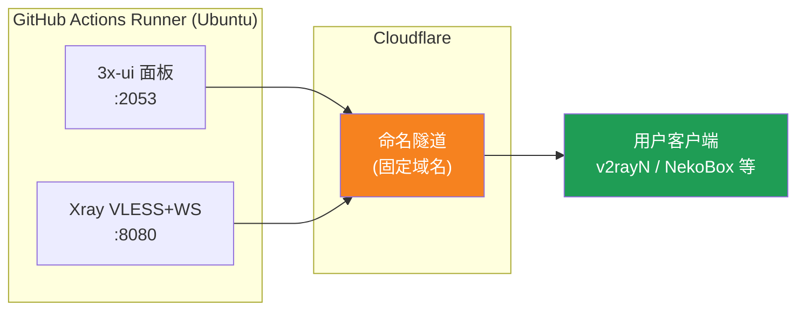
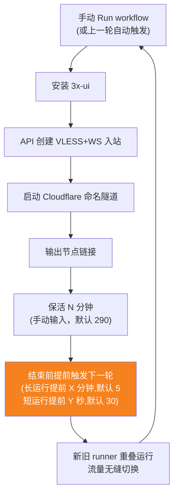
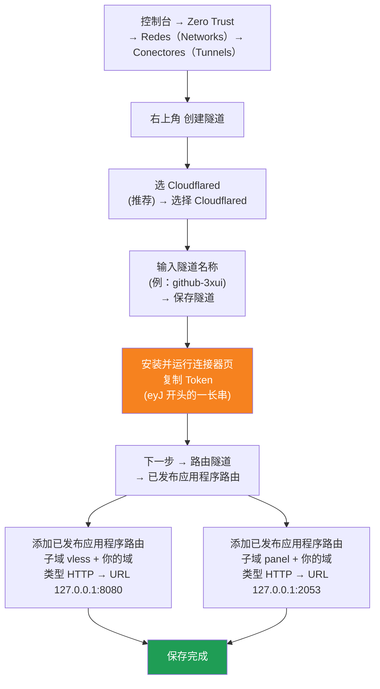

[简体中文](README.md) | [English](README.en.md) | [Русский](README.ru.md) | [日本語](README.ja.md) | [한국어](README.ko.md) | [Español](README.es.md) | [العربية](README.ar.md) | [Čeština](README.cs.md) | [Dansk](README.da.md) | [Deutsch](README.de.md) | [Esperanto](README.eo.md) | [فارسی](README.fa.md) | [Suomi](README.fi.md) | [Français](README.fr.md) | [Ελληνικά](README.gr.md) | [Magyar](README.hu.md) | [Bahasa Indonesia](README.id.md) | [Italiano](README.it.md) | [മലയാളം](README.ml.md) | [Nederlands](README.nl.md) | [Norsk](README.no.md) | [Polski](README.pl.md) | [Português](README.ptbr.md) | [Română](README.ro.md) | [Türkçe](README.tr.md) | [Українська](README.ua.md) | [Tiếng Việt](README.vn.md)

# ☁️ cloud-3xui — Nó VLESS gratuito com GitHub

Implante automaticamente um painel 3x-ui + nó VLESS usando os servidores gratuitos do GitHub Actions, com domínio fixo e renovação automática após queda de conexão.

## Diagrama de arquitetura



## Fluxo de renovação automática



## Renovação automática

- **A duração é você quem decide**: ao executar Run workflow preencha `run_minutes` manualmente, dura os minutos informados; vazio usa o padrão 290
- **Herança automática de parâmetros**: cada ciclo repassa `run_minutes` / `countdown_interval` / `countdown_unit` / `overlap_threshold` / `overlap_long` / `overlap_short` para o próximo, toda a cadeia usa os valores que você preencheu inicialmente
- **Inicialização sobreposta (transição perfeita)**: aciona antecipadamente a próxima execução antes que a atual termine, runners antigos e novos ficam online simultaneamente, o túnel Cloudflare suporta múltiplas conexões, o tráfego é distribuído automaticamente para as conexões disponíveis, o usuário quase não percebe a saída do ciclo antigo. O momento do acionamento é configurável: keep-alive maior que `overlap_threshold` (padrão 5 minutos) conta como execução longa, acionada `overlap_long` (padrão 5 minutos) antes; menor conta como execução curta, acionada `overlap_short` (padrão 30 segundos) antes
- Para teste rápido digite `5`, para uso diário deixe vazio (290)
- Domínio e UUID são fixos, configure o cliente uma única vez
- Para parar clique Cancel em Actions· após o cancelamento não reiniciará sozinho

## Endereços fixos

| Finalidade | Endereço |
|------|------|
| Nó | `vless.mallow.ccwu.cc:443`（VLESS + WebSocket + TLS） |
| Painel | `https://panel.mallow.ccwu.cc/panel`（nome de usuário `admin`） |

> ⚠️ Os domínios acima são exemplos — substitua-os pelo seu próprio domínio.

## Etapas detalhadas de configuração

### Etapa 1: Criar um túnel nomeado no Cloudflare

Site oficial da Cloudflare: https://www.cloudflare-cn.com (nacional) / https://www.cloudflare.com (internacional)

Painel: https://dash.cloudflare.com



Etapas detalhadas:

1. Abra o [painel do Cloudflare](https://dash.cloudflare.com) e, no menu à esquerda, acesse **Zero Trust** → **Redes（Networks）** → **Conectores（Tunnels）**
2. Clique em **Criar túnel** no canto superior direito
3. **Escolha o tipo de túnel**: selecione **Cloudflared** (recomendado) e clique em **Selecionar Cloudflared**
4. **Dê um nome ao túnel**: digite um nome (por exemplo, `github-3xui`) e clique em **Salvar túnel**
5. **Instale e execute o conector**: a página exibirá um comando de instalação. Copie a longa sequência de caracteres que começa com `eyJ` — este é o **Token** — e guarde-a bem (você a usará depois em um GitHub Secret). **Não** é preciso instalar nada localmente; clique em avançar para continuar
6. **Encaminhe o túnel**: vá até a guia **rotas de aplicativo publicadas** e clique em **Adicionar rota de aplicativo publicada** para adicionar duas:

   **Primeira (nó):**
   - Subdomain (subdomínio): `vless`
   - Domain (domínio): escolha o seu próprio domínio
   - Service Type (tipo de serviço): `HTTP`
   - URL: `127.0.0.1:8080`

   **Segunda (painel):**
   - Subdomain (subdomínio): `panel`
   - Domain (domínio): escolha o seu próprio domínio
   - Service Type (tipo de serviço): `HTTP`
   - URL: `127.0.0.1:2053`

7. Salve. O Cloudflare criará os registros DNS automaticamente — não é preciso adicionar nada manualmente. Se o status do túnel na lista de Conectores estiver **Íntegro**, a configuração foi bem-sucedida.

### Etapa 2: Gerar um UUID

1. Abra https://1024tools.com/uuid/
2. Copie o UUID gerado (por exemplo, `cbfc229f-9d34-4fef-9990-8baa82a7327b`)
3. **Guarde bem este UUID** — ele não aparece em texto puro nos logs do workflow, e você precisará dele toda vez que montar o link do nó

### Etapa 3: Adicionar Secrets no GitHub

1. Abra este repositório e clique na aba **Settings**
2. À esquerda, **Secrets and variables** → **Actions**
3. Clique em **New repository secret** no canto superior direito e adicione os três em sequência:

   | Name | Secret (valor) | Descrição |
   |------|-------------|------|
   | `CF_TUNNEL_TOKEN` | Tunnel Token copiado na etapa 1 | Credencial do túnel Cloudflare |
   | `PANEL_PASSWORD` | A senha do painel definida por você | Senha de login do painel 3x-ui |
   | `VLESS_UUID` | UUID gerado na etapa 2 | UUID do nó, fixo e imutável |

### Etapa 4: Executar o workflow

1. Clique na aba **Actions** no topo do repositório
2. À esquerda, selecione **3x-ui VLESS Node**
3. Clique no botão **Run workflow** à direita
4. No formulário exibido:
   - **Panel password**：deixe em branco (usa automaticamente o secret `PANEL_PASSWORD`)
     Senha do painel (em branco = usa o secret `PANEL_PASSWORD`)
   - **Run duration**：padrão `290` (minutos); para o primeiro teste, você pode preencher `5` para uma verificação rápida
     Duração da execução (minutos, padrão 290, máximo 340)
   - **Countdown output interval**: intervalo de exibição da contagem regressiva, padrão `1`, digite `0` para desativar
     Intervalo de exibição da contagem regressiva (padrão 1, 0 para desativar)
   - **Countdown interval unit**: unidade do intervalo da contagem regressiva, selecione `minutes` ou `seconds` no menu suspenso
     Unidade do intervalo de exibição da contagem regressiva
   - **Overlap threshold**: limite de sobreposição (minutos, padrão `5`), keep-alive maior que isso conta como execução longa
     Limite de sobreposição (minutos, padrão 5): keep-alive maior que isso conta como execução longa
   - **Overlap long**: minutos de acionamento antecipado para execuções longas (padrão `5`)
     Minutos de acionamento antecipado para execuções longas (padrão 5)
   - **Overlap short**: segundos de acionamento antecipado para execuções curtas (padrão `30`)
     Segundos de acionamento antecipado para execuções curtas (padrão 30)
5. Clique no botão verde **Run workflow** para iniciar

### Etapa 5: Obter o link do nó

1. Aguarde cerca de 2–3 minutos e clique na tarefa em execução para abrir os detalhes
2. Expanda a etapa **Start named Cloudflare tunnel** e veja a saída do log:
   ```
   ==================================================
     Painel Panel: https://panel.mallow.ccwu.cc/panel  (admin / sua senha your password)

     Nó VLESS node:
     vless://YOUR_UUID@vless.mallow.ccwu.cc:443?encryption=none&security=tls&sni=vless.mallow.ccwu.cc&type=ws&path=%2Fws#GitHub-3xui

     Substitua YOUR_UUID pelo UUID do seu secret VLESS_UUID
     Replace YOUR_UUID with the UUID from your VLESS_UUID secret
     域名：去 Settings → Secrets and variables → Actions → Variables 改 VLESS_HOST / PANEL_HOST 变量
     Domain: set the VLESS_HOST / PANEL_HOST variables in Settings → Secrets and variables → Actions → Variables
   ==================================================
   ```
3. Copie o link `vless://` e substitua `YOUR_UUID` pelo seu próprio UUID
4. Cole em v2rayN / v2rayNG / Streisand / NekoBox ou outro cliente e já pode usar

### Etapa 6: Verificar a renovação automática (opcional)

1. Na primeira execução, defina a duração como `5` minutos
2. Após 5 minutos, verifique o log da última etapa **Trigger next run** — ele deve mostrar:
   ```
   HTTP 204
   Próxima execução disparada Next run triggered
   ```
3. Volte à lista de Actions — uma nova execução disparada automaticamente deve aparecer
4. Após confirmar, execute novamente e volte a duração para `290` para uso normal

## Descrição das etapas do workflow

| Etapa | Português | English | Descrição |
|------|------|---------|------|
| Install 3x-ui | Instalar o 3x-ui | Install 3x-ui | Instala o painel de forma não interativa com o script oficial |
| Create VLESS+WS inbound via API | Criar inbound VLESS+WS via API | Create VLESS+WS inbound via API | Login com o API Token e criação automática do inbound |
| Start named Cloudflare tunnel | Iniciar o túnel nomeado do Cloudflare | Start named Cloudflare tunnel | Conecta ao túnel de domínio fixo usando o Token |
| Keep alive | Manter ativo | Keep alive | Dorme pelo número de minutos especificado, verifica o status dos serviços a cada minuto, exibe a contagem regressiva no intervalo definido |
| Trigger next run | Disparar a próxima execução | Trigger next run | Chama a API para iniciar automaticamente a próxima rodada |

## Perguntas frequentes

**P: O UUID do link do nó aparece como `***` no log?**
R: Este é o mecanismo de proteção de secrets do GitHub. Substitua `YOUR_UUID` pelo UUID que você mesmo preencheu no secret `VLESS_UUID`.

**P: O teste do cliente falha (-1)?**
R: Verifique três pontos: ① se o UUID foi substituído corretamente; ② se a versão do cliente está atualizada (v2rayN 7.x+); ③ se o túnel do Cloudflare está conectado normalmente (veja o log).

**P: A reinicialização automática não foi disparada?**
R: Veja o log da etapa **Trigger next run**. Se mostrar um código de status HTTP diferente de 204, verifique as configurações de permissão de Actions do repositório.

**P: A conexão vai cair durante a rotação?**
R: Usamos inicialização sobreposta: a próxima rodada é disparada antes do fim da atual, os runners antigo e novo ficam online simultaneamente, em teoria imperceptível. Em casos extremos (ex. fila do GitHub) pode haver breve oscilação, o cliente reconecta automaticamente.

**P: Quer parar a renovação automática?**
R: Na página de Actions, cancele (Cancel) a execução atual — nenhuma nova será disparada automaticamente.

## Observações

- **Velocidade**: o tráfego passa pelo Cloudflare → datacenters do GitHub (EUA/Europa), adequado apenas para uso temporário/leve
- **Transição perfeita**: com inicialização sobreposta, cada ciclo inicia o próximo 5 minutos antes, runner antigo e novo online simultaneamente, teoricamente o usuário não percebe nada; em casos extremos (ex. fila do GitHub) pode haver breve oscilação
- **Conformidade**: rodar um proxy no GitHub Actions pode violar os ToS, com risco de banimento da conta — avalie por conta própria
- **Segurança**: não publique `CF_TUNNEL_TOKEN` / `PANEL_PASSWORD` / `VLESS_UUID` em locais públicos