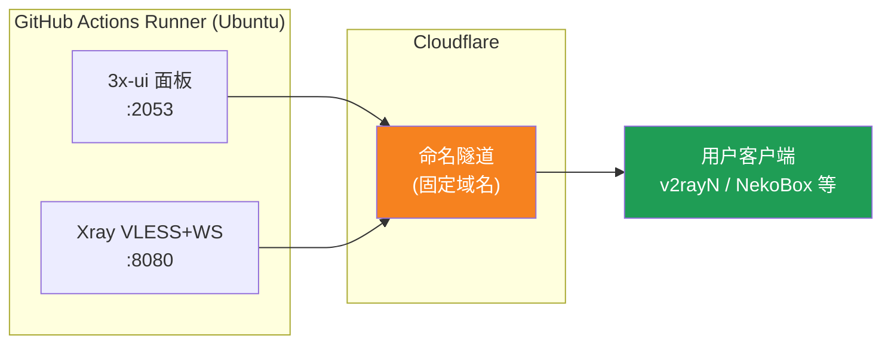
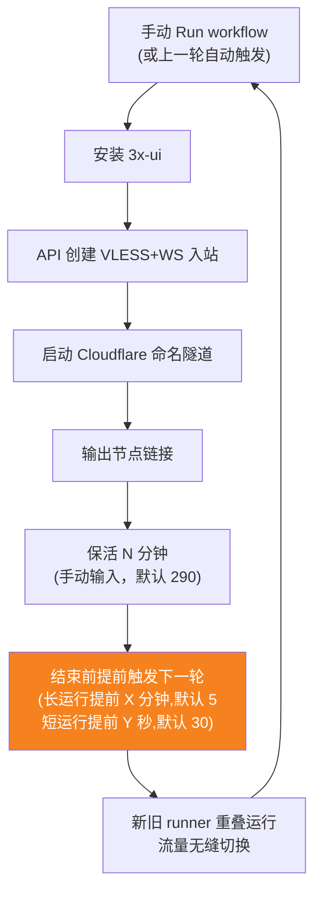
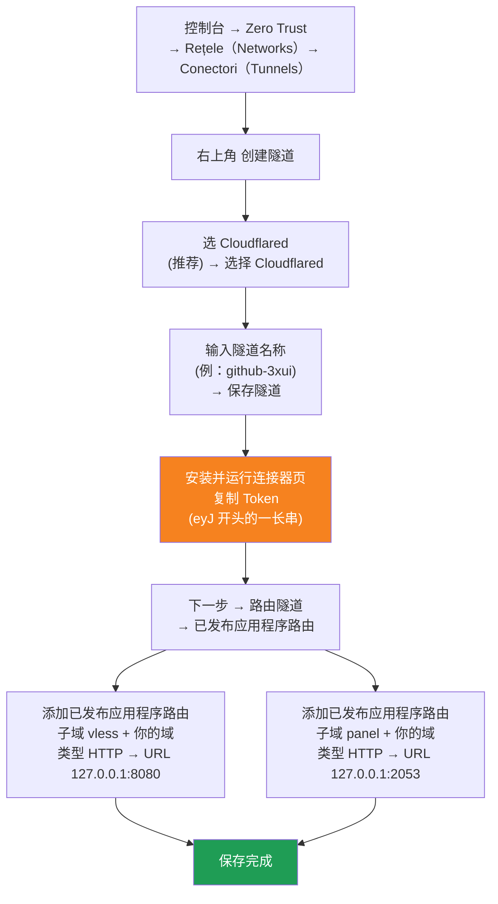

[简体中文](README.md) | [English](README.en.md) | [Русский](README.ru.md) | [日本語](README.ja.md) | [한국어](README.ko.md) | [Español](README.es.md) | [العربية](README.ar.md) | [Čeština](README.cs.md) | [Dansk](README.da.md) | [Deutsch](README.de.md) | [Esperanto](README.eo.md) | [فارسی](README.fa.md) | [Suomi](README.fi.md) | [Français](README.fr.md) | [Ελληνικά](README.gr.md) | [Magyar](README.hu.md) | [Bahasa Indonesia](README.id.md) | [Italiano](README.it.md) | [മലയാളം](README.ml.md) | [Nederlands](README.nl.md) | [Norsk](README.no.md) | [Polski](README.pl.md) | [Português](README.ptbr.md) | [Română](README.ro.md) | [Türkçe](README.tr.md) | [Українська](README.ua.md) | [Tiếng Việt](README.vn.md)

# ☁️ cloud-3xui — Nod VLESS gratuit pe GitHub

Creează automat un panou 3x-ui + nod VLESS pe serverele gratuite GitHub Actions, cu domeniu fix și reînnoire automată la deconectare.

## Diagramă de arhitectură



## Fluxul de reînnoire automată



## Reînnoire automată

- **Durata o stabilești tu**: la Run workflow completează manual `run_minutes`, rulează câte minute introduci; gol folosește implicitul 290
- **Moștenire automată a parametrilor**: fiecare rundă transmite `run_minutes` / `countdown_interval` / `countdown_unit` / `overlap_threshold` / `overlap_long` / `overlap_short` mai departe, întregul lanț folosește valorile introduse inițial de tine
- **Pornire suprapusă (tranziție fără întreruperi)**: declanșează din timp următoarea rulare înainte ca cea curentă să se termine, runner-ele vechi și noi sunt online simultan, tunelul Cloudflare suportă mai multe conexiuni, traficul este distribuit automat către conexiunile disponibile, utilizatorul aproape nu simte ieșirea celui vechi. Momentul declanșării e configurabil: keep-alive mai mare decât `overlap_threshold` (implicit 5 minute) e considerat rulare lungă, declanșată cu `overlap_long` (implicit 5 minute) mai devreme; dacă e mai mic e considerat rulare scurtă, declanșată cu `overlap_short` (implicit 30 secunde) mai devreme
- Pentru test rapid introdu `5`, pentru uz zilnic lasă gol (290)
- Domeniul și UUID sunt fixe, configurezi clientul o singură dată
- Pentru oprire apasă Cancel în Actions· după anulare nu repornește automat

## Adrese fixe

| Utilizare | Adresă |
|------|------|
| Nod | `vless.mallow.ccwu.cc:443`（VLESS + WebSocket + TLS） |
| Panou | `https://panel.mallow.ccwu.cc/panel`（utilizator `admin`） |

> ⚠️ Domeniile de mai sus sunt exemple. Pentru a le modifica, editați variabilele `VLESS_HOST` / `PANEL_HOST` din Settings → Secrets and variables → Actions → Variables — nu trebuie să editați fișierul workflow.

## Configurarea domeniului

Domeniile nodului și ale panoului se află în variabile GitHub — nu trebuie să editați fișierul workflow:

| Variabilă | Valoare exemplu | Descriere |
|-----------|-----------------|-----------|
| `VLESS_HOST` | `vless.mallow.ccwu.cc` | Adresa nodului (nume complet de gazdă) |
| `PANEL_HOST` | `panel.mallow.ccwu.cc` | Adresa panoului (nume complet de gazdă) |

**Cum se modifică**: mergeți la **Settings** → **Secrets and variables** → **Actions** → fila **Variables** → **New repository variable** și completați numele și valoarea. Modificarea intră în vigoare de la următoarea rulare a workflow-ului.

**Trei lucruri de reținut**:
- Fiecare variabilă conține **numele complet de gazdă** (inclusiv prefixul subdomeniului), deci nodul și panoul pot indica domenii diferite — nu trebuie să aibă același domeniu părinte
- Valorile trebuie să corespundă cu numele publice de gazdă (Public Hostnames) create în tunelul Cloudflare la pasul 1 (`vless` → 127.0.0.1:8080, `panel` → 127.0.0.1:2053), altfel linkul nu va funcționa
- Dacă o variabilă nu este setată, bannerul afișează un substituent pentru elementul respectiv (`vless.YOUR_DOMAIN` / `panel.YOUR_DOMAIN`)

## Pași detaliați de configurare

### Domeniu gratuit (nu ai domeniu?)

Nu ai domeniu propriu? Poți înregistra unul gratuit pe https://my.dnshe.com/ (ex. `.ccwu.cc`, valabil 10 ani), apoi direcționează serverele de nume (NS) ale domeniului către Cloudflare.

### Pasul 1: Creați un Named Tunnel în Cloudflare

Site-ul oficial Cloudflare: https://www.cloudflare-cn.com (intern) / https://www.cloudflare.com (internațional)

Consolă: https://dash.cloudflare.com



Pași detaliați:

1. Deschideți [Cloudflare Dashboard](https://dash.cloudflare.com), din meniul din stânga intrați la **Zero Trust** → **Rețele（Networks）** → **Conectori（Tunnels）**
2. Faceți clic pe **Creați un tunel** în colțul din dreapta sus
3. **Selectați tipul de tunel**: alegeți **Cloudflared** (recomandat), faceți clic pe **Selectați Cloudflared**
4. **Dați tunelului un nume**: introduceți un nume (de exemplu `github-3xui`), faceți clic pe **Salvați tunelul**
5. **Instalați și rulați conectorul**: pagina va afișa o comandă de instalare, copiați șirul lung de caractere care începe cu `eyJ` — acesta este **Token**-ul, păstrați-l bine (îl veți folosi ulterior într-un GitHub Secret). **Nu este nevoie** să instalați nimic local, continuați cu pasul următor
6. **Rutați tunelul**: intrați în fila **Rute de aplicații publicate**, faceți clic pe **Adăugați o rută de aplicație publicată** și adăugați două:

   **Primul (nodul):**
   - Subdomeniu: `vless`
   - Domeniu: selectați domeniul dvs.
   - Tip: `HTTP`
   - URL: `127.0.0.1:8080`

   **Al doilea (panoul):**
   - Subdomeniu: `panel`
   - Domeniu: selectați domeniul dvs.
   - Tip: `HTTP`
   - URL: `127.0.0.1:2053`

7. Salvați. Cloudflare va crea automat rezoluția DNS, nu este nevoie de adăugare manuală. Reveniți la lista Conectori; dacă starea tunelului este **normal**, configurarea a reușit.

### Pasul 2: Generați un UUID

1. Deschideți https://1024tools.com/uuid/
2. Copiați UUID-ul generat (de forma `cbfc229f-9d34-4fef-9990-8baa82a7327b`)
3. **Rețineți neapărat acest UUID**; nu va fi afișat în clar în jurnalul workflow-ului și este necesar de fiecare dată când construiți linkul nodului

### Pasul 3: Adăugați Secrets și Variables în GitHub

1. Intrați în acest repository, faceți clic pe fila **Settings**
2. În stânga **Secrets and variables** → **Actions**
3. Faceți clic pe **New repository secret** în colțul dreapta sus și adăugați cele trei, pe rând:

   | Name | Secret (valoare) | Descriere |
   |------|-------------|------|
   | `CF_TUNNEL_TOKEN` | Tunnel Token copiat la Pasul 1 | Acreditări tunel Cloudflare |
   | `PANEL_PASSWORD` | Parola panoului setată de dvs. | Parolă de conectare la panoul 3x-ui |
   | `VLESS_UUID` | UUID-ul generat la Pasul 2 | UUID-ul nodului, fix și neschimbat |

4. Treceți la fila **Variables**, faceți clic pe **New repository variable** și adăugați două variabile (vedeți secțiunea Configurarea domeniului de mai sus):

   | Name | Valoare | Descriere |
   |------|---------|-----------|
   | `VLESS_HOST` | `vless.mallow.ccwu.cc` | Adresa nodului |
   | `PANEL_HOST` | `panel.mallow.ccwu.cc` | Adresa panoului |

### Pasul 4: Rulați workflow-ul

1. Faceți clic pe fila **Actions** din partea de sus a repository-ului
2. În stânga selectați **3x-ui VLESS Node**
3. Faceți clic pe butonul **Run workflow** din dreapta
4. În formularul apărut:
   - **Panel password**: lăsați gol (se folosește automat secretul `PANEL_PASSWORD`)
     Parola panoului (lăsată goală folosește secretul PANEL_PASSWORD)
   - **Run duration**: implicit `290` (minute), la primul test puteți introduce `5` pentru verificare rapidă
     Durata de rulare (minute, implicit 290, maxim 340)
   - **Countdown output interval**: intervalul de afișare al numărătorii inverse, implicit `1`, introduceți `0` pentru dezactivare
     Intervalul de afișare al numărătorii inverse (implicit 1, 0 pentru dezactivare)
   - **Countdown interval unit**: unitatea intervalului numărătorii inverse, selectați `minutes` sau `seconds` din meniul derulant
     Unitatea intervalului de afișare al numărătorii inverse
   - **Overlap threshold**: prag de suprapunere (minute, implicit `5`), keep-alive-ul mai lung decât atât e considerat rulare lungă
     Prag de suprapunere (minute, implicit 5): keep-alive-ul mai lung decât atât e considerat rulare lungă
   - **Overlap long**: minute de declanșare timpurie pentru rulări lungi (implicit `5`)
     Minute de declanșare timpurie pentru rulări lungi (implicit 5)
   - **Overlap short**: secunde de declanșare timpurie pentru rulări scurte (implicit `30`)
     Secunde de declanșare timpurie pentru rulări scurte (implicit 30)
5. Faceți clic pe butonul verde **Run workflow** pentru a porni

### Pasul 5: Obțineți linkul nodului

1. Așteptați aproximativ 2-3 minute, faceți clic pe taskul în execuție pentru a intra în pagina de detalii
2. Extindeți pasul **Start named Cloudflare tunnel** și consultați ieșirea din jurnal:
   ```
   ==================================================
     面板 Panel: https://panel.mallow.ccwu.cc/panel  (admin / 你的面板密码)

     VLESS 节点 node:
     vless://YOUR_UUID@vless.mallow.ccwu.cc:443?encryption=none&security=tls&sni=vless.mallow.ccwu.cc&type=ws&path=%2Fws#GitHub-3xui

     把 YOUR_UUID 换成你在 VLESS_UUID secret 里填的 UUID
     Replace YOUR_UUID with the UUID from your VLESS_UUID secret
     域名：去 Settings → Secrets and variables → Actions → Variables 改 VLESS_HOST / PANEL_HOST 变量
     Domain: set the VLESS_HOST / PANEL_HOST variables in Settings → Secrets and variables → Actions → Variables
   ==================================================
   ```
3. Copiați linkul `vless://` și înlocuiți `YOUR_UUID` cu UUID-ul dvs. (Domeniul este deja cel real, din variabilele dvs. — nu trebuie înlocuit.)
4. Lipiți-l în clienți precum v2rayN / v2rayNG / Streisand / NekoBox și este gata de utilizare

### Pasul 6: Verificați reînnoirea automată (opțional)

1. La prima rulare setați durata la `5` minute
2. După 5 minute consultați jurnalul ultimului pas **Trigger next run**, ar trebui să afișeze:
   ```
   HTTP 204
   已触发下一次运行 Next run triggered
   ```
3. Reveniți la lista Actions, ar trebui să apară o nouă rulare declanșată automat
4. După confirmare, rulați din nou cu durata setată la `290` pentru utilizare normală

## Descrierea pașilor workflow-ului

| Pas | Română | English | Descriere |
|------|------|---------|------|
| Install 3x-ui | Instalați 3x-ui | Install 3x-ui | Instalează panoul cu scriptul oficial în mod non-interactiv |
| Create VLESS+WS inbound via API | Creați inbound VLESS+WS prin API | Create VLESS+WS inbound via API | Autentificare cu API Token, creare automată a inbound-ului |
| Start named Cloudflare tunnel | Porniți Named Tunnel-ul Cloudflare | Start named Cloudflare tunnel | Conectează tunelul cu domeniu fix folosind Token-ul |
| Keep alive | Menține activ | Keep alive | Doarme numărul specificat de minute, verifică starea serviciilor în fiecare minut, afișează numărătoarea inversă la intervalul setat |
| Trigger next run | Declanșează următoarea rulare | Trigger next run | Apelează API-ul pentru a porni automat următoarea rundă |

## Întrebări frecvente

**Î: UUID-ul din linkul nodului apare ca `***` în jurnal?**
R: Este mecanismul de protecție a secretelor din GitHub. Înlocuiți `YOUR_UUID` cu UUID-ul pe care l-ați completat dvs. în secretul `VLESS_UUID`.

**Î: Domeniul apare ca `YOUR_DOMAIN` în jurnal?**
R: Mergeți la Settings → Secrets and variables → Actions → Variables și creați variabilele `VLESS_HOST` / `PANEL_HOST` cu numele complete de gazdă; asigurați-vă că acestea corespund cu numele publice de gazdă din tunelul dvs. Cloudflare.

**Î: Clientul nu se conectează la test (-1)?**
R: Verificați trei lucruri: ① dacă UUID-ul a fost înlocuit corect; ② dacă versiunea clientului este recentă (v2rayN 7.x+); ③ dacă tunelul Cloudflare este conectat corect (consultați jurnalul).

**Î: Repornirea automată nu s-a declanșat?**
R: Consultați jurnalul pasului **Trigger next run**. Dacă afișează un cod de stare HTTP diferit de 204, verificați setările de permisiuni Actions ale repository-ului.

**Î: Se întrerupe conexiunea la rotație?**
R: Folosim pornire suprapusă: runda următoare este declanșată înainte de încheierea celei curente, runner-ele vechi și nou sunt online simultan, teoretic insesizabil. În cazuri extreme (ex. coadă GitHub) pot apărea fluctuații scurte, clientul se reconectează automat.

**Î: Doriți să opriți reînnoirea automată?**
R: Mergeți la pagina Actions și faceți Cancel la rularea curentă, nu se va mai declanșa automat.

## Note

- **Viteză**: traficul trece prin Cloudflare → serverele GitHub (SUA/Europa), potrivit doar pentru utilizare temporară/ușoară
- **Tranziție fără întreruperi**: cu pornire suprapusă, fiecare rundă pornește următoarea cu 5 minute mai devreme, runner-ul vechi și cel nou online simultan, teoretic utilizatorul nu percepe nimic; în cazuri extreme (ex. coada GitHub) pot apărea fluctuații scurte
- **Conformitate**: rularea unui proxy pe GitHub Actions poate încălca ToS și poate duce la suspendarea contului, evaluați pe propria răspundere
- **Securitate**: nu publicați `CF_TUNNEL_TOKEN` / `PANEL_PASSWORD` / `VLESS_UUID` în locuri publice
