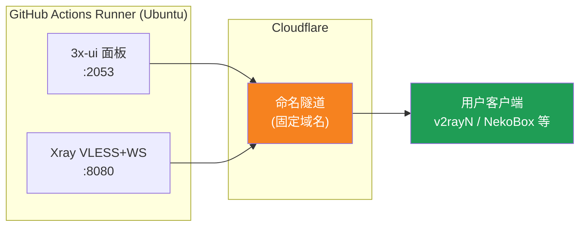
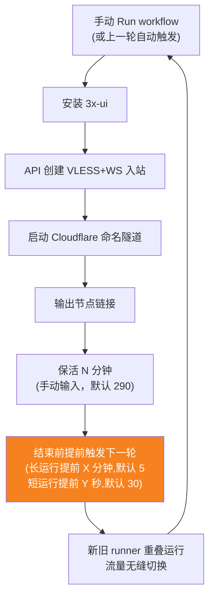
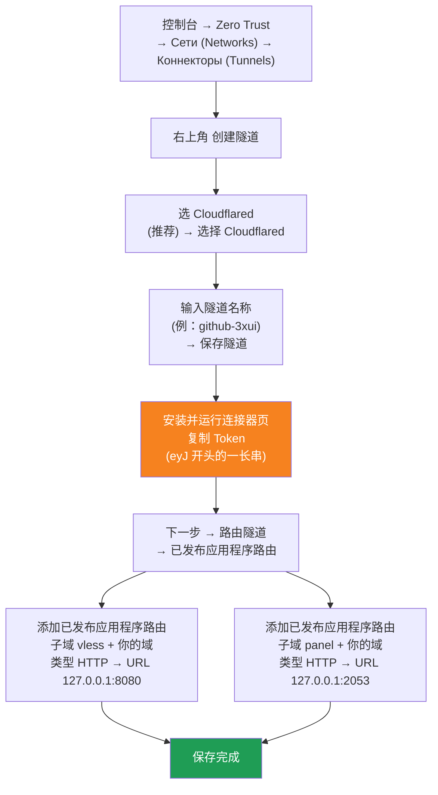

[简体中文](README.md) | [English](README.en.md) | [Русский](README.ru.md) | [日本語](README.ja.md) | [한국어](README.ko.md) | [Español](README.es.md) | [العربية](README.ar.md) | [Čeština](README.cs.md) | [Dansk](README.da.md) | [Deutsch](README.de.md) | [Esperanto](README.eo.md) | [فارسی](README.fa.md) | [Suomi](README.fi.md) | [Français](README.fr.md) | [Ελληνικά](README.gr.md) | [Magyar](README.hu.md) | [Bahasa Indonesia](README.id.md) | [Italiano](README.it.md) | [മലയാളം](README.ml.md) | [Nederlands](README.nl.md) | [Norsk](README.no.md) | [Polski](README.pl.md) | [Português](README.ptbr.md) | [Română](README.ro.md) | [Türkçe](README.tr.md) | [Українська](README.ua.md) | [Tiếng Việt](README.vn.md)

# ☁️ cloud-3xui — Бесплатный VLESS-узел на GitHub

Автоматическая сборка панели 3x-ui и VLESS-узла на бесплатных серверах GitHub Actions: фиксированный домен и автоматическое восстановление соединения.

## Архитектура



## Процесс автоматического восстановления



## Автоматическое восстановление

- **Длительность поддержания соединения задаёте вы**: при нажатии Run workflow вручную заполните `run_minutes` — запуск будет длиться столько минут, сколько вы укажете; если оставить пустым, будет использоваться значение по умолчанию 290
- **Параметры наследуются автоматически**: каждый цикл передаёт `run_minutes` / `countdown_interval` / `countdown_unit` / `overlap_threshold` / `overlap_long` / `overlap_short` следующему циклу через API, поэтому вся цепочка использует значения, которые вы ввели изначально
- Для быстрой проверки введите `5`; для обычного использования оставьте пустым — будет действовать значение по умолчанию 290
- **Перекрывающийся запуск (бесшовное переключение)**: следующий цикл запускается заранее до конца текущего цикла; старый и новый runner работают одновременно, туннели Cloudflare поддерживают несколько подключений, трафик автоматически направляется на доступные подключения, поэтому пользователи почти не замечают завершение старого цикла. Время запуска настраивается: keep-alive дольше `overlap_threshold` (по умолчанию 5 минут) считается длинным циклом и запускает `overlap_long` (по умолчанию 5 минут) заранее; более короткие считаются короткими циклами и запускаются за `overlap_short` (по умолчанию 30 секунд) заранее
- Домен и UUID фиксированы — клиент настраивается один раз и работает постоянно
- Чтобы остановить, перейдите в Actions и нажмите Cancel — после отмены автоматический перезапуск не произойдёт


## Фиксированные адреса

| Назначение | Адрес |
|------------|-------|
| Узел | `vless.mallow.ccwu.cc:443` (VLESS + WebSocket + TLS) |
| Панель | `https://panel.mallow.ccwu.cc/panel` (имя пользователя `admin`) |

> ⚠️ Указанные выше домены приведены в качестве примера — замените их своими.

## Подробные шаги настройки

### Бесплатный домен (нет домена? начните здесь)

Нет собственного домена? Получите бесплатный на https://my.dnshe.com/ (например, `.ccwu.cc`, срок действия 10 лет), затем делегируйте NS-записи домена в Cloudflare.

### Шаг 1. Создание именованного туннеля в Cloudflare


Официальный сайт Cloudflare: https://www.cloudflare-cn.com (Китай) / https://www.cloudflare.com (международный)
Панель управления: https://dash.cloudflare.com



Подробные шаги:

1. Откройте [панель Cloudflare](https://dash.cloudflare.com), в левом меню перейдите в **Zero Trust** → **Сети (Networks)** → **Коннекторы (Tunnels)**
2. Нажмите **Create a tunnel** в правом верхнем углу
3. **Выберите тип туннеля**: выберите **Cloudflared** (рекомендуется) и нажмите **Select Cloudflared**
4. **Назовите туннель**: введите имя (например, `github-3xui`) и нажмите **Save tunnel**
5. **Установите и запустите коннектор**: на странице показана команда установки — скопируйте длинный **токен**, начинающийся с `eyJ`, и сохраните его (позже он понадобится как GitHub Secret). Устанавливать что-либо локально **не** нужно — просто нажмите «Далее»
6. **Маршрутизация туннеля**: перейдите на вкладку **Public hostnames** и нажмите **Add a public hostname**, добавьте две записи:

   **Первая запись (узел):**
   - Поддомен: `vless`
   - Домен: выберите ваш домен
   - Тип: `HTTP`
   - URL: `127.0.0.1:8080`

   **Вторая запись (панель):**
   - Поддомен: `panel`
   - Домен: выберите ваш домен
   - Тип: `HTTP`
   - URL: `127.0.0.1:2053`
7. Сохраните. Cloudflare создаст DNS-записи автоматически. Статус **Healthy** в списке коннекторов (Tunnels) означает успешную настройку.


### Шаг 2. Генерация UUID

1. Откройте https://1024tools.com/uuid/
2. Скопируйте сгенерированный UUID (выглядит примерно так: `cbfc229f-9d34-4fef-9990-8baa82a7327b`)
3. **Обязательно сохраните этот UUID** — он не отображается в открытом виде в логах workflow, и он понадобится каждый раз при сборке ссылки на узел.

### Шаг 3. Добавление секретов в GitHub

1. Откройте этот репозиторий и перейдите на вкладку **Settings**.
2. Слева выберите **Secrets and variables** → **Actions**.
3. Нажмите **New repository secret** в правом верхнем углу и добавьте три секрета:

   | Name | Secret (значение) | Описание |
   |------|-------------------|----------|
   | `CF_TUNNEL_TOKEN` | Tunnel Token, скопированный на шаге 1 | Учётные данные туннеля Cloudflare |
   | `PANEL_PASSWORD` | Заданный вами пароль панели | Пароль для входа в панель 3x-ui |
   | `VLESS_UUID` | UUID, сгенерированный на шаге 2 | UUID узла, не изменяется |

### Шаг 4. Запуск workflow

1. Нажмите вкладку **Actions** вверху репозитория.
2. Слева выберите **3x-ui VLESS Node**.
3. Нажмите кнопку **Run workflow** справа.
4. В открывшейся форме:
   - **Panel password**: оставьте пустым (автоматически используется секрет `PANEL_PASSWORD`)
     Пароль панели (если оставить пустым, используется секрет PANEL_PASSWORD)
   - **Run duration**: по умолчанию `290` (минут); для первой проверки можно ввести `5` для быстрой проверки; для обычного использования просто оставьте пустым
   - **Countdown output interval**: Интервал вывода обратного отсчёта, по умолчанию `1`, введите `0` для отключения
   - **Countdown interval unit**: Единица измерения интервала обратного отсчёта, в выпадающем списке выберите `minutes` или `seconds`
   - **Overlap threshold**: Порог перекрытия (минуты, по умолчанию `5`) — keep-alive дольше этого считается длинным циклом
   - **Overlap long**: За сколько минут до конца запускать следующий цикл при длинном цикле (по умолчанию `5`)
   - **Overlap short**: За сколько секунд до конца запускать следующий цикл при коротком цикле (по умолчанию `30`)
     Длительность работы (минут, по умолчанию 290, максимум 340)
5. Нажмите зелёную кнопку **Run workflow**, чтобы запустить.

### Шаг 5. Получение ссылки на узел

1. Подождите около 2–3 минут, затем нажмите на выполняющуюся задачу, чтобы открыть страницу с деталями.
2. Разверните шаг **Start named Cloudflare tunnel** и проверьте вывод лога:
   ```
   ==================================================
     面板 Panel: https://panel.mallow.ccwu.cc/panel  (admin / 你的面板密码)

     VLESS 节点 node:
     vless://YOUR_UUID@vless.mallow.ccwu.cc:443?encryption=none&security=tls&sni=vless.mallow.ccwu.cc&type=ws&path=%2Fws#GitHub-3xui

     把 YOUR_UUID 换成你在 VLESS_UUID secret 里填的 UUID
     Replace YOUR_UUID with the UUID from your VLESS_UUID secret
     域名：去 Settings → Secrets and variables → Actions → Variables 改 VLESS_HOST / PANEL_HOST 变量
     Domain: set the VLESS_HOST / PANEL_HOST variables in Settings → Secrets and variables → Actions → Variables
   ==================================================
   ```
3. Скопируйте ссылку `vless://` и замените `YOUR_UUID` вашим UUID.
4. Вставьте её в клиент v2rayN / v2rayNG / Streisand / NekoBox или другой клиент — всё готово.

### Шаг 6. Проверка автоматического восстановления (необязательно)

1. При первом запуске установите длительность `5` минут.
2. Через 5 минут проверьте лог последнего шага **Trigger next run** — он должен содержать:
   ```
   HTTP 204
   已触发下一次运行 Next run triggered
   ```
3. Вернитесь к списку Actions — там должен появиться новый автоматически запущенный запуск.
4. Убедившись, что всё работает, запустите заново, вернув длительность `290`, для обычного использования.

## Описание шагов workflow

| Шаг | 中文 | English | Описание |
|-----|------|---------|----------|
| Install 3x-ui | 安装 3x-ui | Install 3x-ui | Неинтерактивная установка панели официальным скриптом |
| Create VLESS+WS inbound via API | 通过 API 创建 VLESS+WS 入站 | Create VLESS+WS inbound via API | Вход по API Token и автоматическое создание входящего соединения |
| Start named Cloudflare tunnel | 启动 Cloudflare 命名隧道 | Start named Cloudflare tunnel | Подключение к туннелю с фиксированным доменом по Token |
| Keep alive | 保活 | Keep alive | Ожидание заданного числа минут с мониторингом состояния сервисов и выводом обратного отсчёта с заданным интервалом |
| Trigger next run | 触发下一次运行 | Trigger next run | Вызов API для автоматического запуска следующего цикла |

## Частые вопросы

**Вопрос: В логах UUID в ссылке на узел отображается как `***`?**
Ответ: Это механизм защиты секретов GitHub. Просто замените `YOUR_UUID` на UUID, указанный вами в секрете `VLESS_UUID`.

**Вопрос: Тест клиента не проходит (-1)?**
Ответ: Проверьте три момента: ① правильно ли заменён UUID; ② достаточно ли свежая версия клиента (v2rayN 7.x+); ③ корректно ли подключён туннель Cloudflare (смотрите логи).

**Вопрос: Автоматический перезапуск не сработал?**
Ответ: Проверьте лог шага **Trigger next run**. Если там отображается HTTP-статус, отличный от 204, проверьте настройки прав Actions в репозитории.

**Вопрос: Прервётся ли соединение при ротации?**
Ответ: Используется перекрывающийся запуск — следующий цикл запускается заранее до конца текущего, старый и новый runner работают одновременно, поэтому теоретически перерыва нет. В экстремальных случаях, например при очереди GitHub, возможны кратковременные колебания; клиент переподключится автоматически.

**Вопрос: Как остановить автоматическое восстановление?**
Ответ: Просто перейдите на страницу Actions и отмените (Cancel) текущий запуск — автоматически он больше не запустится.

## Примечания

- **Скорость**: трафик идёт через Cloudflare → дата-центры GitHub (США/Европа), поэтому подходит только для временного/умеренного использования
- **Бесшовное переключение**: используется перекрывающийся запуск — следующий цикл запускается за 5 минут до конца каждого цикла, старый и новый раннеры работают одновременно, теоретически пользователи ничего не замечают; в экстремальных случаях (например, очередь GitHub) возможны кратковременные колебания
- **Соответствие правилам**: запуск прокси в GitHub Actions может нарушать ToS и привести к блокировке аккаунта — оцените риски самостоятельно
- **Безопасность**: не публикуйте `CF_TUNNEL_TOKEN` / `PANEL_PASSWORD` / `VLESS_UUID` в открытых местах
