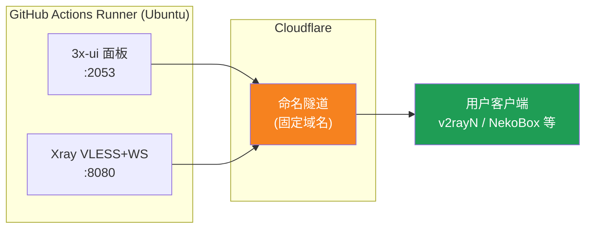
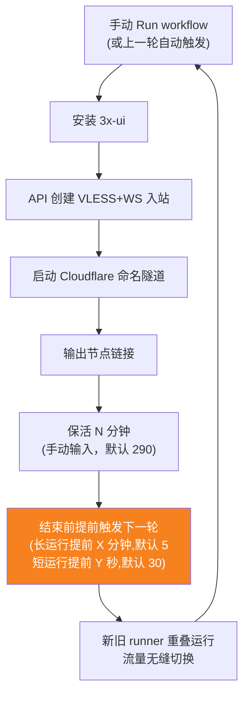
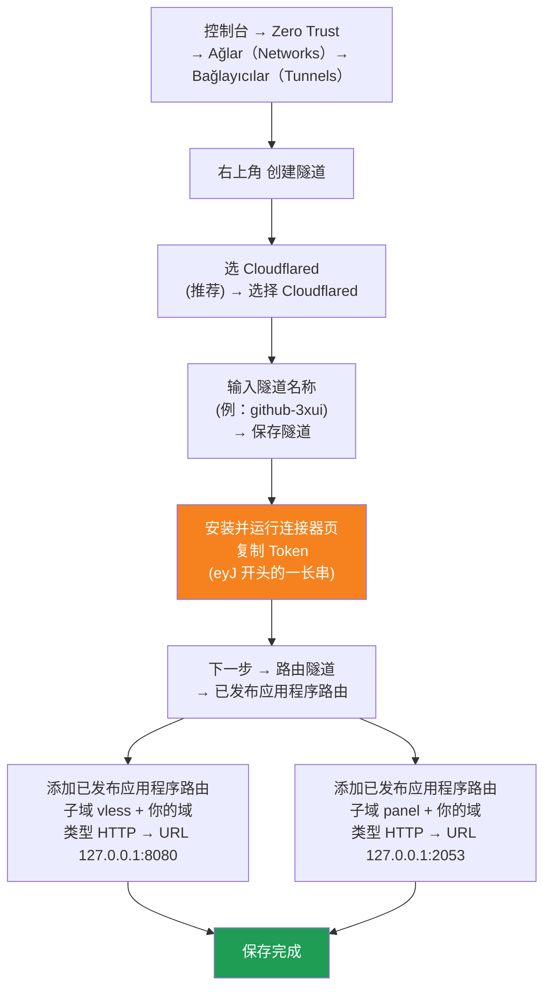

[简体中文](README.md) | [English](README.en.md) | [Русский](README.ru.md) | [日本語](README.ja.md) | [한국어](README.ko.md) | [Español](README.es.md) | [العربية](README.ar.md) | [Čeština](README.cs.md) | [Dansk](README.da.md) | [Deutsch](README.de.md) | [Esperanto](README.eo.md) | [فارسی](README.fa.md) | [Suomi](README.fi.md) | [Français](README.fr.md) | [Ελληνικά](README.gr.md) | [Magyar](README.hu.md) | [Bahasa Indonesia](README.id.md) | [Italiano](README.it.md) | [മലയാളം](README.ml.md) | [Nederlands](README.nl.md) | [Norsk](README.no.md) | [Polski](README.pl.md) | [Português](README.ptbr.md) | [Română](README.ro.md) | [Türkçe](README.tr.md) | [Українська](README.ua.md) | [Tiếng Việt](README.vn.md)

# ☁️ cloud-3xui — GitHub Ücretsiz VLESS Nodu

GitHub Actions'in ücretsiz sunucularında 3x-ui paneli + VLESS nodu otomatik kurun; sabit alan adı, bağlantı kesilince otomatik yenileme.

## Mimari Şeması



## Otomatik Yenileme Akışı



## Otomatik yenileme

- **Süreye sen karar ver**: Run workflow çalıştırırken `run_minutes` alanını manuel doldur, yazdığın dakika kadar çalışır; boş bırakılırsa varsayılan 290 kullanılır
- **Otomatik parametre devralma**: her tur `run_minutes` / `countdown_interval` / `countdown_unit` / `overlap_threshold` / `overlap_long` / `overlap_short` değerlerini sonrakine aktarır, tüm zincir başlangıçta girdiğin değerleri kullanır
- **Örtüşen başlatma (kesintisiz geçiş)**: mevcut çalıştırma bitmeden sonrakini erken tetikler, eski ve yeni runner’lar aynı anda çevrimiçi olur, Cloudflare tüneli birden fazla bağlantıyı destekler, trafik otomatik olarak kullanılabilir bağlantılara dağıtılır, kullanıcı eskinin çıkışını neredeyse hissetmez. Tetikleme zamanı yapılandırılabilir: `overlap_threshold` (varsayılan 5 dakika) değerinden büyük keep-alive uzun çalıştırma sayılır, `overlap_long` (varsayılan 5 dakika) erken tetiklenir; küçükse kısa çalıştırma sayılır, `overlap_short` (varsayılan 30 saniye) erken tetiklenir
- Hızlı test için `5` yaz, günlük kullanımda boş bırak (290)
- Alan adı ve UUID sabittir, istemciyi bir kez yapılandırman yeterli
- Durdurmak için Actions'ta Cancel'e bas· iptalden sonra otomatik yeniden başlamaz

## Sabit Adresler

| Kullanım | Adres |
|------|------|
| Düğüm | `vless.mallow.ccwu.cc:443`（VLESS + WebSocket + TLS） |
| Panel | `https://panel.mallow.ccwu.cc/panel`（kullanıcı adı `admin`） |

> ⚠️ Yukarıdaki alan adları örnektir, kendi alan adınızla değiştirin.

## Detaylı Yapılandırma Adımları

### Ücretsiz alan adı (alan adınız yok mu?)

Kendi alan adınız yok mu? https://my.dnshe.com/ adresinden ücretsiz bir tane alabilirsiniz (örn. `.ccwu.cc`, 10 yıl geçerli), ardından alan adının NS kayıtlarını Cloudflare'e yönlendirin.

### Adım 1: Cloudflare Named Tunnel Oluşturun

Resmi Cloudflare sitesi: https://www.cloudflare-cn.com (yerel) / https://www.cloudflare.com (uluslararası)

Kontrol paneli: https://dash.cloudflare.com



Ayrıntılı adımlar:

1. [Cloudflare Dashboard](https://dash.cloudflare.com) sayfasını açın, sol menüden **Zero Trust** → **Ağlar（Networks）** → **Bağlayıcılar（Tunnels）** bölümüne girin
2. Sağ üst köşedeki **Tünel oluştur** düğmesine tıklayın
3. **Tünel türünü seçin**: **Cloudflared**'i seçin (önerilen), **Cloudflared seç** düğmesine tıklayın
4. **Tünele ad verin**: bir ad girin (örneğin `github-3xui`), **Tüneli kaydet** düğmesine tıklayın
5. **Bağlayıcıyı kurun ve çalıştırın**: sayfada bir kurulum komutu görünür, `eyJ` ile başlayan uzun karakter dizisini (**Token**) kopyalayıp iyi saklayın (daha sonra GitHub Secret'e ekleyeceksiniz). Yerel olarak kurmanıza **gerek yok**, ileriye tıklayıp devam edin
6. **Tüneli yönlendirin**: **Yayınlanan uygulama yolları** sekmesine girin, **Yayınlanan uygulama yolu ekle** düğmesine tıklayın ve iki tane ekleyin:

   **Birincisi (düğüm):**
   - Alt alan adı: `vless`
   - Alan adı: alan adınızı seçin
   - Tür: `HTTP`
   - URL: `127.0.0.1:8080`

   **İkincisi (panel):**
   - Alt alan adı: `panel`
   - Alan adı: alan adınızı seçin
   - Tür: `HTTP`
   - URL: `127.0.0.1:2053`

7. Kaydedin. Cloudflare DNS çözümlemesini otomatik oluşturur, elle eklemenize gerek yok. Bağlayıcılar listesine dönün; tünel durumu **normal** ise yapılandırma başarılıdır.

### Adım 2: UUID Oluşturun

1. https://1024tools.com/uuid/ adresini açın
2. Oluşturulan UUID'yi kopyalayın (örneğin `cbfc229f-9d34-4fef-9990-8baa82a7327b`)
3. **Bu UUID'yi mutlaka not edin**; iş akışı günlüğünde açık metin olarak görünmez, düğüm bağlantısını her oluşturduğunuzda buna ihtiyacınız olur

### Adım 3: GitHub'a Secrets Ekleyin

1. Bu depoya girin, **Settings** sekmesine tıklayın
2. Solda **Secrets and variables** → **Actions**
3. Sağ üstteki **New repository secret** düğmesine tıklayın ve üçünü sırayla ekleyin:

   | Name | Secret (değer) | Açıklama |
   |------|-------------|------|
   | `CF_TUNNEL_TOKEN` | 1. adımda kopyaladığınız Tunnel Token | Cloudflare tünel kimlik bilgisi |
   | `PANEL_PASSWORD` | Belirlediğiniz panel şifresi | 3x-ui panel giriş şifresi |
   | `VLESS_UUID` | 2. adımda oluşturduğunuz UUID | Düğüm UUID'si, sabit değişmez |

### Adım 4: İş Akışını Çalıştırın

1. Deponun üstündeki **Actions** sekmesine tıklayın
2. Solda **3x-ui VLESS Node** öğesini seçin
3. Sağdaki **Run workflow** düğmesine tıklayın
4. Açılan formda:
   - **Panel password**: boş bırakın (otomatik olarak `PANEL_PASSWORD` secret kullanılır)
     Panel şifresi (boş bırakılırsa PANEL_PASSWORD secret kullanılır)
   - **Run duration**: varsayılan `290` (dakika), ilk testte hızlı doğrulama için `5` yazabilirsiniz
     Çalışma süresi (dakika, varsayılan 290, en fazla 340)
   - **Countdown output interval**: geri sayım çıktı aralığı, varsayılan `1`, kapatmak için `0` girin
     Geri sayım çıktı aralığı (varsayılan 1, kapatmak için 0)
   - **Countdown interval unit**: geri sayım aralığı birimi, açılır menüden `minutes` veya `seconds` seçin
     Geri sayım çıktı aralığı birimi
   - **Overlap threshold**: çakışma eşiği (dakika, varsayılan `5`), bundan uzun keep-alive uzun çalıştırma sayılır
     Çakışma eşiği (dakika, varsayılan 5): bundan uzun keep-alive uzun çalıştırma sayılır
   - **Overlap long**: uzun çalıştırmalar için erken tetikleme dakikası (varsayılan `5`)
     Uzun çalıştırmalar için erken tetikleme dakikası (varsayılan 5)
   - **Overlap short**: kısa çalıştırmalar için erken tetikleme saniyesi (varsayılan `30`)
     Kısa çalıştırmalar için erken tetikleme saniyesi (varsayılan 30)
5. Çalıştırmayı başlatmak için yeşil **Run workflow** düğmesine tıklayın

### Adım 5: Düğüm Bağlantısını Alın

1. Yaklaşık 2-3 dakika bekleyin, çalışan göreve tıklayıp detay sayfasına girin
2. **Start named Cloudflare tunnel** adımını genişletin, günlük çıktısını inceleyin:
   ```
   ==================================================
     面板 Panel: https://panel.mallow.ccwu.cc/panel  (admin / 你的面板密码)

     VLESS 节点 node:
     vless://YOUR_UUID@vless.mallow.ccwu.cc:443?encryption=none&security=tls&sni=vless.mallow.ccwu.cc&type=ws&path=%2Fws#GitHub-3xui

     把 YOUR_UUID 换成你在 VLESS_UUID secret 里填的 UUID
     Replace YOUR_UUID with the UUID from your VLESS_UUID secret
     域名：去 Settings → Secrets and variables → Actions → Variables 改 VLESS_HOST / PANEL_HOST 变量
     Domain: set the VLESS_HOST / PANEL_HOST variables in Settings → Secrets and variables → Actions → Variables
   ==================================================
   ```
3. `vless://` bağlantısını kopyalayın, `YOUR_UUID` kısmını kendi UUID'nizle değiştirin
4. v2rayN / v2rayNG / Streisand / NekoBox gibi istemcilere yapıştırıp kullanın

### Adım 6: Otomatik Yenilemeyi Doğrulayın (isteğe bağlı)

1. İlk çalıştırmada süreyi `5` dakika olarak ayarlayın
2. 5 dakika sonra son adım **Trigger next run** günlüğüne bakın, şunu göstermelidir:
   ```
   HTTP 204
   已触发下一次运行 Next run triggered
   ```
3. Actions listesine dönün, otomatik tetiklenen yeni bir çalıştırma görünmelidir
4. Doğruladıktan sonra yeniden çalıştırıp süreyi normal kullanım için `290` olarak değiştirin

## İş Akışı Adımları Açıklaması

| Adım | Türkçe | English | Açıklama |
|------|--------|---------|------|
| Install 3x-ui | 3x-ui kurun | Install 3x-ui | Resmi betikle etkileşimsiz panel kurulumu |
| Create VLESS+WS inbound via API | API ile VLESS+WS inbound oluşturun | Create VLESS+WS inbound via API | API Token ile giriş, otomatik inbound oluşturma |
| Start named Cloudflare tunnel | Cloudflare Named Tunnel başlatın | Start named Cloudflare tunnel | Token ile sabit alan adlı tünele bağlanın |
| Keep alive | Canlı tut | Keep alive | Belirtilen dakika boyunca uyur, her dakika hizmet durumunu kontrol eder, ayarlanan aralıkta geri sayımı gösterir |
| Trigger next run | Sonraki çalıştırmayı tetikle | Trigger next run | API çağrısıyla bir sonraki turu otomatik başlat |

## Sık Sorulan Sorular

**S: Günlükteki düğüm bağlantısında UUID `***` olarak görünüyor?**
C: Bu GitHub'un secret koruma mekanizmasıdır. `YOUR_UUID` kısmını `VLESS_UUID` secret'ına girdiğiniz kendi UUID'nizle değiştirmeniz yeterli.

**S: İstemci testi başarısız (-1)?**
C: Üç şeyi kontrol edin: ① UUID doğru değiştirilmiş mi; ② istemci sürümü güncel mi (v2rayN 7.x+); ③ Cloudflare tüneli düzgün bağlanmış mı (günlüğe bakın).

**S: Otomatik yeniden başlatma tetiklenmedi?**
C: **Trigger next run** adımının günlüğüne bakın. 204 dışında bir HTTP durum kodu gösteriyorsa deponun Actions izin ayarlarını kontrol edin.

**S: Rotasyon sırasında bağlantı kesilir mi?**
C: Örtüşen başlatma kullanıyoruz: mevcut tur bitmeden sonraki tur tetiklenir, eski ve yeni runner aynı anda çevrimiçi olur, teorik olarak hissedilmez. Uç durumlarda (örn. GitHub kuyruğu) kısa dalgalanma olabilir, istemci otomatik olarak yeniden bağlanır.

**S: Otomatik yenilemeyi durdurmak mı istiyorsunuz?**
C: Actions sayfasına gidip mevcut çalıştırmayı Cancel etmeniz yeterli, otomatik olarak tekrar tetiklenmez.

## Notlar

- **Hız**: Trafik Cloudflare → GitHub sunucuları (ABD/Avrupa) üzerinden geçer, yalnızca geçici/hafif kullanım için uygundur
- **Kesintisiz geçiş**: örtüşen başlatma ile her tur sonrakini 5 dakika erken başlatır, eski ve yeni runner aynı anda çevrimiçi, teorik olarak kullanıcı hiçbir şey hissetmez; aşırı durumlarda (örn. GitHub kuyruğu) kısa dalgalanmalar olabilir
- **Uyumluluk**: GitHub Actions'ta proxy çalıştırmak ToS ihlali nedeniyle hesap kapatma riski taşır, kendiniz değerlendirin
- **Güvenlik**: `CF_TUNNEL_TOKEN` / `PANEL_PASSWORD` / `VLESS_UUID` değerlerini herkese açık yerlerde paylaşmayın
