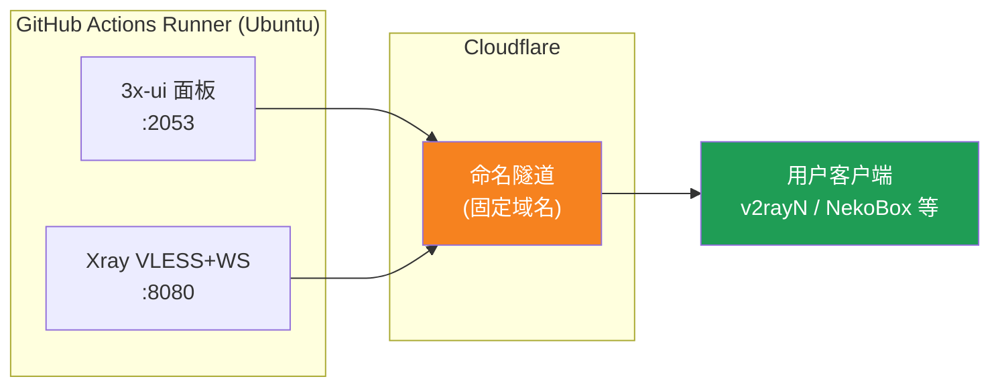
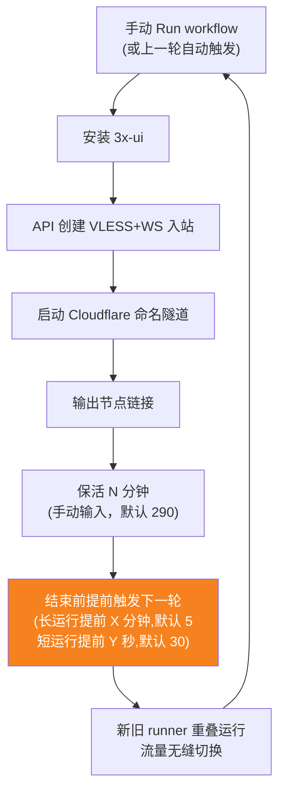
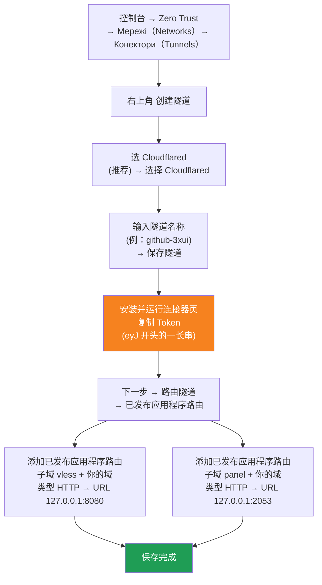

[简体中文](README.md) | [English](README.en.md) | [Русский](README.ru.md) | [日本語](README.ja.md) | [한국어](README.ko.md) | [Español](README.es.md) | [العربية](README.ar.md) | [Čeština](README.cs.md) | [Dansk](README.da.md) | [Deutsch](README.de.md) | [Esperanto](README.eo.md) | [فارسی](README.fa.md) | [Suomi](README.fi.md) | [Français](README.fr.md) | [Ελληνικά](README.gr.md) | [Magyar](README.hu.md) | [Bahasa Indonesia](README.id.md) | [Italiano](README.it.md) | [മലയാളം](README.ml.md) | [Nederlands](README.nl.md) | [Norsk](README.no.md) | [Polski](README.pl.md) | [Português](README.ptbr.md) | [Română](README.ro.md) | [Türkçe](README.tr.md) | [Українська](README.ua.md) | [Tiếng Việt](README.vn.md)

# ☁️ cloud-3xui — Безкоштовний VLESS-вузол на GitHub

Автоматично розгортайте панель 3x-ui + VLESS-вузол на безкоштовних серверах GitHub Actions: фіксований домен, автоматичне відновлення при розриві.

## Схема архітектури



## Процес автоматичного відновлення



## Автоматичне поновлення

- **Тривалість визначаєш ти**: під час Run workflow вручну заповни `run_minutes`, працюватиме стільки хвилин, скільки введеш; порожнє поле — 290 за замовчуванням
- **Автоматичне успадкування параметрів**: кожен раунд передає `run_minutes` / `countdown_interval` / `countdown_unit` / `overlap_threshold` / `overlap_long` / `overlap_short` далі, весь ланцюжок використовує значення, які ти ввів спочатку
- **Перекривний запуск (безшовний перехід)**: запускає наступний запуск завчасно до завершення поточного, старі й нові runner одночасно онлайн, тунель Cloudflare підтримує кілька з’єднань, трафік автоматично розподіляється на доступні з’єднання, користувач майже не відчуває виходу старого. Момент запуску налаштовується: keep-alive більший за `overlap_threshold` (за замовчуванням 5 хвилин) вважається довгим запуском, запускається раніше на `overlap_long` (за замовчуванням 5 хвилин); менший вважається коротким запуском, запускається раніше на `overlap_short` (за замовчуванням 30 секунд)
- Для швидкого тесту введи `5`, для щоденного користування лиши порожнім (290)
- Домен та UUID фіксовані, клієнт налаштовується один раз
- Щоб зупинити, натисни Cancel в Actions· після скасування автоматично не перезапуститься

## Фіксовані адреси

| Призначення | Адреса |
|------|------|
| Вузол | `vless.mallow.ccwu.cc:443`（VLESS + WebSocket + TLS） |
| Панель | `https://panel.mallow.ccwu.cc/panel`（ім'я користувача `admin`） |

> ⚠️ Наведені вище домени — приклади. Щоб змінити їх, відредагуйте змінні `VLESS_HOST` / `PANEL_HOST` у Settings → Secrets and variables → Actions → Variables — редагувати файл workflow не потрібно.

## Налаштування домену

Домени вузла та панелі зберігаються у змінних GitHub — редагувати файл workflow не потрібно:

| Змінна | Приклад значення | Опис |
|--------|------------------|------|
| `VLESS_HOST` | `vless.mallow.ccwu.cc` | Адреса вузла (повне ім'я хоста) |
| `PANEL_HOST` | `panel.mallow.ccwu.cc` | Адреса панелі (повне ім'я хоста) |

**Як змінити**: перейдіть у **Settings** → **Secrets and variables** → **Actions** → вкладка **Variables** → **New repository variable** і введіть ім'я та значення. Зміна набуде чинності з наступного запуску workflow.

**Три моменти**:
- Кожна змінна містить **повне ім'я хоста** (включно з префіксом піддомену), тому вузол і панель можуть вказувати на різні домени — їм не обов'язково мати спільний батьківський домен
- Значення мають збігатися з публічними іменами хостів (Public Hostnames), створеними в тунелі Cloudflare на кроці 1 (`vless` → 127.0.0.1:8080, `panel` → 127.0.0.1:2053), інакше посилання не працюватиме
- Якщо змінну не задано, банер покаже заповнювач для цього елемента (`vless.YOUR_DOMAIN` / `panel.YOUR_DOMAIN`)

## Детальні кроки налаштування

### Безкоштовний домен (немає домену?)

Немає власного домену? Зареєструйте безкоштовний на https://my.dnshe.com/ (напр. `.ccwu.cc`, дійсний 10 років), а потім спрямуйте NS-сервери домену на Cloudflare.

### Крок 1: Створіть Named Tunnel у Cloudflare

Офіційний сайт Cloudflare: https://www.cloudflare-cn.com (внутрішній) / https://www.cloudflare.com (міжнародний)

Консоль: https://dash.cloudflare.com



Детальні кроки:

1. Відкрийте [Cloudflare Dashboard](https://dash.cloudflare.com), у лівому меню перейдіть до **Zero Trust** → **Мережі（Networks）** → **Конектори（Tunnels）**
2. Натисніть **Створити тунель** у верхньому правому куті
3. **Оберіть тип тунелю**: виберіть **Cloudflared** (рекомендовано), натисніть **Вибрати Cloudflared**
4. **Назвіть тунель**: введіть назву (наприклад `github-3xui`), натисніть **Зберегти тунель**
5. **Установіть і запустіть конектор**: на сторінці буде показано команду встановлення, скопіюйте довгий рядок символів, що починається з `eyJ` — це **Token**, збережіть його (пізніше додасте до GitHub Secret). Встановлювати щось локально **не потрібно**, натисніть далі, щоб продовжити
6. **Маршрутизуйте тунель**: перейдіть на вкладку **Опубліковані маршрути застосунків**, натисніть **Додати опублікований маршрут застосунку** і додайте два:

   **Перший (вузол):**
   - Піддомен: `vless`
   - Домен: оберіть ваш домен
   - Тип: `HTTP`
   - URL: `127.0.0.1:8080`

   **Другий (панель):**
   - Піддомен: `panel`
   - Домен: оберіть ваш домен
   - Тип: `HTTP`
   - URL: `127.0.0.1:2053`

7. Збережіть. Cloudflare автоматично створить DNS-записи, додавати вручну не потрібно. Поверніться до списку Конектори; якщо статус тунелю **в нормі**, налаштування успішне.

### Крок 2: Згенеруйте UUID

1. Відкрийте https://1024tools.com/uuid/
2. Скопіюйте згенерований UUID (наприклад `cbfc229f-9d34-4fef-9990-8baa82a7327b`)
3. **Обов'язково збережіть цей UUID**; у журналі workflow він не відображається у відкритому вигляді, він потрібен щоразу для побудови посилання на вузол

### Крок 3: Додайте Secrets і Variables у GitHub

1. Увійдіть до цього репозиторію, натисніть вкладку **Settings**
2. Ліворуч **Secrets and variables** → **Actions**
3. Натисніть **New repository secret** у верхньому правому куті та додайте три по черзі:

   | Name | Secret (значення) | Опис |
   |------|-------------|------|
   | `CF_TUNNEL_TOKEN` | Tunnel Token, скопійований на кроці 1 | Облікові дані тунелю Cloudflare |
   | `PANEL_PASSWORD` | Встановлений вами пароль панелі | Пароль входу до панелі 3x-ui |
   | `VLESS_UUID` | UUID, згенерований на кроці 2 | UUID вузла, фіксований і незмінний |

4. Перейдіть на вкладку **Variables**, натисніть **New repository variable** і додайте дві змінні (див. розділ «Налаштування домену» вище):

   | Name | Значення | Опис |
   |------|----------|------|
   | `VLESS_HOST` | `vless.mallow.ccwu.cc` | Адреса вузла |
   | `PANEL_HOST` | `panel.mallow.ccwu.cc` | Адреса панелі |

### Крок 4: Запустіть workflow

1. Натисніть вкладку **Actions** у верхній частині репозиторію
2. Ліворуч оберіть **3x-ui VLESS Node**
3. Натисніть кнопку **Run workflow** праворуч
4. У формі, що з'явиться:
   - **Panel password**: залиште порожнім (автоматично використовується secret `PANEL_PASSWORD`)
     Пароль панелі (якщо порожньо — використовується secret PANEL_PASSWORD)
   - **Run duration**: за замовчуванням `290` (хвилин), для першого тесту можна ввести `5` для швидкої перевірки
     Тривалість роботи (хвилин, за замовчуванням 290, максимум 340)
   - **Countdown output interval**: інтервал виведення зворотного відліку, за замовчуванням `1`, введіть `0` щоб вимкнути
     Інтервал виведення зворотного відліку (за замовчуванням 1, 0 щоб вимкнути)
   - **Countdown interval unit**: одиниця інтервалу зворотного відліку, виберіть `minutes` або `seconds` у спадному меню
     Одиниця інтервалу виведення зворотного відліку
   - **Overlap threshold**: поріг перекриття (хвилини, за замовчуванням `5`), keep-alive довший за це вважається довгим запуском
     Поріг перекриття (хвилини, за замовчуванням 5): keep-alive довший за це вважається довгим запуском
   - **Overlap long**: хвилини раннього запуску для довгих запусків (за замовчуванням `5`)
     Хвилини раннього запуску для довгих запусків (за замовчуванням 5)
   - **Overlap short**: секунди раннього запуску для коротких запусків (за замовчуванням `30`)
     Секунди раннього запуску для коротких запусків (за замовчуванням 30)
5. Натисніть зелену кнопку **Run workflow**, щоб почати

### Крок 5: Отримайте посилання на вузол

1. Зачекайте приблизно 2-3 хвилини, натисніть на запущене завдання, щоб відкрити сторінку деталей
2. Розгорніть крок **Start named Cloudflare tunnel**, перегляньте вивід журналу:
   ```
   ==================================================
     面板 Panel: https://panel.mallow.ccwu.cc/panel  (admin / 你的面板密码)

     VLESS 节点 node:
     vless://YOUR_UUID@vless.mallow.ccwu.cc:443?encryption=none&security=tls&sni=vless.mallow.ccwu.cc&type=ws&path=%2Fws#GitHub-3xui

     把 YOUR_UUID 换成你在 VLESS_UUID secret 里填的 UUID
     Replace YOUR_UUID with the UUID from your VLESS_UUID secret
     域名：去 Settings → Secrets and variables → Actions → Variables 改 VLESS_HOST / PANEL_HOST 变量
     Domain: set the VLESS_HOST / PANEL_HOST variables in Settings → Secrets and variables → Actions → Variables
   ==================================================
   ```
3. Скопіюйте посилання `vless://` і замініть `YOUR_UUID` на ваш UUID (Домен уже справжній, із ваших змінних, — замінювати його не потрібно.)
4. Вставте його в клієнти на кшталт v2rayN / v2rayNG / Streisand / NekoBox — і користуйтеся

### Крок 6: Перевірте автоматичне відновлення (необов'язково)

1. Під час першого запуску встановіть тривалість `5` хвилин
2. Через 5 хвилин перегляньте журнал останнього кроку **Trigger next run**, має відобразитися:
   ```
   HTTP 204
   已触发下一次运行 Next run triggered
   ```
3. Поверніться до списку Actions, там має з'явитися новий автоматично запущений запуск
4. Після підтвердження запустіть знову, повернувши тривалість `290` для звичайного використання

## Опис кроків workflow

| Крок | Українська | English | Опис |
|------|------------|---------|------|
| Install 3x-ui | Встановіть 3x-ui | Install 3x-ui | Встановлення панелі офіційним скриптом у неінтерактивному режимі |
| Create VLESS+WS inbound via API | Створіть VLESS+WS inbound через API | Create VLESS+WS inbound via API | Вхід за API Token, автоматичне створення inbound |
| Start named Cloudflare tunnel | Запустіть Named Tunnel Cloudflare | Start named Cloudflare tunnel | Підключення тунелю з фіксованим доменом за Token |
| Keep alive | Підтримка активності | Keep alive | Спить вказану кількість хвилин, щхвилини перевіряє стан служб, показує зворотний відлік із заданим інтервалом |
| Trigger next run | Запустіть наступний запуск | Trigger next run | Виклик API для автоматичного запуску наступного раунду |

## Часті запитання

**З: UUID у посиланні на вузол у журналі відображається як `***`?**
В: Це механізм захисту секретів GitHub. Просто замініть `YOUR_UUID` на UUID, який ви вказали в секреті `VLESS_UUID`.

**З: У журналі домен відображається як `YOUR_DOMAIN`?**
В: Перейдіть у Settings → Secrets and variables → Actions → Variables і створіть змінні `VLESS_HOST` / `PANEL_HOST` з повними іменами хостів; переконайтеся, що вони збігаються з публічними іменами хостів у вашому тунелі Cloudflare.

**З: Клієнт не проходить тест (-1)?**
В: Перевірте три моменти: ① чи правильно замінено UUID; ② чи нова версія клієнта (v2rayN 7.x+); ③ чи нормально підключено тунель Cloudflare (дивіться журнал).

**З: Автоматичний перезапуск не спрацював?**
В: Перегляньте журнал кроку **Trigger next run**. Якщо відображається HTTP-статус, відмінний від 204, перевірте налаштування дозволів Actions репозиторію.

**З: Чи буде розрив з'єднання під час ротації?**
В: Використовуємо перекривний запуск: наступний раунд запускається до завершення поточного, старий і новий runner одночасно онлайн, теоретично непомітно. В екстремальних випадках (напр. черга GitHub) можливі короткі коливання, клієнт перепідключиться автоматично.

**З: Хочете зупинити автоматичне відновлення?**
В: Перейдіть на сторінку Actions і зробіть Cancel поточного запуску — автоматично більше не запускатиметься.

## Зауваження

- **Швидкість**: трафік іде через Cloudflare → сервери GitHub (США/Європа), підходить лише для тимчасового/легкого використання
- **Безшовний перехід**: з перекривним запуском кожен раунд запускає наступний на 5 хвилин раніше, старий і новий runner одночасно онлайн, теоретично користувач нічого не відчуває; в екстремальних випадках (напр. черга GitHub) можливі короткі коливання
- **Відповідність**: запуск проксі в GitHub Actions може порушувати ToS і призвести до блокування акаунта — оцінюйте самостійно
- **Безпека**: не публікуйте `CF_TUNNEL_TOKEN` / `PANEL_PASSWORD` / `VLESS_UUID` у відкритих місцях
