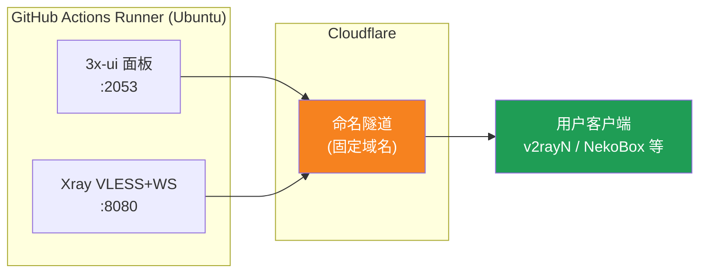
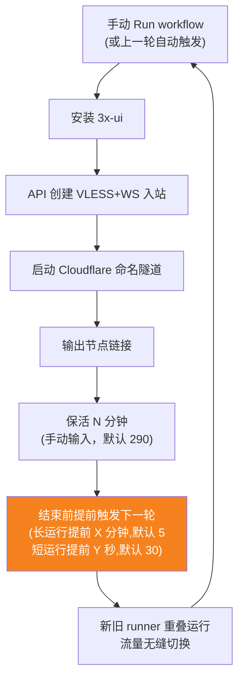
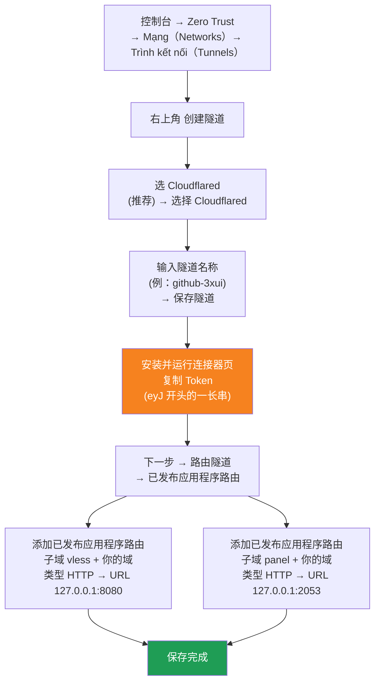

[简体中文](README.md) | [English](README.en.md) | [Русский](README.ru.md) | [日本語](README.ja.md) | [한국어](README.ko.md) | [Español](README.es.md) | [العربية](README.ar.md) | [Čeština](README.cs.md) | [Dansk](README.da.md) | [Deutsch](README.de.md) | [Esperanto](README.eo.md) | [فارسی](README.fa.md) | [Suomi](README.fi.md) | [Français](README.fr.md) | [Ελληνικά](README.gr.md) | [Magyar](README.hu.md) | [Bahasa Indonesia](README.id.md) | [Italiano](README.it.md) | [മലയാളം](README.ml.md) | [Nederlands](README.nl.md) | [Norsk](README.no.md) | [Polski](README.pl.md) | [Português](README.ptbr.md) | [Română](README.ro.md) | [Türkçe](README.tr.md) | [Українська](README.ua.md) | [Tiếng Việt](README.vn.md)

# ☁️ cloud-3xui — Node VLESS Miễn Phí trên GitHub

Tự động dựng bảng điều khiển 3x-ui + node VLESS trên máy chủ miễn phí của GitHub Actions, tên miền cố định, tự động gia hạn khi đứt kết nối.

## Sơ Đồ Kiến Trúc



## Quy Trình Tự Động Gia Hạn



## Tự động gia hạn

- **Thời gian do bạn quyết định**: khi Run workflow hãy nhập tay `run_minutes`, chạy đúng số phút đã nhập; để trống sẽ dùng mặc định 290
- **Kế thừa tham số tự động**: mỗi lượt sẽ truyền `run_minutes` / `countdown_interval` / `countdown_unit` / `overlap_threshold` / `overlap_long` / `overlap_short` sang lượt tiếp theo, cả chuỗi dùng giá trị bạn nhập ban đầu
- **Khởi động chồng lấp (chuyển đổi liền mạch)**: kích hoạt sớm lượt tiếp theo trước khi lượt hiện tại kết thúc, runner cũ và mới cùng online, tunnel Cloudflare hỗ trợ nhiều kết nối, lưu lượng tự động chuyển sang các kết nối khả dụng, người dùng gần như không cảm nhận được khi lượt cũ thoát ra. Thời điểm kích hoạt có thể cấu hình: keep-alive lớn hơn `overlap_threshold` (mặc định 5 phút) được tính là lần chạy dài, kích hoạt sớm `overlap_long` (mặc định 5 phút); nhỏ hơn thì tính là lần chạy ngắn, kích hoạt sớm `overlap_short` (mặc định 30 giây)
- Muốn test nhanh thì nhập `5`, dùng hàng ngày thì để trống (290)
- Domain và UUID cố định, cấu hình client một lần là xong
- Muốn dừng thì bấm Cancel trong Actions· sau khi hủy sẽ không tự khởi động lại

## Địa Chỉ Cố Định

| Mục đích | Địa chỉ |
|------|------|
| Node | `vless.mallow.ccwu.cc:443`（VLESS + WebSocket + TLS） |
| Bảng điều khiển | `https://panel.mallow.ccwu.cc/panel`（tên đăng nhập `admin`） |

> ⚠️ Các tên miền ở trên chỉ là ví dụ, hãy thay bằng tên miền của bạn.

## Các Bước Cấu Hình Chi Tiết

### Tên miền miễn phí (chưa có tên miền?)

Chưa có tên miền riêng? Bạn có thể đăng ký một tên miền miễn phí tại https://my.dnshe.com/ (ví dụ `.ccwu.cc`, hiệu lực 10 năm), rồi trỏ NS của tên miền về Cloudflare.

### Bước 1: Tạo Named Tunnel trong Cloudflare

Trang chủ chính thức của Cloudflare: https://www.cloudflare-cn.com (trong nước) / https://www.cloudflare.com (quốc tế)

Bảng điều khiển: https://dash.cloudflare.com



Các bước chi tiết:

1. Mở [Cloudflare Dashboard](https://dash.cloudflare.com), vào menu bên trái **Zero Trust** → **Mạng（Networks）** → **Trình kết nối（Tunnels）**
2. Nhấn **Tạo tunnel** ở góc trên bên phải
3. **Chọn loại tunnel**: chọn **Cloudflared** (khuyên dùng), nhấn **Chọn Cloudflared**
4. **Đặt tên cho tunnel**: nhập tên (ví dụ `github-3xui`), nhấn **Lưu tunnel**
5. **Cài đặt và chạy trình kết nối**: trang sẽ hiển thị một lệnh cài đặt, sao chép chuỗi ký tự dài bắt đầu bằng `eyJ` — đó chính là **Token**, lưu lại cẩn thận (sau này dùng để lưu vào GitHub Secret). **Không cần** cài đặt gì trên máy, nhấn tiếp theo để tiếp tục
6. **Định tuyến tunnel**: vào tab **Định tuyến ứng dụng đã xuất bản**, nhấn **Thêm định tuyến ứng dụng đã xuất bản** và thêm hai cái:

   **Cái thứ nhất (node):**
   - Tên miền phụ: `vless`
   - Tên miền: chọn tên miền của bạn
   - Loại: `HTTP`
   - URL: `127.0.0.1:8080`

   **Cái thứ hai (bảng điều khiển):**
   - Tên miền phụ: `panel`
   - Tên miền: chọn tên miền của bạn
   - Loại: `HTTP`
   - URL: `127.0.0.1:2053`

7. Lưu lại. Cloudflare sẽ tự động tạo bản ghi DNS, không cần thêm thủ công. Quay lại danh sách Trình kết nối; nếu trạng thái tunnel là **bình thường** thì cấu hình thành công.

### Bước 2: Tạo UUID

1. Mở https://1024tools.com/uuid/
2. Sao chép UUID được tạo (dạng như `cbfc229f-9d34-4fef-9990-8baa82a7327b`)
3. **Hãy ghi nhớ UUID này**, nhật ký workflow sẽ không hiển thị nó dưới dạng văn bản thuần, mỗi lần ghép liên kết node đều cần dùng đến nó

### Bước 3: Thêm Secrets vào GitHub

1. Vào kho này, nhấn tab **Settings**
2. Bên trái **Secrets and variables** → **Actions**
3. Nhấn **New repository secret** ở góc trên bên phải, lần lượt thêm ba cái:

   | Name | Secret (giá trị) | Giải thích |
   |------|-------------|------|
   | `CF_TUNNEL_TOKEN` | Tunnel Token đã sao chép ở bước 1 | Thông tin xác thực tunnel Cloudflare |
   | `PANEL_PASSWORD` | Mật khẩu bảng điều khiển bạn đặt | Mật khẩu đăng nhập bảng 3x-ui |
   | `VLESS_UUID` | UUID đã tạo ở bước 2 | UUID của node, cố định không đổi |

### Bước 4: Chạy Workflow

1. Nhấn tab **Actions** ở đầu kho
2. Bên trái chọn **3x-ui VLESS Node**
3. Nhấn nút **Run workflow** bên phải
4. Trong biểu mẫu hiện ra:
   - **Panel password**: để trống (tự động dùng secret `PANEL_PASSWORD`)
     Mật khẩu bảng điều khiển (để trống sẽ dùng secret PANEL_PASSWORD)
   - **Run duration**: mặc định `290` (phút), lần đầu kiểm tra có thể điền `5` để xác minh nhanh
     Thời gian chạy (phút, mặc định 290, tối đa 340)
   - **Countdown output interval**: khoảng thời gian xuất đếm ngược, mặc định `1`, điền `0` để tắt
     Khoảng thời gian xuất đếm ngược (mặc định 1, điền 0 để tắt)
   - **Countdown interval unit**: đơn vị khoảng thời gian đếm ngược, chọn `minutes` hoặc `seconds` trong menu thả xuống
     Đơn vị khoảng thời gian xuất đếm ngược
   - **Overlap threshold**: ngưỡng chồng lấp (phút, mặc định `5`), keep-alive dài hơn giá trị này được tính là lần chạy dài
     Ngưỡng chồng lấp (phút, mặc định 5): keep-alive dài hơn giá trị này được tính là lần chạy dài
   - **Overlap long**: số phút kích hoạt sớm cho lần chạy dài (mặc định `5`)
     Số phút kích hoạt sớm cho lần chạy dài (mặc định 5)
   - **Overlap short**: số giây kích hoạt sớm cho lần chạy ngắn (mặc định `30`)
     Số giây kích hoạt sớm cho lần chạy ngắn (mặc định 30)
5. Nhấn nút **Run workflow** màu xanh để bắt đầu chạy

### Bước 5: Lấy Liên Kết Node

1. Đợi khoảng 2-3 phút, nhấn vào tác vụ đang chạy để vào trang chi tiết
2. Mở rộng bước **Start named Cloudflare tunnel**, xem đầu ra nhật ký:
   ```
   ==================================================
     面板 Panel: https://panel.mallow.ccwu.cc/panel  (admin / 你的面板密码)

     VLESS 节点 node:
     vless://YOUR_UUID@vless.mallow.ccwu.cc:443?encryption=none&security=tls&sni=vless.mallow.ccwu.cc&type=ws&path=%2Fws#GitHub-3xui

     把 YOUR_UUID 换成你在 VLESS_UUID secret 里填的 UUID
     Replace YOUR_UUID with the UUID from your VLESS_UUID secret
     域名：去 Settings → Secrets and variables → Actions → Variables 改 VLESS_HOST / PANEL_HOST 变量
     Domain: set the VLESS_HOST / PANEL_HOST variables in Settings → Secrets and variables → Actions → Variables
   ==================================================
   ```
3. Sao chép liên kết `vless://`, thay `YOUR_UUID` bằng UUID của bạn
4. Dán vào các ứng dụng khách như v2rayN / v2rayNG / Streisand / NekoBox là dùng được

### Bước 6: Xác Minh Tự Động Gia Hạn (tùy chọn)

1. Lần chạy đầu tiên đặt thời gian là `5` phút
2. Sau 5 phút xem nhật ký bước cuối **Trigger next run**, sẽ hiển thị:
   ```
   HTTP 204
   已触发下一次运行 Next run triggered
   ```
3. Quay lại danh sách Actions, sẽ xuất hiện một lần chạy mới được kích hoạt tự động
4. Sau khi xác nhận không có vấn đề, chạy lại và đổi thời gian về `290` để sử dụng bình thường

## Giải Thích Các Bước Workflow

| Bước | Tiếng Việt | English | Giải thích |
|------|------------|---------|------|
| Install 3x-ui | Cài đặt 3x-ui | Install 3x-ui | Cài đặt bảng điều khiển bằng script chính thức, không tương tác |
| Create VLESS+WS inbound via API | Tạo inbound VLESS+WS qua API | Create VLESS+WS inbound via API | Đăng nhập bằng API Token, tự động tạo inbound |
| Start named Cloudflare tunnel | Khởi động Named Tunnel Cloudflare | Start named Cloudflare tunnel | Kết nối tunnel tên miền cố định bằng Token |
| Keep alive | Giữ hoạt động | Keep alive | Ngủ số phút chỉ định, kiểm tra trạng thái dịch vụ mỗi phút, xuất đếm ngược theo khoảng thời gian đã đặt |
| Trigger next run | Kích hoạt lần chạy tiếp theo | Trigger next run | Gọi API để tự động khởi động vòng tiếp theo |

## Câu Hỏi Thường Gặp

**H: UUID trong liên kết node ở nhật ký hiển thị `***`?**
Đ: Đây là cơ chế bảo vệ secret của GitHub. Chỉ cần thay `YOUR_UUID` bằng UUID bạn đã điền trong secret `VLESS_UUID`.

**H: Ứng dụng khách kiểm tra không thông (-1)?**
Đ: Kiểm tra ba điểm: ① UUID đã thay đúng chưa; ② phiên bản ứng dụng khách có mới không (v2rayN 7.x+); ③ tunnel Cloudflare có kết nối bình thường không (xem nhật ký).

**H: Tự động khởi động lại không được kích hoạt?**
Đ: Xem nhật ký bước **Trigger next run**. Nếu hiển thị mã trạng thái HTTP khác 204, hãy kiểm tra cài đặt quyền Actions của kho.

**H: Đứt kết nối khi luân chuyển không?**
Đ: Dùng khởi động chồng lấp: vòng tiếp theo được kích hoạt trước khi vòng hiện tại kết thúc, runner cũ và mới cùng online, về lý thuyết không cảm nhận được. Trong trường hợp cực đoan (như GitHub xếp hàng) có thể có dao động ngắn, client sẽ tự động kết nối lại.

**H: Muốn dừng tự động gia hạn?**
Đ: Vào trang Actions, Cancel lần chạy hiện tại là được, sẽ không tự động kích hoạt nữa.

## Lưu Ý

- **Tốc độ**: Lưu lượng đi qua Cloudflare → máy chủ GitHub (Mỹ/Châu Âu), chỉ phù hợp dùng tạm thời/nhẹ
- **Chuyển đổi liền mạch**: với khởi động chồng lấp, mỗi lượt kích hoạt lượt tiếp theo sớm 5 phút, runner cũ và mới cùng online, về lý thuyết người dùng không cảm nhận gì; trong trường hợp cực đoan (ví dụ hàng đợi GitHub) vẫn có thể có dao động ngắn
- **Tuân thủ**: Chạy proxy trên GitHub Actions có nguy cơ vi phạm ToS bị khóa tài khoản, tự đánh giá
- **Bảo mật**: Đừng đăng `CF_TUNNEL_TOKEN` / `PANEL_PASSWORD` / `VLESS_UUID` ở nơi công khai
